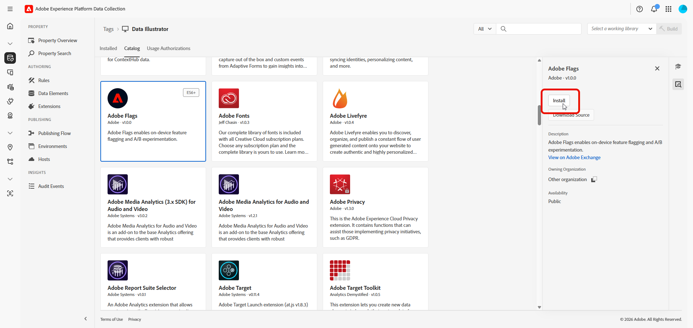
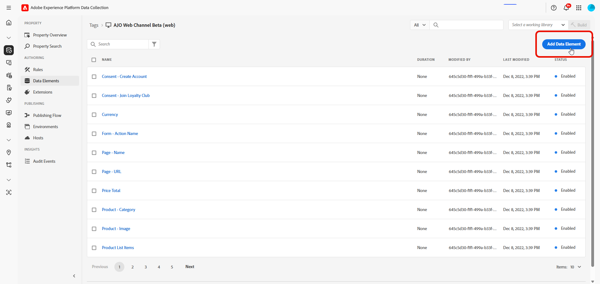

# Flags extension for Web {#web-extension-integration-guide}

This guide describes how to integrate the Flags extension with the Adobe Experience Platform Web SDK (Alloy) for web applications. The Flags extension enables feature flag management and controlled rollouts for web experiences.

## Prerequisites {#prerequisites}

Before implementing the Flags extension, ensure you have:

* A web property configured in [Adobe Experience Platform Data Collection](https://experience.adobe.com/#/data-collection)
* The Adobe Experience Platform Web SDK extension installed
* An Adobe Experience Cloud Organization ID
* Access to Flags in your organization

### Required permissions {#required-permissions}

Ensure that you have the following property rights:

* Develop
* Manage Extensions

## Extension dependencies {#extension-dependencies}

The Flags extension requires the following Adobe Experience Platform extension:

| Extension | Description | Required |
|---|---|---|
| Adobe Experience Platform Web SDK | Provides core functionality including Edge Network communication and identity management | Yes |

Ensure this extension is installed in your Data Collection web property before installing the Flags extension.

## Configure Flags extension in Data Collection {#configure}

### Install the extension {#install-extension}

1. Log in to [Adobe Experience Platform Data Collection](https://experience.adobe.com/#/data-collection).

1. Select the **[!UICONTROL Tags]** tab and choose your mobile property.

1. Navigate to **[!UICONTROL Extensions]** > **[!UICONTROL Catalog]**.

1. Search for **[!DNL Adobe Flags]** and select **[!UICONTROL Install]**.

   

#### Configure the extension settings {#configure-extension-settings}

When you install the Flags extension, you are taken to the configuration page. Configure the following settings:

| Setting | Description | Required |
|---|---|---|
| Client ID | A unique identifier for your application in Flags. | Yes |

#### Publish the extension {#publish-extension}

Follow the [publishing process](https://experienceleague.adobe.com/en/docs/experience-platform/tags/publish/overview) to update your configuration.

1. Add the extension to a library.

1. Build to your development environment.

1. Validate with [Adobe Experience Platform Debugger](https://experienceleague.adobe.com/docs/experience-platform/debugger/home.html).

1. Promote to staging and production.

## Add the Tags embed code to your website {#embed-code}

After publishing your Tags library, you must add the embed code to your website. The embed code is a `<script>` tag that loads the Tags library and all configured extensions including the Flags extension.

### Copy the embed code {#copy-embed-code}

1. In Data Collection, navigate to your web property.

1. Access the **[!UICONTROL Environments]** menu.

1. Select the box icon in the **[!UICONTROL Install]** column of your selected environment.

   

1. In the **[!UICONTROL Web Install Instructions]** dialog, Tags defaults to the asynchronous embed code.

1. Select the **[!UICONTROL Copy]** icon to copy the embed code to your clipboard.

    >[!NOTE]
    >
    >Each environment has a unique embed code URL. See [Environments](https://experienceleague.adobe.com/docs/experience-platform/tags/publish/environments/environments.html) documentation for more information.

   

### Implement the embed code {#implement-embed-code}

>[!NOTE]
>
>Replace the `src` URL with your actual embed code from the Environments page. The URL contains your company identifier, property identifier, and environment identifier (for example, `launch-EN123456789abcdef.min.js`).

Add the embed code in the `<head>` element of your HTML pages. The embed code should be placed before other scripts that depend on the Tags library:

```html
<!DOCTYPE html>
<html>
<head>
  <title>My Website</title>

  <!-- Adobe Experience Platform Tags embed code -->
  <script src="https://assets.adobedtm.com/your-company/your-property/launch-ENxxxxxxxxxxx.min.js" async></script>
</head>
<body>
  <!-- Your page content -->
</body>
</html>
```

### Evaluate flags with Tags components {#tags-components}

The Flags extension provides Tags-native evaluation surfaces.

| Component | Type | Description |
|---|---|---|
| Feature Is Enabled | Condition | Returns whether a feature is enabled for the current user/context |
| Feature Flag | Data element | Returns a boolean or full feature object |

## Initialize the SDK {#initialize-sdk}

The Flags extension initializes automatically when the Tags library loads. The extension exposes the client on:

```javascript
window._flagClient
```

### Wait for client readiness {#client-readiness}

Tags loads asynchronously. Before calling SDK methods from custom code, wait until the client is initialized:

```javascript
window.flagClientReady
  .then(function () {
    const enabled = window._flagClient.isFeatureEnabled('my-feature', context);
    // Use enabled to select the feature or fallback behavior.
  })
  .catch(function (error) {
    console.error('Flags initialization failed:', error);
  });
```

## Evaluation context {#evaluation-context}

`FeatureEvaluationContext` includes identity (required for evaluation, A/B bucketing, and analytics) and optional targeting attributes (used for rule matching).

| Property | Required | Description |
|---|---|---|
| `identityNamespace` | Yes | Identity namespace (see [Adobe Identity namespaces](https://experienceleague.adobe.com/en/docs/experience-platform/identity/features/namespaces)). Common values: `ECID`, `Email`, `CRMId`. |
| `identityId` | Yes | Identity value for the current user. |
| `attributes` | No | `Record<string, string[]>`. Key is the context attribute name used by your flag rules (for example `locale`, `platform`). Value is the list of candidate attribute values for that key. |

In Tags components, set identity defaults in the condition or data element UI. The Feature Flag data element also accepts runtime attributes via `getVar(name, attributes)` when the second argument is a flat attribute map.

### Usage {#usage}

```javascript
const context = {
  identityNamespace: 'ECID',
  identityId: 'your-visitor-ecid',
  attributes: {
    locale: ['en-US'],
    platform: ['web']
  }
};
```

## API reference {#api-reference}

### Feature evaluation {#is-feature-enabled}

`isFeatureEnabled` returns whether a Flags feature is on or off for the given context. Pass `featureKey` and a `FeatureEvaluationContext`. See [Evaluation context](#evaluation-context). Use the **Feature Is Enabled** Tags condition or call `window._flagClient.isFeatureEnabled(...)` from custom code after initialization.

**Signature**

```javascript
isFeatureEnabled(featureKey: string, context: FeatureEvaluationContext): boolean
```

**Parameters**

| Parameter | Type | Description |
|---|---|---|
| `featureKey` | string | Feature key to evaluate in Flags |
| `context` | FeatureEvaluationContext | Identity (required) and optional targeting attributes. See [Evaluation context](#evaluation-context). |

## Create a Feature Flag data element {#create-data-element}

Use a data element when you need a flag value available as `%Data Element Name%` in rules or custom code.

1. In your property, access **[!UICONTROL Data Elements]** menu and select **[!UICONTROL Add Data Element]**.

   

1. On the **Create Data Element** screen, configure the Tags fields:

    * **[!UICONTROL Name]**: a descriptive name (for example `checkout flag`)
    * **[!UICONTROL Extension]**: Flags
    * **[!UICONTROL Data Element Type]**: Feature Flag 

1. Configure the **Flags** extension fields:

    * **[!UICONTROL Feature Key]**: Unique flag key (for example `checkout_flag`), required.
    * **[!UICONTROL Return Type]**: **Boolean (true/false)** — enabled/disabled, or **Feature Object (full details)** — full payload including `meta`, required.
      
      | Return type | Resolves to |
      |---|---|
      | Boolean (true/false) | `true` if enabled, `false` otherwise |
      | Feature Object (full details) | Evaluated feature payload when the flag is enabled and the context matches its audience; `null` when the flag is disabled, not found, or the context does not match |

1. Select **Save**.

### Use the data element {#use-data-element}

In a rule, reference by name, for example `%Test Flag%`.

In custom code, use `_satellite.getVar`. With runtime attributes, pass a flat attribute map as the second argument to evaluate:

```javascript
var isEnabled = _satellite.getVar('Test Flag', {
  locale: ['en-US'],
  platform: ['web']
});
```

**Custom code**

```javascript
var isEnabled = _satellite.getVar('Test Flag', {
  locale: ['en-US'],
  platform: ['web']
});
if (isEnabled) {
  // your custom code
} else {
  // your default code
}
```

### getFeature {#get-feature}

`getFeature` returns the evaluated feature payload when you need metadata beyond enabled/disabled.

Use a **Feature Flag** data element with **Return Type: Feature Object (full details)**, see [Create a Feature Flag data element](#create-data-element), or call `window._flagClient.getFeature(...)` from custom code after `flagClientReady` resolves.

**Signature**

```javascript
getFeature(featureKey: string, context: FeatureEvaluationContext): FeatureResult | null
```

**Parameters**

| Parameter | Type | Description |
|---|---|---|
| `featureKey` | string | Feature key to evaluate in Flags |
| `context` | FeatureEvaluationContext | Identity (required) and targeting attributes. See [Evaluation context](#evaluation-context). |

**Response**

`getFeature` evaluates a flag only when it is enabled and the provided context matches the flag audience criteria. In that case it returns a result object; otherwise, it returns `null`.

*FeatureResult*

| Field | Type | Description |
|---|---|---|
| `id` | number | Numeric feature identifier. `-1` for feature-level control sentinel. |
| `key` | `string \| null` | Feature key. `null` for feature-level control sentinel. |
| `featureGroupKey` | `string \| null` | Feature group key when available |
| `meta` | `string \| null` | Feature metadata when available |
| `analyticsParam` | `AnalyticsParam \| null` | Analytics details for the evaluated feature |

*AnalyticsParam*

| Field | Type | Description |
|---|---|---|
| `featureGroupId` | number | Numeric feature group identifier |
| `featureId` | number | Numeric feature identifier |
| `variantId` | `number \| null` | Variant identifier (`0` if the user is in the control group) |

**Control group behavior**

| Scenario | isFeatureEnabled | getFeature | Analytics event isFeatureEnabled | Analytics event getFeature |
|---|---|---|---|---|
| Treatment | `true` | Normal result | Yes | Yes |
| Feature-level control | `false` | Sentinel (`id: -1`, `key: null`) | Yes (`variantId: 0`) | Yes |
| Criteria mismatch / not found | `false` | `null` | No | No |

**Examples**

*Tags data element*

Reference your data element (for example `%Test Feature%`) in a rule and fetch it via `_satellite.getVar`.

*Custom code*

```javascript
var feature = _flagClient.getFeature('new-test-flag', {
  identityNamespace: 'ECID',
  identityId: visitorEcid,
  attributes: {
    locale: ['en-US']
  }
});

var meta = feature && feature.meta;
if (meta) {
  // your custom code
} else {
  // your default code
}
```

### extensionVersion {#extension-version}

Returns the version string of the Flags extension.

**Signature**

```javascript
_flagClient.extensionVersion(): string
```

**Example**

```javascript
const version = _flagClient.extensionVersion();
console.log(`Flags extension version: ${version}`);
```

## API summary {#api-summary}

| API | Returns |
|---|---|
| Feature Flag (Tags data element, boolean) | boolean |
| Feature Flag (Tags data element, object) | Feature object or `null` |
| `window.flagClientReady` | Promise — wait for extension initialization |
| `window._flagClient.isFeatureEnabled(featureKey, context)` | boolean |
| `window._flagClient.getFeature(featureKey, context)` | Feature object or `null` |
| `window._flagClient.extensionVersion()` | Extension version string |

## Error handling {#error-handling}

The extension handles errors gracefully:

| Scenario | Behavior |
|---|---|
| Network unavailable at initialization | The SDK retries the initial fetch 3 times with backoff and initialization fails. `window.flagClientReady` and `_satellite.getVar(...)` rejects with `Failed to initialize Flag`; `window._flagClient` remains `undefined`. |
| Missing identity in context | Evaluation throws an error; provide both `identityNamespace` and `identityId` |
| Feature not found | `getFeature` returns `null`; `isFeatureEnabled` returns `false` |

**Example**

```javascript
try {
  const isEnabled = _flagClient.isFeatureEnabled('my-feature', context);
  // Use the result
} catch (error) {
  console.error('Evaluation failed:', error.message);
  // Use default value
}
```

## Best practices {#best-practices}

### Provide consistent identity {#consistent-identity}

Use the same identity namespace and ID across evaluations for consistent bucketing in percentage rollouts.

**Example**

```javascript
const context = {
  identityNamespace: 'ECID',
  identityId: identity,
  attributes: {
    locale: ['en-US'],
    platform: ['web']
  }
};

const isEnabled = _flagClient.isFeatureEnabled('my-feature', context);
```

### Handle missing features gracefully {#handle-missing}

Always provide fallback behavior when a feature is not found or evaluation fails.

```javascript
const feature = _flagClient.getFeature('new-test-flag', context);

if (feature && feature.meta) {
  // your custom code
} else {
  // Feature not enabled - use default code
}
```

### Evaluate after page load {#evaluate-after-load}

Ensure the Tags library and Flags extension have initialized before calling APIs. Use the **Library Loaded** event in rules, a **Feature Flag** data element, or wait for `flagClientReady`:

```javascript
window.flagClientReady.then(function () {
  var isEnabled = window._flagClient.isFeatureEnabled('my-feature', context);
  // Use the result
});
```

## See also {#see-also}

* [Create your first feature flag](../../feature-flags/create-your-first-feature-flag.md)
* [Audience in feature flags and feature groups](../../audience/audience-in-feature-flags-and-feature-groups.md)
* [Reporting](../../feature-flags/reporting.md)

