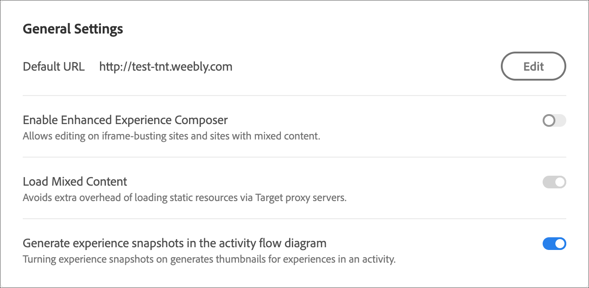
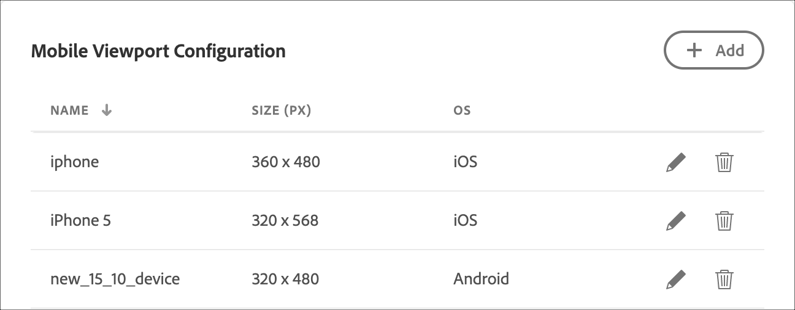
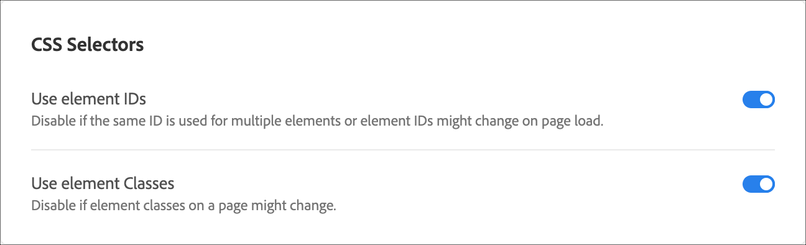

# Configure the Visual Experience Composer (VEC)

Use the **[!UICONTROL Visual Experience Composer]** tab under **[!UICONTROL Administration]** to set account-wide defaults for the [!DNL Adobe Target] [!UICONTROL Visual Experience Composer] (VEC). These settings apply whenever authors build or preview experiences in the VEC.

**Configuration overview**

1. [General settings](#general-settings): Default URL, Enhanced Experience Composer, mixed content, and experience snapshots.
1. [Mobile viewport configuration](#mobile-viewport-configuration): Preview devices for responsive experiences ([Target Premium](/help/main/c-intro/intro.md#premium) only).
1. [CSS selectors](#css): How Target generates selectors for content delivery.

To open the configuration page, click **[!UICONTROL Administration]** > **[!UICONTROL Visual Experience Composer]**.

>[!NOTE]
>
>Settings on this page apply to the entire [!DNL Target] account.

## General settings {#general-settings}

On the **[!UICONTROL General Settings]** section, configure defaults used when you open the VEC.

The following settings are available:

* **Default URL**

  Set the default URL used by the [!UICONTROL Visual Experience Composer]. This is the default page, such as your home page, used whenever you set up an experience for each new activity. If you do not set a default URL, you must enter a URL for each activity when you create it.

* **Enable Enhanced Experience Composer**

  Allows editing on iFrame-busting sites and sites with mixed content. Some sites might not be compatible with the enhanced version. Deselect this option to revert to the original [!UICONTROL Visual Experience Composer]. Activity delivery on sites is not affected by this choice.

  Note that the [!UICONTROL Enhanced Experience Composer] is not supported in [!DNL Safari]. 

  For more information, see [Troubleshooting the Visual Experience Composer](/help/main/c-experiences/c-visual-experience-composer/r-troubleshoot-composer/troubleshoot-composer.md).

  You can also enable the [!UICONTROL Enhanced Experience Composer] at the activity level. See [Learn how to enable the Enhanced Experience Composer at the activity level](/help/main/c-experiences/c-visual-experience-composer/experience-composer-best-practices.md).

* **Load Mixed Content**

  Enable mixed content while opening a website using the [!UICONTROL Enhanced Experience Composer] (EEC). Enabling this option avoids the extra overhead of loading static resources via [!DNL Target] proxy servers.

  This option is helpful if, for example:

    * Your Content Security Policy (CSP) headers allow loading mixed content without the use of proxy servers with the EEC enabled.
    * Your HTTP website faces increased load time in the EEC, wherein JavaScript, images, and so forth take longer to load via proxy.

* **Generate experience snapshots in the activity flow diagram**

  Enabling experience snapshots generates thumbnails for your experiences in the activity workflow diagram. Disabling snapshots might result in faster performance for some users.

## Mobile viewport configuration {#mobile-viewport-configuration}

>[!NOTE]
>
>The **[!UICONTROL Mobile Viewport Configuration]** settings are a [Target Premium](/help/main/c-intro/intro.md#premium) feature.

Add devices to use when previewing experiences. Each device has an associated audience.

Use the following steps to add a mobile viewport:

1. Click **[!UICONTROL Add]**.
1. Specify a descriptive name for the mobile viewport, specify the width and height, and select the desired operating system.
1. Click **[!UICONTROL Save]**.

For preview and audience details, see [Learn how to use mobile viewports for responsive experiences](/help/main/c-experiences/c-visual-experience-composer/mobile-viewports.md).

## CSS Selectors {#css}

Specify how [!DNL Target] generates CSS selectors.

These options help [!DNL Target] understand your site's structure to generate better CSS selectors for content delivery. By default, [!DNL Target] generates selectors based on element IDs on the page. If your site uses few IDs, or duplicates IDs on the same page, then using classes might be a better option.

You can choose one or both of the following options:

* **Use element IDs**

  Deselect this option if the same ID is used for multiple elements or if element ID might change on page load.

* **Use element classes**

  By default, [!DNL Target] only uses element IDs. However, if your page is designed to use classes to identify elements, such as a page built with [!DNL Adobe Experience Manager], you should also select **[!UICONTROL Use element classes]**. Selector accuracy is generally highest when using IDs, lower when using classes, and lowest when neither option is selected. Test your page in the VEC to confirm that selectors are correct.

  You can override this setting per activity by clicking the **[!UICONTROL Settings]** gear icon and selecting **[!UICONTROL CSS Selectors]**, useful when sites in the same account are configured differently. Per-activity overrides are not available in **[!UICONTROL Automated Personalization]** or **[!UICONTROL Multivariate Testing]** activities. For selector behavior and troubleshooting, see [Element selectors used in the Visual Experience Composer](/help/main/c-experiences/c-visual-experience-composer/vec-selectors.md).

## Training video: Account Preferences (7:33) 

>[!BEGINSHADEBOX]

The [!DNL Target] **[!UICONTROL Administration]** menu UI (formerly **[!UICONTROL Setup]**) has been redesigned to provide improved performance, reduce the maintenance time required when releasing new features, and to improve the user experience across the product. The information in the following video is generally correct; however, options might be in slightly different locations. Updated videos will be posted soon.

>[!ENDSHADEBOX]

This video includes information about account preferences.

* Describe the account settings available in [!DNL Target Standard]

>[!VIDEO](https://video.tv.adobe.com/v/17379)
