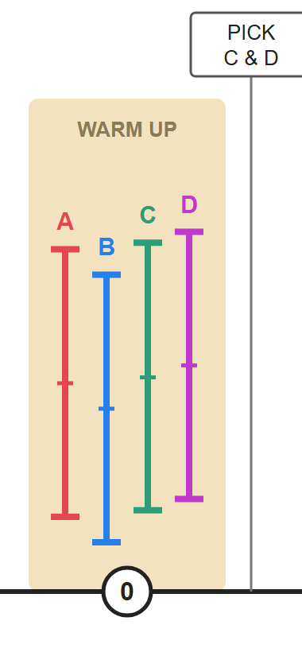
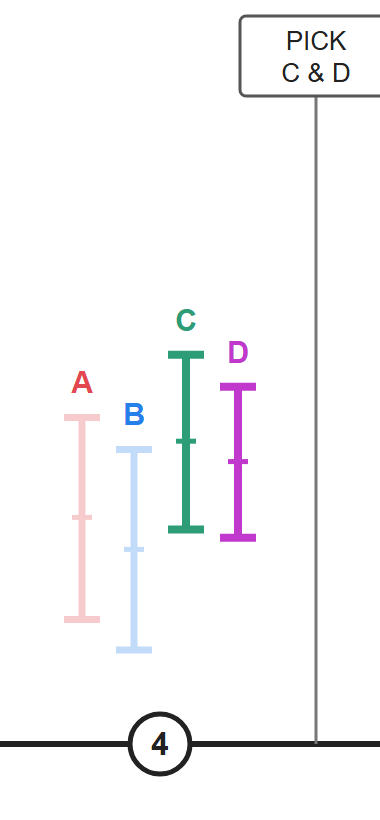

# Get started with [!UICONTROL Auto-Allocate] {#auto-allocate-overview}

>[!BEGINSHADEBOX]

**On this page:** Learn how an **[!UICONTROL Auto-Allocate]** activity identifies a winning experience and reallocates traffic to it, when to use it, how the algorithm works, and what to consider before you use it.

>[!ENDSHADEBOX]

An **[!UICONTROL Auto-Allocate]** activity in [!DNL Adobe Target] identifies a winner among two or more experiences and automatically reallocates more traffic to the winner to increase conversions while the test continues to run and learn.

You create an **[!UICONTROL Auto-Allocate]** activity with the three-step guided workflow of an A/B activity: choose the **[!UICONTROL Auto-Allocate to best experience]** option on the **[!UICONTROL Targeting]** page (step 2). For the steps, see [Create an Auto-Allocate activity](/help/main/c-activities/automated-traffic-allocation/create-auto-allocate-activity.md).

## Why use [!UICONTROL Auto-Allocate] {#why-auto-allocate}

Standard A/B tests have an inherent cost. You must spend traffic to measure the performance of each experience, and the traffic distribution remains fixed even after some experiences outperform others. The sample size is complicated to determine, the activity must run its entire course before you can act on a winner, and there is still a chance that the identified winner is not a true winner.

An **[!UICONTROL Auto-Allocate]** activity reduces this cost and overhead:

* It monitors the goal metric performance of all experiences and sends proportionally more new entrants to the high-performing experiences. Enough traffic is reserved to explore the other experiences.
* Optimization occurs in parallel with learning, so you can see the benefits in your results while the activity is still running.
* Visitors move gradually toward winning experiences, so you do not need to wait until the activity ends. You benefit from lift more quickly because activity entrants who would have been sent to less successful experiences are shown potential winning experiences.

Key benefits:

* Preserves the strictness of an A/B test.
* Finds a statistically significant winner faster than a manual A/B test.
* Provides higher average campaign lift than a manual A/B test.

### How [!UICONTROL Auto-Allocate] identifies a winner {#true-winner}

A normal A/B test in [!DNL Target] compares each challenger only with the control. For example, if an activity has experiences A, B, C, and D, where A is the control, the test compares A versus B, A versus C, and A versus D. Most products, including [!DNL Target], use a [Welch's t-test](https://en.wikipedia.org/wiki/Welch%27s_t-test){target=_blank} for these comparisons to produce p-value-based confidence. However, [!DNL Target] does not automatically perform the implicit comparisons (B versus C, B versus D, and C versus D) that are required to find the "best" experience, so you must analyze the results manually.

**[!UICONTROL Auto-Allocate]** removes this manual step:

* It performs all implicit comparisons across experiences and produces a "true" winner. There is no notion of a "control" experience in the test.
* It allocates new visitors to experiences until the confidence interval of the best experience does not overlap with the confidence interval of any other experience.
* It uses confidence intervals based on the [Bernstein Inequality](https://en.wikipedia.org/wiki/Bernstein_inequalities_%28probability_theory%29){target=_blank}, which compensates for repeated evaluations that would normally produce false positives.
* When it stops, provided that there is no substantial time-dependence to the visitors who arrive at the page, there is at least a 95% chance that it returns an experience whose true response is no worse than 1% (relative) less than the true response of the winning experience.

## When to use [!UICONTROL Auto-Allocate] {#when-to-use}

Choose between **[!UICONTROL Auto-Allocate]**, **[!UICONTROL A/B Test]**, and **[!UICONTROL Automated Personalization]** activities according to your goal:

| Activity | Use it when | How it differs |
|---|---|---|
| **[!UICONTROL Auto-Allocate]** | You want to optimize your activity from the beginning and identify the winning experiences as quickly as possible. | By serving high-performing experiences more often, the overall activity performance is increased. |
| [**[!UICONTROL A/B Test]**](/help/main/c-activities/t-test-ab/test-ab.md#test-ab) | You want to characterize the performance of all experiences before optimizing your site. | An A/B test helps you rank all of your experiences, whereas **[!UICONTROL Auto-Allocate]** finds top performers but does not guarantee differentiation among the lower performers. |
| [**[!UICONTROL Automated Personalization]**](/help/main/c-activities/t-automated-personalization/automated-personalization.md#automated-personalization-overview) | You want optimization algorithms of the highest complexity, such as machine-learning models that build predictions based on individual profile attributes. | **[!UICONTROL Auto-Allocate]** looks at the aggregate behavior of experiences (just like standard A/B tests) and does not differentiate between visitors. |

## How the algorithm works {#how-it-works}

The algorithm of **[!UICONTROL Auto-Allocate]** is a [multi-armed bandit](https://en.wikipedia.org/wiki/Multi-armed_bandit){target=_blank} approach to optimization, which balances exploratory learning and exploitation of that learning. It incorporates both measured performance (such as conversion rate) and the confidence intervals of the cumulative data. Unlike a standard A/B test, where traffic is split evenly between experiences, **[!UICONTROL Auto-Allocate]** changes the traffic allocation across experiences:

* 80% of visitors are allocated using the logic described in this section.
* 20% of visitors are randomly assigned across all experiences to adapt to changing visitor behavior.

The multi-armed bandit approach keeps some traffic free for exploration while it exploits the experiences that are performing well. More new visitors are placed into better performing experiences, while the ability to react to changing conditions is preserved. The models update at least once an hour to ensure that they react to the latest data.

As more visitors enter the activity, some experiences become more successful and receive more traffic. 20% of traffic continues to be served randomly to explore all experiences. If one of the lower-performing experiences starts to perform better, more traffic is allocated to that experience. If the success of a higher-performing experience decreases, less traffic is allocated to it. This can happen, for example, when an event causes visitors to look for different information on your media site, or when weekend sales on your retail site provide different results.

The following illustration represents how the algorithm might perform during a test with four experiences (click to expand the illustration):

{width="600" zoomable="yes"}

The illustration shows how the traffic allocated to each experience progresses over several rounds of the activity lifetime until a clear winner is determined.

| Round | Description |
|--- |--- |
|{width="200" zoomable="yes"}|**Warm-up round (0)**: Each experience gets equal traffic until each experience in the activity has a minimum of 1,000 visitors and 50 conversions.<ul><li>Experience A=25%</li><li>Experience B=25%</li><li>Experience C=25%</li><li>Experience D=25%</li></ul>After each experience reaches 1,000 visitors and 50 conversions, [!DNL Target] starts the automated traffic allocation. All allocations happen in rounds, and two experiences are picked for each round. Only two experiences move forward into the next round: D and C.<ul><li>Moving forward means that the two experiences are allocated 80% of the traffic equally.</li><li>The other two experiences continue to participate but are served only as part of the 20% random traffic allocation as new visitors enter the activity.</li><li>All allocations are updated every hour (shown by the rounds along the x-axis above). After each round, the cumulative data is compared.</li></ul>|
|{width="200" zoomable="yes"}|**Round 1**: 80% of traffic is allocated to experiences C and D (40% each). 20% of traffic is allocated randomly to experiences A, B, C, and D (5% each). During this round, experience A performs well.<ul><li>The algorithm picks experience D to move forward into the next round because it has the highest conversion rate (as indicated by each activity's vertical scale).</li><li>The algorithm picks experience A to move forward as well because it has the highest upper bound of the Bernstein 95% confidence interval of the remaining experiences.</li></ul>Experiences D and A move forward.|
|{width="200" zoomable="yes"}|**Round 2**: 80% of traffic is allocated to experiences A and D (40% each). 20% of traffic is allocated randomly, so experiences A, B, C, and D each get 5% of traffic. During this round, experience B performs well.<ul><li>The algorithm picks experience D to move forward into the next round because it has the highest conversion rate (as indicated by each activity's vertical scale).</li><li>The algorithm picks experience B to move forward as well because it has the highest upper bound of the Bernstein 95% confidence interval of the remaining experiences.</li></ul>Experiences D and B move forward.|
|{width="200" zoomable="yes"}|**Round 3**: 80% of traffic is allocated to experiences B and D (40% each). 20% of traffic is allocated randomly, so experiences A, B, C, and D each get 5% of traffic. During this round, experience D continues to perform well and experience C performs well.<ul><li>The algorithm picks experience D to move forward into the next round because it has the highest conversion rate (as indicated by each activity's vertical scale).</li><li>The algorithm picks experience C to move forward as well because it has the highest upper bound of the Bernstein 95% confidence interval of the remaining experiences.</li></ul>Experiences D and C move forward.|
|{width="200" zoomable="yes"}|**Round 4**: 80% of traffic is allocated to experiences C and D (40% each). 20% of traffic is allocated randomly, so experiences A, B, C, and D each get 5% of traffic. During this round, experience C performs well.<ul><li>The algorithm picks experience C to move forward into the next round because it has the highest conversion rate (as indicated by each activity's vertical scale).</li><li>The algorithm picks experience D to move forward as well because it has the highest upper bound of the Bernstein 95% confidence interval of the remaining experiences.</li></ul>Experiences C and D move forward.|
|{width="200" zoomable="yes"}|**Round *n***: As the activity progresses, a high-performing experience starts to emerge, and the process continues until there is a winning experience. When the confidence interval of the experience with the highest conversion rate does not overlap with the confidence interval of any other experience, it is labeled the winner. A [badge displays on the winning activity's page](/help/main/c-activities/automated-traffic-allocation/determine-winner.md) and in the **[!UICONTROL Activity]** list.<ul><li>The algorithm picks experience C as the clear winner.</li></ul>At this point, the algorithm serves 80% of traffic to experience C, while 20% of traffic continues to be served randomly to all experiences (A, B, C, and D). In total, C gets 85% of traffic. In the unlikely event that the confidence interval of the winner begins to overlap again, the algorithm reverts to the behavior of round 4. **Important**: If you manually chose a winner earlier in the process, it would be easy to choose the wrong experience. For this reason, it is best practice to wait until the algorithm determines the winning experience.|

>[!NOTE]
>
>If an activity has only two experiences, both experiences get equal traffic until [!DNL Target] finds a winning experience with 75% confidence. At that point, two-thirds of the traffic is allocated to the winner and one-third to the loser. After that, when an experience reaches 95% confidence, 90% of traffic is allocated to the winner and 10% to the loser. [!DNL Target] always sends some traffic to the "losing" experience to avoid false positives in the end (that is, to maintain some exploration).

After an **[!UICONTROL Auto-Allocate]** activity is activated, the following operations are not allowed in the [!DNL Target] UI:

* Switching the **[!UICONTROL Traffic Allocation]** mode to **[!UICONTROL Manual]**.
* Changing the goal metric type.
* Changing options in the **[!UICONTROL Advanced Settings]** panel.

For more information, see [How Auto-Allocate outperforms a manual test](/help/main/c-activities/automated-traffic-allocation/faster-results-higher-revenue.md).

## Caveats {#caveats}

Consider the following information when you work with **[!UICONTROL Auto-Allocate]**.

### Only one advanced metric setting is supported

The **[!UICONTROL Auto-Allocate]** feature works with only one advanced metric setting: **[!UICONTROL Increment Count and Keep User in Activity]**. The following advanced metric settings are not supported: **[!UICONTROL Increment Count]**, **[!UICONTROL Release User]**, **[!UICONTROL Allow Reentry and Increment Count]**, and **[!UICONTROL Release User and Bar from Reentry]**.

### Frequent return visitors can inflate conversion rates {#return-visitors}

If a visitor who sees experience A returns frequently and converts several times, the conversion rate (CR) of experience A is artificially increased. Compare this result with experience B, where visitors convert but do not return often. As a result, the CR of experience A looks better than the CR of experience B, so new visitors are more likely to be allocated to A than to B. If you choose to count once per entrant, the CR of A and the CR of B might be identical.

The logic favors visitors who convert quickly or visit more often, because such visitors temporarily inflate the overall conversion rate of the experience they belong to. The algorithm adjusts itself frequently, so the increase in conversion rate is amplified at each snapshot.

If return visitors are randomly distributed, their effect on conversion rates is more likely to be evened out. To mitigate this effect, consider changing the counting method of the goal metric to count only once per entrant.

### Differentiation is between high performers, not between low performers

**[!UICONTROL Auto-Allocate]** is good at differentiating between high-performing experiences (and finding a winner). There could be times when you do not have enough differentiation among the underperforming experiences.

If you want to produce statistically significant differentiation between all experiences, consider using the manual traffic allocation mode.

### Time-correlated conversion rates can skew allocation

Some factors that can be ignored during a standard A/B test, because they affect all experiences equally, cannot be ignored in an **[!UICONTROL Auto-Allocate]** activity. The algorithm is sensitive to the observed conversion rates. The following factors can affect experience performance unequally:

* Experiences with varying contextual (time, location, gender, and so on) relevance.

  For example:

  * "Thank God it is Friday" results in higher conversions on Friday.
  * "Jump-start your Monday" has higher conversion on Monday.
  * "Gear up for an East-coast winter" provides higher conversion in East-coast or winter-afflicted locations.

  Using experiences with varying contextual relevance can skew the results in an **[!UICONTROL Auto-Allocate]** test more than in an A/B test, because the A/B test analyzes the results over a longer period.

* Experiences with varying delays in conversion, possibly due to the urgency of the message.

  For example, "30% sale ends today" signals the visitor to convert today, but "50% off first purchase" does not create the same sense of urgency.

## Frequently asked questions {#faq}

Consult the following questions and answers when you work with **[!UICONTROL Auto-Allocate]** activities.

+++ Does [!UICONTROL Analytics for Target] (A4T) support [!UICONTROL Auto-Allocate] activities?

Yes. For more information, see [A4T support for Auto-Allocate and Auto-Target activities](/help/main/c-integrating-target-with-mac/a4t/a4t-at-aa.md).

+++

+++ Are returning visitors automatically reallocated to high-performing experiences?

No. Only new visitors are automatically allocated. Returning visitors continue to see their original experience to protect the validity of the A/B test.

+++

+++ How does the algorithm treat false positives?

The algorithm guarantees a 95% confidence or 5% false-positive rate if you wait until the winner badge appears.

+++

+++ When does [!UICONTROL Auto-Allocate] start allocating traffic?

The algorithm starts working after all experiences in the activity have a minimum of 1,000 visitors and 50 conversions.

+++

+++ How aggressively does the algorithm exploit?

80% of traffic is served using **[!UICONTROL Auto-Allocate]** and 20% of traffic is served randomly. When a winner has been identified, 80% of traffic goes to it, while all experiences continue to get some traffic as part of the 20%, including the winning experience.

+++

+++ Are losing experiences shown at all?

Yes. The multi-armed bandit ensures that at least 20% of traffic is reserved to explore changing patterns or conversion rates across all experiences.

+++

+++ What happens to activities with long conversion delays?

As long as all experiences being optimized face similar delays, the behavior is the same as for an activity with a faster conversion cycle. However, it takes longer to reach the 50-conversion threshold before the traffic allocation process begins.

+++

+++ How is [!UICONTROL Auto-Allocate] different from [!UICONTROL Automated Personalization]?

**[!UICONTROL Automated Personalization]** uses each visitor's profile attributes to determine the best experience. In doing so, it not only optimizes but also personalizes the activity for that visitor.

**[!UICONTROL Auto-Allocate]**, on the other hand, is an A/B test that produces an aggregate winner (the most popular experience, but not necessarily the most effective experience for each visitor).

+++

+++ Do returning visitors inflate the conversion rate of my success metric?

Yes, they can. See [Frequent return visitors can inflate conversion rates](#return-visitors) for the explanation and the way to mitigate this effect.

+++

+++ Can I use the sample size calculator with [!UICONTROL Auto-Allocate] to estimate how long the activity takes to identify the winner?

You can use the existing [!DNL Adobe Target] [Sample Size Calculator](/help/main/c-activities/t-test-ab/sample-size-determination.md#section_6B8725BD704C4AFE939EF2A6B6E834E6) to get an estimate of how long the test runs. As with traditional A/B testing, apply the Bonferroni correction if you are testing more than two offers or more than one conversion metric or hypothesis. This calculator is designed for traditional fixed-horizon A/B testing and provides an estimate only. Using the calculator for an **[!UICONTROL Auto-Allocate]** activity is optional, because **[!UICONTROL Auto-Allocate]** declares a winner for you. You do not need to pick a fixed point in time to look at the test results. The provided values are always statistically valid.

Internal [!DNL Adobe] experiments have found the following:

* When testing exactly two experiences, **[!UICONTROL Auto-Allocate]** finds a winner more quickly than fixed-horizon testing (that is, the time frame suggested by the sample size calculator) when the performance difference between experiences is large. However, **[!UICONTROL Auto-Allocate]** might require extra time to identify a winner when the performance difference between experiences is small. In these cases, fixed-horizon tests would typically have ended without a statistically significant result.
* When testing more than two experiences, **[!UICONTROL Auto-Allocate]** finds a winner more quickly than fixed-horizon testing (that is, the time frame suggested by the sample size calculator) when a single experience strongly outperforms all other experiences. When two or more experiences are both "winning" against other experiences but are closely matched to each other, **[!UICONTROL Auto-Allocate]** might require extra time to determine which is superior. In these cases, fixed-horizon tests would typically have ended by concluding that the "winning" experiences were better than the lower-performing experiences, but would not have identified which one was superior.

+++

+++ Should I remove an underperforming experience from an [!UICONTROL Auto-Allocate] activity to speed up the process of determining a winner?

There is no real reason to remove an underperforming experience. **[!UICONTROL Auto-Allocate]** automatically serves high-performing experiences more often and underperforming experiences less often. Leaving an underperforming experience in the activity does not significantly affect the speed of determining a winner.

20% of visitors are randomly assigned across all experiences. The amount of traffic served to an underperforming experience is minimal (20% divided by the number of experiences).

+++

+++ Can I change the goal metric midway through an [!UICONTROL Auto-Allocate] activity?

[!DNL Adobe] does not recommend that you change the goal metric midway through an activity. Although it is possible to change the goal metric during an activity in the [!DNL Target] UI, you should always start a new activity. [!DNL Adobe] does not guarantee what happens if you change the goal metric in an activity after it is running.

This recommendation applies to **[!UICONTROL Auto-Allocate]**, **[!UICONTROL Auto-Target]**, and **[!UICONTROL Automated Personalization]** activities that use either [!DNL Target] or [!DNL Analytics] (A4T) as the reporting source.

+++

+++ Can I change the reporting source midway through an [!UICONTROL Auto-Allocate] activity?

[!DNL Adobe] does not recommend that you change the reporting source midway through an activity. Although it is possible to change the reporting source (from [!DNL Target] to A4T or the opposite way) during an activity in the [!DNL Target] UI, you should always start a new activity. [!DNL Adobe] does not guarantee what happens if you change the reporting source in an activity after it is running.

This recommendation applies to **[!UICONTROL Auto-Allocate]**, **[!UICONTROL Auto-Target]**, and **[!UICONTROL Automated Personalization]** activities that use either [!DNL Target] or [!DNL Analytics] (A4T) as the reporting source.

+++

+++ Can I use the [!UICONTROL Reset Report Data] option while running an [!UICONTROL Auto-Allocate] activity?

Using the **[!UICONTROL Reset Report Data]** option for **[!UICONTROL Auto-Allocate]** activities is not suggested. Although it removes the visible reporting data, this option does not remove all training records from the **[!UICONTROL Auto-Allocate]** model. Instead of using the **[!UICONTROL Reset Report Data]** option, create a new activity and deactivate the original activity. This guidance also applies to **[!UICONTROL Auto-Target]** and **[!UICONTROL Automated Personalization]** activities.

+++

+++ How does [!UICONTROL Auto-Allocate] build models with regard to environments?

**[!UICONTROL Auto-Allocate]** builds models based on the traffic and conversion behavior recorded in the default environment only. By default, **[!UICONTROL Production]** is the default environment, but the default environment can be changed in [!DNL Target] ([Administration > Environments](/help/main/administrating-target/environments.md)).

If a hit occurs in another (non-default) environment, traffic is distributed according to the observed conversion behavior in the default environment. The result of that hit (conversion or non-conversion) is recorded for reporting purposes but is not considered in the **[!UICONTROL Auto-Allocate]** model.

When you select another environment, the report shows the traffic and conversions for that environment. The default selected environment for a report is the account-wide default. The default environment cannot be set on a per-activity basis.

+++

+++ Can an [!UICONTROL Auto-Allocate] activity adjust the lookback window over the course of a test to consider changing trends over time?

For example, can the activity consider the month of December for deciding how to allocate traffic, rather than looking at September visitor data (when the test began)?

No. **[!UICONTROL Auto-Allocate]** considers the performance of the entire activity.

+++

+++ Does [!UICONTROL Auto-Allocate] show a winning experience to a returning visitor if the winning experience is different from what the visitor saw when qualifying for the activity?

**[!UICONTROL Auto-Allocate]** uses sticky decisioning for the same reasons that **[!UICONTROL A/B Test]** activities are sticky. The traffic allocation works for new visitors only.

+++

## Training videos {#section_893E5B36DC4A415C9B1D287F51FCCB83}

The following videos contain more information about the concepts discussed in this article.

### Activity Workflow - Targeting (2:14) 

This video includes information about setting up traffic allocation.

* Assign an audience to your activity
* Throttle traffic up or down
* Select your traffic allocation method
* Allocate traffic between different experiences

>[!VIDEO](https://video.tv.adobe.com/v/17385)

### Creating A/B Tests (8:36) 

This video demonstrates how to create an A/B test using the Target three-step guided workflow. **[!UICONTROL Auto-Allocate]** is discussed beginning at 4:45.

* Create an A/B activity in [!DNL Adobe Target]
* Allocate traffic using a manual split or automatic traffic allocation

>[!VIDEO](https://video.tv.adobe.com/v/17391)
