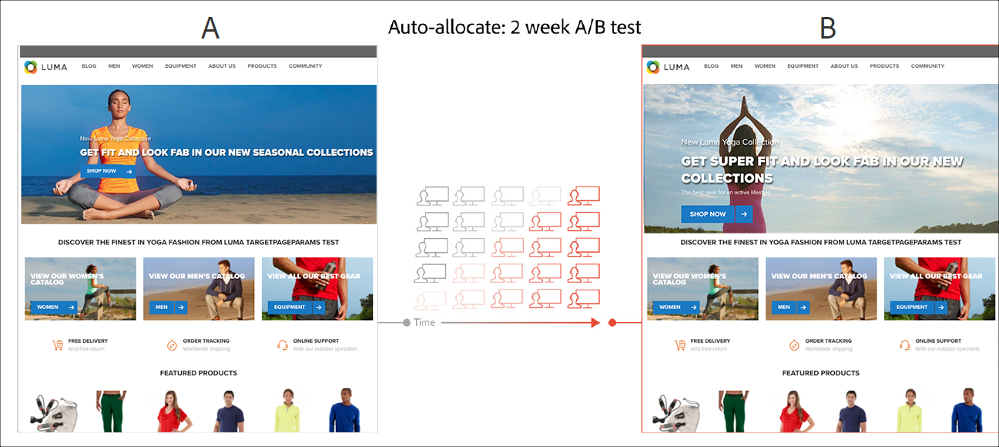
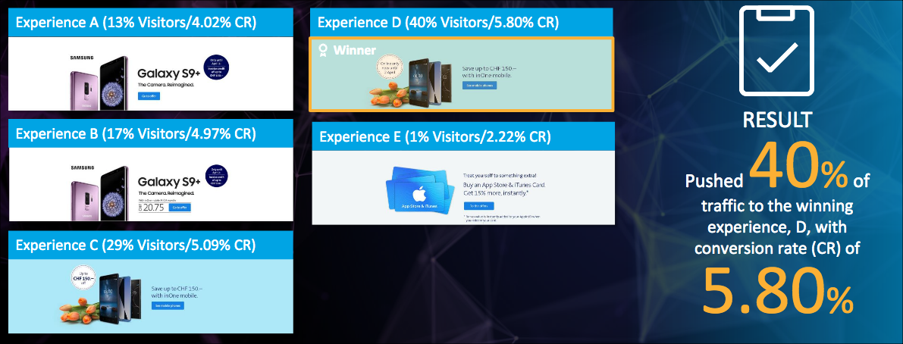

# How [!UICONTROL Auto-Allocate] outperforms a manual test {#faster-results-higher-revenue}

>[!BEGINSHADEBOX]

**On this page:** Learn why an **[!UICONTROL Auto-Allocate]** activity can deliver faster results and higher revenue than a manual A/B test, how it works, and when manual traffic allocation remains the better choice.

>[!ENDSHADEBOX]

With a manual A/B activity, you might be losing conversions because you cannot deliver the winning experience to your entire audience until the activity completes. Your traffic distribution remains fixed even after you recognize that some experiences are outperforming others, and the activity must run its entire course before you can act on a winner.

## Auto-allocating traffic {#auto-allocating-traffic}

**[!UICONTROL Auto-Allocate]** is your best option if you want to serve the winning experience more often and earlier in the activity, while also removing or reducing the set-up and calculation cost of picking sample sizes, confidence levels, and other statistical concepts.

## How does [!UICONTROL Auto-Allocate] work? {#how-it-works}

**[!UICONTROL Auto-Allocate]** uses the principle of the multi-armed bandit. A one-armed bandit is a colloquial term for a slot machine. Think of the auto-allocation of traffic as a set of slot machines, in this case test variations, whose handles are pulled equally at first. Over time, one or more machines, or test variations, might pay out more than others. When this situation happens, a gambler naturally starts pulling the handles of the machines that win more often. In traffic allocation terms, [!DNL Target] serves more visitors the experience or experiences that are winning more.

The following illustration shows a two-week A/B activity. With **[!UICONTROL Auto-Allocate]**, as a winning experience emerges, [!DNL Target] diverts more of the traffic to that winner early in the test.

## How does [!UICONTROL Auto-Allocate] provide faster results? {#faster-results}

More visitors see the variations that perform best. As a single variation pulls ahead, even more visitors are diverted to that winning experience while the test is still running. This method is especially helpful if the A/B activity runs during a core business moment, such as a holiday, a product launch, or a world news event.

## How can [!UICONTROL Auto-Allocate] provide higher revenue? {#higher-revenue}

**[!UICONTROL Auto-Allocate]** finds the winner faster than a manual A/B split and allows you to exploit that winner immediately, capturing upside revenue that would have been lost in a traditional or manual approach. Because **[!UICONTROL Auto-Allocate]** directs more traffic to the experience with the highest conversion rate, it can increase your revenue while the activity runs and learns.

In the following example, **[!UICONTROL Auto-Allocate]** gained more revenue during the test by pushing more traffic (40%) to Experience D, which had the highest conversion rate.

## In what cases should I stick with manual traffic allocation? {#manual-allocation}

A manual A/B test is the most applicable option when you must rank-order how every experience performed relative to the others. **[!UICONTROL Auto-Allocate]** finds and exploits top performers but does not guarantee differentiation among the lower-performing experiences. Use manual traffic allocation for complete control of how much of your visitor traffic sees each test variant and for customization of the statistical thresholds that are relevant for your business.

## Get started {#get-started}

Ready to launch your first **[!UICONTROL Auto-Allocate]** activity? See [Create an Auto-Allocate activity](/help/main/c-activities/automated-traffic-allocation/create-auto-allocate-activity.md) and the [Auto-Allocate overview](/help/main/c-activities/automated-traffic-allocation/automated-traffic-allocation.md).
