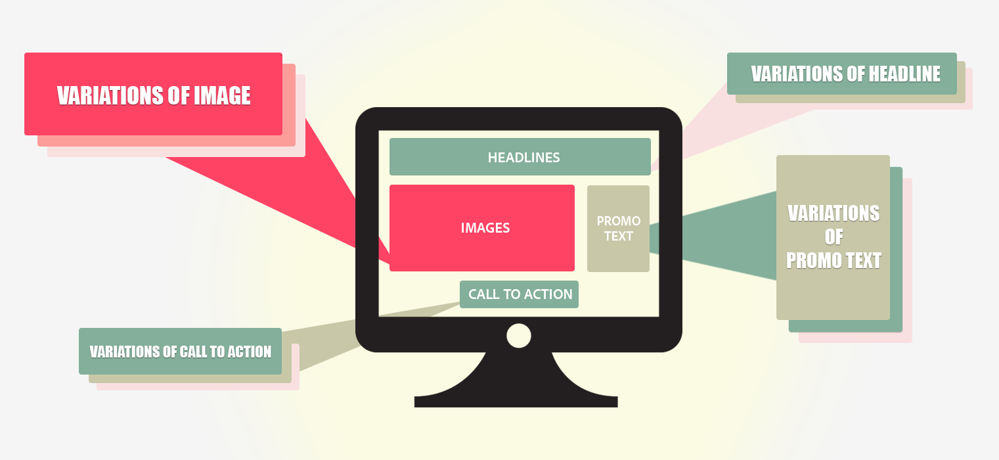

# Get started with [!UICONTROL Multivariate Test] {#get-started-mvt}

>[!BEGINSHADEBOX]

**On this page:** Learn how a **[!UICONTROL Multivariate Test]** works, which terms [!DNL Target] uses, when to use it instead of an A/B test, and how partial-factorial testing reduces the traffic requirements.

>[!ENDSHADEBOX]

A **[!UICONTROL Multivariate Test]** (MVT) activity in [!DNL Adobe Target] compares combinations of offers in elements on a page to determine which combination performs the best for a specific audience. It also helps to identify which element most impacts the success of the activity. Multivariate testing helps you discover the relative influence that specific elements have on conversion, compared to other elements on the page, and can help you refine a combination of elements that have been shown to be effective.

A **[!UICONTROL Multivariate Test]** provides two advantages compared to an A/B test:

* It shows which elements on your page have the greatest influence on conversion, which is also known as the "main effect". This information is useful, for example, to help you determine where to place the content that you want to receive the most attention.
* It helps you find compound effects between two or more elements on a page, which is also known as the "interaction effect". For example, a particular ad might produce more conversions when combined with a certain banner or hero image.

[!DNL Target] uses full-factorial multivariate tests to help you optimize your content. A full-factorial multivariate test examines all possible combinations of content with equal probability. For example, if you have two page elements with three offers each, there are nine possible combinations (3x3). Three elements, with two containing three possible offers and one with two offers, provide 18 options (3x3x2).

In [!DNL Target], each combination is one experience. The **[!UICONTROL Multivariate Test]** compares each experience so that you can learn which combinations are the most successful. At the same time, [!DNL Target] collects and analyzes data to understand how each location and the offers influence the success metric.

Because of the number of combinations that can be generated, a **[!UICONTROL Multivariate Test]** requires more time and traffic than an A/B test. The page must receive enough traffic to produce statistically significant results for each experience. To obtain useful results, understand the amount of traffic that your page receives, and test the optimal number of combinations for the right amount of time.

The [Traffic Estimator](/help/main/c-activities/c-multivariate-testing/t-create-multivariate-test/traffic-estimator.md#traffic-estimator) can help you design a test that works with your traffic. Before you use it, you should have good statistics showing the number of impressions and conversions that your site normally receives, and consider your traffic levels per day. The more experiences an activity has, the more traffic the activity must include or the longer it must run. If your amount of traffic is not high, test a few combinations. Otherwise, the amount of time required to produce meaningful test results might be too long to be useful.

## MVT terminology {#mvt-terminology}

Several terms are used in different ways across the industry. The following table defines the terms that [!DNL Target] uses when you set up a multivariate test.

| Term | Definition |
|--- |--- |
|Combination|The content variations created when you test multiple content options in multiple locations. For example, if you are testing three locations, each with three content options, there are 27 possible combinations (3x3x3). A visitor to your site sees one combination, also referred to as an experience.|
|Content|The text or image that makes up a test variation within a location. In a multivariate test, several content options within multiple locations are compared. In MVT methodology, the content is sometimes referred to as a *level*.|
|Element|A DOM element that contains content variations to be tested in the MVT test. See also *Location*.|
|Location|A specific content area on a page, often contained by a single DOM element. In MVT methodology, a location is sometimes referred to as a *factor*. A full-factorial multivariate test compares all possible combinations of offers in your locations.|

## When to use [!UICONTROL Multivariate Test] vs A/B {#when-to-use-mvt}

The following table shows when to use a **[!UICONTROL Multivariate Test]**, an A/B test, or both together to optimize your page.

| Situation | What to do | Details |
|--- |--- |--- |
|You have fewer than three elements to test.|Run a series of A/B tests.|Use an MVT test when you have at least three elements to test.|
|You want to optimize both the layout and the content of your page.|Use an A/B test to optimize your page layout, followed by an MVT test to determine the best content in each element on the page.|An A/B test can provide important feedback on the layout, and MVT tests excel at testing the content within the elements in your page design. Running an A/B test on the layout before testing multiple content options helps you determine the best layout and the most impactful content.|
|The number of different experiences exceeds five and spans two or more elements.|Use an MVT test to determine which element is the most important, then follow up with a more focused A/B test on that element.|The MVT test shows which areas on the page are most likely to improve conversion. These are the elements that a marketer should focus on. For example, the MVT test might show that the call to action is the most important element for meeting your goals. You can then run an A/B test to further refine the results, for example, by testing two specific images against each other, or by comparing the wording or colors of a call to action. By following an MVT test with one or more A/B tests, you can determine the best possible content for the results that you want.|

For more considerations, such as how many elements to include and how to plan the test, see [Multivariate Test best practices](/help/main/c-activities/c-multivariate-testing/best-practices.md).

## Partial-factorial testing {#partial-factorial}

[!DNL Target] offers full-factorial multivariate testing as a built-in activity option. In statistics, "Design of Experiments" offers many approaches, or designs, to determine which factors influence results. One such approach is the [Taguchi Method](https://en.wikipedia.org/wiki/Taguchi_methods) for partial-factorial testing. The Taguchi Method enables marketers to make a set of assumptions that reduce the number of permutations of experiences that must be tested, which in turn decreases the traffic requirements for a multivariate test. You can apply this approach in [!DNL Target] by using this [offline spreadsheet](/help/main/assets/MVT-Taguchi-Partial-Factorial-Design-02102017.xlsx).

If your team uses other Design of Experiments approaches, you can use the spreadsheet as a reference implementation for custom experiment designs.

As you use the offline calculation spreadsheet, consider the following tips:

* Pick the elements that you want to change and the number of versions of each element (3x2, 4x3, and so forth).
* Keep the numbering consistent. For example, if the button is Element 1 and the options are Blue, Green, and Yellow, the blue button is 1-1, the green button is 1-2, and the yellow button is 1-3.
* The offline spreadsheet provides the appropriate number of experiences needed (four for a 3x2, nine for a 4x3, and so forth).
* Build the experiences in the A/B workflow with the [Visual Experience Composer (VEC)](/help/main/c-experiences/experiences.md). You can use custom code, edit HTML, WYSIWYG, or any combination.
* After the activity is over (based on the sample size calculator), run the results through the spreadsheet to get the other details.

## Training videos {#training-videos}

The following videos contain more information about the concepts discussed on this page.

### Activity Types (9:03) 

This overview video explains the activity types available in [!DNL Target]. Multivariate testing is discussed beginning at 4:20. In this video, you learn how to:

* Describe the types of activities included in [!DNL Adobe Target].
* Select the appropriate activity type to achieve your goals.
* Describe the three-step guided workflow that applies to all activity types.

>[!VIDEO](https://video.tv.adobe.com/v/17386)

### Creating Multivariate Tests (9:25) 

This video explains how to understand, plan, and create a multivariate test using the [!DNL Target] three-step guided workflow. In this video, you learn how to:

* Define and design a multivariate test.
* Create a multivariate test.

>[!VIDEO](https://video.tv.adobe.com/v/17395)
