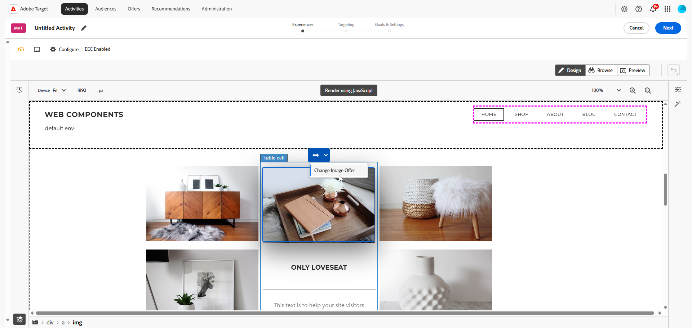

# Create combinations {#create-combinations}

>[!BEGINSHADEBOX]

**On this page:** Learn how to create the image and HTML offers that make up the combinations of a **[!UICONTROL Multivariate Test]**.

>[!ENDSHADEBOX]

In a **[!UICONTROL Multivariate Test]** (MVT), every location contains several offers, and each combination of offers across the locations is one experience. Use the **[!UICONTROL Visual Experience Composer]** (VEC) in [!DNL Adobe Target] to create the offers that you want to include in your test.

For more information about using the VEC to create and edit offers, see [Visual Experience Composer options](/help/main/c-experiences/c-visual-experience-composer/viztarget-options.md).

>[!NOTE]
>
>You can click **[!UICONTROL Expand Selection]** when selecting objects on the page to select the parent element in addition to the originally selected element. When you select any parent element, all children of that element are automatically selected. You can expand the selection multiple times.
>
>You can also use the [DOM path](/help/main/c-experiences/c-visual-experience-composer/viztarget-options.md#dom-path) to navigate elements.

## Image offers {#image-offers}

Test multiple image offers within a location to determine which image is most successful.

1. Click an image on your page, and then select **[!UICONTROL Change Image Offer]**.

    
  
1. From the **[!UICONTROL Image Offer]** dialog box, select all the images that you want to include in the test, then click **[!UICONTROL Add]**.

    

Each image becomes a separate experience in that location.

## HTML offers {#html-offers}

Test multiple HTML offers within a location to determine which offer is most successful.

1. Click an HTML offer on your page, then click **[!UICONTROL Change HTML Offer]**.

    

1. Choose your HTML offer and click **[!UICONTROL Create Offer]** then **[!UICONTROL HTML Offer]**.

    

1. Name the offer, type or paste the code for the HTML offer, then click **[!UICONTROL Create]**.

   Repeat for any additional HTML offers that you want to include.
  
1. Click **[!UICONTROL Save]**.

Each HTML offer becomes a separate experience in that location.

For recommendations on how many combinations to include and how to review them before you launch the test, see [Multivariate Test best practices](/help/main/c-activities/c-multivariate-testing/best-practices.md#create).
