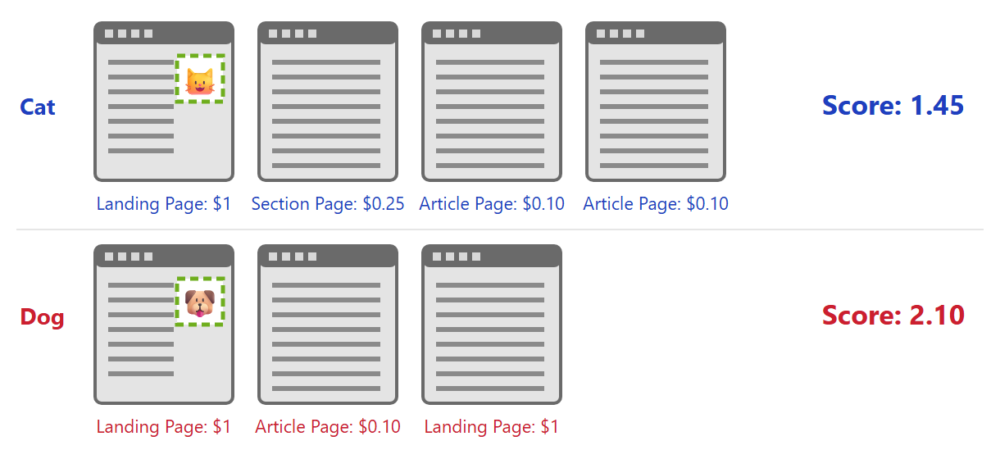

# Capture score {#capture-score}

>[!BEGINSHADEBOX]

**On this page:** Learn how the Capture Score engagement metric calculates the score of a visit, and how to assign a score to a page.

>[!ENDSHADEBOX]

The Capture Score engagement metric in [!DNL Adobe Target] calculates an aggregated score based on the value assigned to the pages that a visitor views on your site. The score starts at the point where the visitor first sees the first display [!DNL Target] request of the activity.

The following example shows how the score is calculated in an activity that tests two experiences, one with a cat image and one with a dog image.

In this example, the first visitor sees the cat experience. Assume that a global [!DNL Target] request passes in a page score based on the value of the page. If the marketer has captured page count engagement on a success metric associated with **any Target request**, the visit score accumulates for any request seen after the display request around the cat image.

The first page adds 1 to the score, the second page 0.25, the third 0.10, and the fourth 0.10, for a total of 1.45. This total can be interpreted as either currency or points. In a separate visit, a visitor sees the dog experience. Although this visitor views fewer pages, the score is 2.10, which is greater than the other visit, because the visitor viewed more valuable pages.

You can take into account acquisition costs and affiliate link revenue by passing adboxes and redirectors, as depicted in the following page flow. In this example, both [!DNL Target] requests on the article page pass a score, possibly representing a known CPM.

## Assigning a page score

You can assign a value to any page on your site based on what the page is worth to you. For example, a cooking site might be able to sell ads for more money on its feature article pages than in its experience section. The feature articles are then more valuable than the experience section. A page score lets you develop an overall "value" of a visit, so that a person who reads more feature articles gets more "points" than someone who only browses the experiences.

There are two methods to assign a score to a page:

* In the [!DNL Target] request, create a parameter called `mboxPageValue`.

  Example: `('global_mbox', 'mboxPageValue=10');`

  The specified value is added to the score every time the page with that [!DNL Target] request is viewed. If multiple requests on the page include score values, the score for the page is the total of all request values. `mboxPageValue` is a reserved parameter used for passing values in a [!DNL Target] request to capture an engagement score. Positive and negative values can be passed. The sum is calculated at the end of each visit to determine the total score of the visit.

* Pass the `?mboxPageValue=n` parameter in the URL of the page.

  Example: `https://www.mydomain.com?mboxPageValue=5`

  The specified value is added to the score for each [!DNL Target] request on the page. For example, if you pass the parameter `?mboxPageValue=10` and there are three [!DNL Target] requests on the page, the score for the page is 30.

>[!NOTE]
>
>The counter starts with the first display request of the activity, not the entry request, and [!DNL Target] requests located above that request are not included in the score. For example, if you enter the activity on the homepage, which does not have a display request, then link to a catalog page that contains a display request, the counter begins when you move to the catalog page.

The best practice is to assign values in the [!DNL Target] request. This method lets you be precise about the values that you measure, depending on the content of each request.

>[!NOTE]
>
>For easier maintenance, you can configure the page score value assignments of your site in the [!DNL at.js] file with some conditional JavaScript logic. This approach eliminates the need to add more code to your pages. Contact your account consultant for assistance.

You can combine the two methods, but this might result in a higher score than expected. For example, you assign a value of 10 to each of three [!DNL Target] requests and no score to a fourth request, then pass the URL parameter `?mboxPageValue=5`. The page score is 50: 30 for the three requests with assigned values, plus 20 for the URL parameter (5 for each of the four requests on the page).

You can also pass in negative values on certain pages that cost you money or are not good for a visitor to see. Negative values affect the overall score as well. This technique can be used on a page that visitors reach from an advertisement, so that you know how much the CPC was. It can also be used on a support or contact page, where visitors might call or request assistance.
