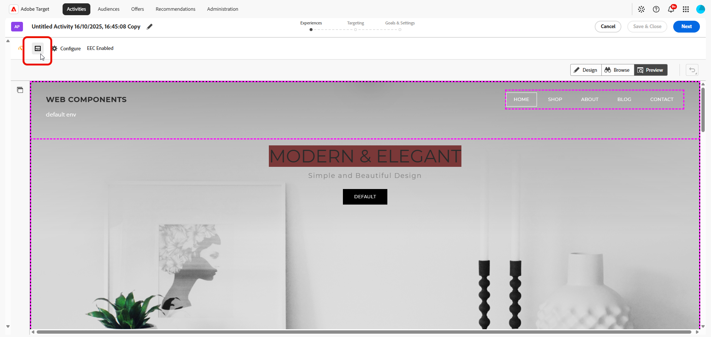

# Preview experiences in [!UICONTROL Automated Personalization] activities in the [!UICONTROL Visual Experience Composer] (VEC) {#preview-ap-experiences}

>[!BEGINSHADEBOX]

**On this page:** Learn how to preview each experience of an **[!UICONTROL Automated Personalization]** activity in the **[!UICONTROL Visual Experience Composer]**, and how to exclude or include experiences.

>[!ENDSHADEBOX]

[!DNL Adobe Target] **[!UICONTROL Automated Personalization]** (AP) activities compare multiple offers on a page, so it is helpful to preview the page with each experience. The preview shows how the offers combine in each experience, so you can decide whether to keep or exclude it.

1. In the **[!UICONTROL Visual Experience Composer]** (VEC), click **[!UICONTROL Preview]**.

    

1. Click the **[!UICONTROL Show Experiences]** icon () to display the list of all experiences in the left frame.

    

1. Click a specific experience in the list to view that experience.

1. (Optional) To exclude or include experiences, click the **[!UICONTROL Manage Content]** icon () to display the **[!UICONTROL Manage Content]** dialog box. 

    

1. You might choose to exclude an experience that shows conflicting variations or an experience that is not aesthetically balanced. Then do one of the following:

   * To exclude one experience, click the **[!UICONTROL More Actions]** icon () next to the experience, then click **[!UICONTROL Exclude]**.
   * To exclude multiple experiences, select the check boxes for the experiences, then click **[!UICONTROL Exclude]**.
   * To include multiple experiences that were excluded, select the check boxes for the experiences, then click **[!UICONTROL Include]**.
