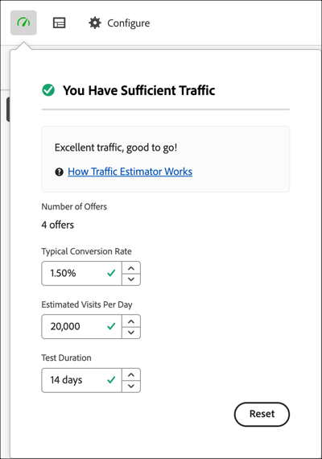

# Estimate the traffic required for success {#traffic-estimator}

>[!BEGINSHADEBOX]

**On this page:** Learn how to use the **[!UICONTROL Traffic Estimator]** to check whether your **[!UICONTROL Automated Personalization]** activity has sufficient traffic to succeed.

>[!ENDSHADEBOX]

The [!DNL Adobe Target] **[!UICONTROL Traffic Estimator]** provides feedback that lets you know whether you have sufficient traffic for your **[!UICONTROL Automated Personalization]** (AP) activity to succeed. AP activities use multiple offer combinations, so it is important to know how much traffic is required to provide meaningful results. The **[!UICONTROL Traffic Estimator]** uses statistics about your page and the number of experiences being tested to estimate the amount of traffic and the test duration necessary to make the activity successful.

The **[!UICONTROL Traffic Estimator]** determines whether there is enough traffic to generate personalized models by comparing the estimated page impressions and the typical conversion rate for the pages. Ideally, for a successful activity, the correct sample size ensures that personalized content is ready within 50% of the activity duration or 14 days, whichever is less. This process allows sufficient time for obtaining personalized content and learning which content to deliver.

[!DNL Target] randomly serves experiences until the personalization algorithms are built. The check mark icon beside each offer shows when the model for that offer is ready and [!DNL Target] is able to begin delivering personalized content. Lift is expected only after the models are ready, so the visual indication lets you set the right expectation. Use the **[!UICONTROL Traffic Estimator]** in the **[!UICONTROL Visual Experience Composer]** (VEC) to get a guideline of when the models are ready.

>[!NOTE]
>
>A personalized model is not always deployed, even when your traffic is sufficient. [!DNL Target] builds and tests the model, but it deploys the model only if it performs better than a random selection of experiences. If the model is not better than random, the offers are probably not different enough from each other. In that case, make the offers more visually different if the messaging is similar, or change the messaging itself.

## Use the Traffic Estimator {#use-traffic-estimator}

While you build an **[!UICONTROL Automated Personalization]** activity, the **[!UICONTROL Traffic Estimator]** lets you check whether the traffic to your page is sufficient for the personalized models to be ready in time. Running this check before you launch the activity helps you avoid a test that cannot reach enough visitors to deliver personalized content, and shows you how to adjust the number of offer combinations or the duration of the activity if the traffic is not sufficient.

1. From your **[!UICONTROL Automated Personalization]** activity, access the **[!UICONTROL Experiences]** page of the **[!UICONTROL Visual Experience Composer].

1. Click the **[!UICONTROL Traffic]** icon ().

    The **[!UICONTROL Traffic Estimator]** opens. To exit window, click the icon again.

   

1. Specify the typical conversion rate (or the conversion rate that you expect from this activity), the estimated activity impressions per day, and the test duration.

   The **[!UICONTROL Traffic Estimator]** uses these metrics to determine what adjustments are necessary to run a successful test.

   |Metric|Description|
   | --- | --- |
   |**[!UICONTROL Number of Offers]**|This metric is calculated automatically based on the number of experiences being created as a part of your activity, after any exclusions.|
   |**[!UICONTROL Typical Conversion Rate]**|This metric is expressed as a percentage, based on your estimation or past data from your analytics system.|
   |**[!UICONTROL Estimated Visits Per Day]**|This metric is the number of visits per day from visitors who are able to view the activity, based on the targeting criteria. This metric could be based on your analytics data. This number must be visits, not unique visitors.|
   |**[!UICONTROL Test Duration]**|The number of days you want the activity to run.|

1. Review the results. As you change the numbers, the estimate changes. 

    For example, if you are testing many combinations and your conversion rate and impressions are too low, the **[!UICONTROL Traffic Estimator]** shows how long the test must run to be successful. Or, if your traffic is low, the **[!UICONTROL Traffic Estimator]** could suggest a lower number of offer combinations so you can run the test the desired number of days.

   

1. If you do not have sufficient traffic, consider the following options:

   * Use an [**[!UICONTROL Auto-Target]**](/help/main/c-activities/auto-target/auto-target-to-optimize.md) activity instead of **[!UICONTROL Automated Personalization]** to create experiences with several offer changes in one experience variation.
   * Reduce the number of offer combinations within your **[!UICONTROL Automated Personalization]** activity.
   * Increase the duration of the activity.

1. Adjust the numbers until the **[!UICONTROL Traffic Estimator]** indicates that you have sufficient traffic, then design your test accordingly.

   If the traffic is sufficient, the **[!UICONTROL Traffic]** icon shows a green check. If it is insufficient, the icon shows a red warning label.

   
