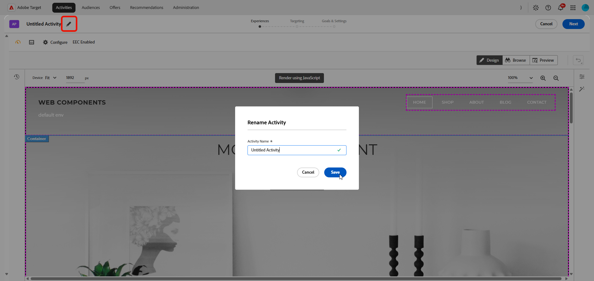
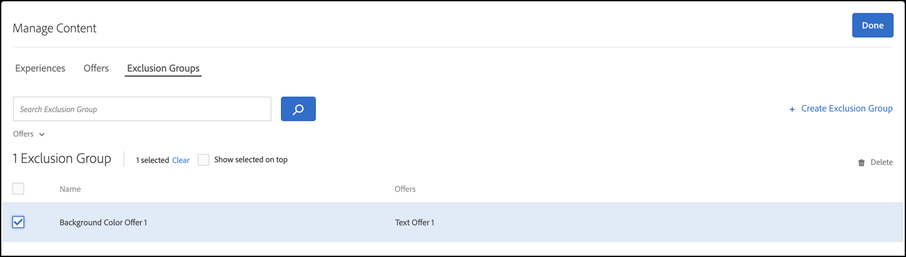

# Create an [!UICONTROL Automated Personalization] activity {#create-ap-activity}

>[!BEGINSHADEBOX]

**On this page:** Learn how to create an **[!UICONTROL Automated Personalization]** (AP) activity in the **[!UICONTROL Visual Experience Composer]** (VEC). You build your experiences, set targeting and a control group, then configure goals and settings.

>[!ENDSHADEBOX]

The **[!UICONTROL Automated Personalization]** activity workflow in [!DNL Target] varies from the workflow of the other activity types. It follows the three-step guided workflow in the **[!UICONTROL Visual Experience Composer]**:

1. [Build experiences](#build-experiences)
1. [Set targeting](#set-targeting)
1. [Configure goals and settings](#configure-goals-and-settings)

## Before you begin {#before-you-begin}

For optimal performance, keep your **[!UICONTROL Automated Personalization]** and **[!UICONTROL Auto-Target]** activities within these limits:

* 4–6 locations, with 4–6 offers per location.
* Under 5,000 total experiences for best results. The hard limit is 30,000, and the same limit applies when the **[!UICONTROL Disallow Duplicates]** option is enabled.

The total number of experiences grows from the cartesian combination of locations and offers. Larger configurations can lead to slow loading or editing in the **[!UICONTROL Visual Experience Composer]**.

## Step 1: Build experiences {#build-experiences}

Define the pool of content variations that **[!UICONTROL Automated Personalization]** can personalize against. The richer and more distinct your experiences and offers, the better the algorithm can match the right content to each visitor.

### Create the activity {#create-activity}

Start the activity and open the page that you want to personalize in the **[!UICONTROL Visual Experience Composer]** (VEC).

1. From the [!DNL Target] **[!UICONTROL Activities]** list, click **[!UICONTROL Create Activity]** > **[!UICONTROL Automated Personalization]**.

   

1. Choose your Experience Composer:

   * To use the **[!UICONTROL Visual Experience Composer]** (VEC), click **[!UICONTROL Visual]**.

   * To use the **[!UICONTROL Form-Based Experience Composer]**, select **[!UICONTROL Form]** instead. See [Form-Based Experience Composer](/help/main/c-experiences/form-experience-composer.md) for more information.

      >[!NOTE]
      >
      >In addition to the VEC and **[!UICONTROL Form-Based Experience Composer]**, [!DNL Target] offers the **[!UICONTROL Single Page Application VEC]**. For more information about the various composers, see [Experiences and Offers](/help/main/c-experiences/experiences.md). For troubleshooting information about the VEC, see [Troubleshooting the Visual Experience Composer](/help/main/c-experiences/c-visual-experience-composer/r-troubleshoot-composer/troubleshoot-composer.md).

      

1. (Conditional) [Choose a workspace](/help/main/administrating-target/c-user-management/property-channel/property-channel.md).

1. In the **[!UICONTROL Enter Activity URL]** box, specify your [activity URL](/help/main/c-activities/t-test-ab/t-test-create-ab/ab-activity-url.md). If your account is [configured with a default URL](/help/main/administrating-target/visual-experience-composer-set-up.md), that URL appears by default. You can change from the default to another URL if necessary.
   
   Note that [!DNL Target] does not differentiate between URL protocols ([!DNL https] and [!DNL http]). As a result, [!DNL `http://www.adobe.com`] and [!DNL `https://www.adobe.com`] both match.

1. Then, click **[!UICONTROL Create]**. The page with the specified URL opens in the VEC.
   
1. To name the activity, click the **[!UICONTROL Edit]** icon (  ) and specify a descriptive name for the activity, and then click **[!UICONTROL Save]**.

   {{activity-name-rules}}

   

### Design the content {#design-content}

Set up the content that the algorithm can combine, and exclude any experiences that you do not want.

1. Modify the page elements as explained in [Visual Experience Composer options](/help/main/c-experiences/c-visual-experience-composer/viztarget-options.md).

   * To preview several images quickly, select multiple images at once from the asset manager. You can then view the page with each of the images configured for the activity.
   * To change text in your offers, edit the text element directly on the page.

   When you edit an element, bars appear on that element to indicate that you have changed it.

1. Click the **[!UICONTROL Manage Content]** icon (  ) to configure the available combinations.

   The **[!UICONTROL Manage Content]** dialog box opens with two tabs: **[!UICONTROL Experiences]** and **[!UICONTROL Offers]**.

   

1. On the **[!UICONTROL Experiences]** tab, review the list of pieces of content and the location each one is assigned to.

1. (Optional) To exclude experiences from the activity, select the checkbox for each experience that you want to exclude, and then click the **[!UICONTROL Exclude]** icon.

   For more options, see [Managing exclusions](/help/main/c-activities/t-automated-personalization/managing-exclusions.md).

   

1. (Conditional) Click the **[!UICONTROL Offers]** tab to manage the offers in the activity.

   * To organize the offers for reporting, select pieces of content and assign them to reporting groups. For more information, see [Offer reporting groups in Automated Personalization](/help/main/c-activities/t-automated-personalization/offer-reporting-groups-in-automated-personalization.md).
   * To limit who sees an offer, use targeting to allow only certain visitors to see that offer.

<!--
1. (Conditional) Click **[!UICONTROL Exclusion Groups]** to choose any combination of elements that you want to exclude from the activity.

   

   Although you can create up to 30,000 experiences in an AP test, the algorithm performs its best when fewer than 10,000 distinct experiences are used. This same limit is applied even when the activity has enabled the **[!UICONTROL Disallow Duplicates]** option.

   If you do not currently have any exclusion groups included in your activity, click **Create Exclusion Group**. You can filter to create a list that shows only the combinations you want to exclude. Name your exclusion group, then click **Save**.

   To edit an existing exclusion group, hover over the group you want to edit, then click the pencil icon.
-->

1. Click **[!UICONTROL Done]** when you have finished setting up the content of your activity.

## Step 2: Set targeting {#set-targeting}

Decide which visitors enter the activity and how much of your traffic is exposed. Pair them with a control group so [!DNL Target] can measure the lift personalization delivers.

1. Click **[!UICONTROL Targeting]** at the top of the **[!UICONTROL Visual Experience Composer]** to move to the next step in the three-step guided workflow.

   

1. (Conditional) Click the **[!UICONTROL All Visitors]** control to [select another audience](/help/main/c-activities/t-test-ab/t-test-create-ab/ab-audience.md) for the activity and set its visitor percentage.

   The **[!UICONTROL All Visitors]** audience is set as the default. If you select another audience, its name displays in the leftmost control. For example, you might limit entries to 50% of all visitors or 45% of your "Californians" audience.

1. Click the **[!UICONTROL Traffic Allocation]** control and choose one of the following options:

   

   +++Traffic Allocation Goal options

   | Option | When to use it |
   |--- |--- |
   |**[!UICONTROL Evaluate Personalization Algorithm (50/50)]**|Your goal is to test the algorithm. Visitors are split 50/50 between the control and the targeted algorithm. This split gives the most accurate estimate of the lift, and it is the fastest and most accurate way to test whether the algorithm performs better than no personalization (for example, a randomly served control). Suggested for use with "random experiences" as your control.|
   |**[!UICONTROL Maximizing Personalization Traffic (90/10)]**|Your goal is to create an "always on" activity. 10% of the visitors go into the control, which ensures that there is enough data for the algorithms to continue learning over time. This is the fastest and most accurate way to maximize the amount of traffic that is personalized when you are less concerned with the exact lift. The tradeoff is that you have less precision in what the exact lift is. No matter your goal, this option is the recommended traffic split when you use a specific experience as the control.|
   |**[!UICONTROL Custom Allocation]**|You want to split the percentage manually.|

   +++

1. (Conditional) From the **[!UICONTROL Control]** drop-down list, [select a specific experience to be used as control](/help/main/c-activities/t-automated-personalization/experience-as-control.md) or select **[!UICONTROL Random Experience]**.

   The control experience provides a comparison to determine how much lift is provided by the automated test. **[!UICONTROL Automated Personalization]** always measures performance against a control group. Best practice is to place at least 10% of entrants into the control group.

   >[!NOTE]
   >
   >In **[!UICONTROL Automated Personalization]** activities, entry criteria (URL targeting, template rules, and audience targets) are evaluated for each request. In previous versions, entry criteria were evaluated once per session.

## Step 3: Configure goals and settings {#configure-goals-and-settings}

Tell [!DNL Target] what success looks like. The optimization goal you choose is the metric the personalization algorithm trains against, so pick the outcome that matters most for this activity.

1. Click **[!UICONTROL Next]** to display the **[!UICONTROL Goals & Settings]** page.

1. Configure the activity with the following settings, then click **[!UICONTROL Save & Close]**.

   | Setting | Description |
   |--- |--- |
   |**[!UICONTROL Name]**|Name the activity. Give the activity a name that is descriptive enough that team members can recognize it in the **[!UICONTROL Activities]** list. Follow the activity name rules described in [Step 1: Build experiences](#build-experiences).|
   |**[!UICONTROL Objective]**|(Optional) Type the objective of the test. The objective helps you remember the purpose of the activity.|
   |**[!UICONTROL Priority]**|Decides which activity displays when several activities share a location and an audience. See [Set the priority](#set-priority).|
   |**[!UICONTROL Duration]**|Set the start and end dates for the activity. You can select **[!UICONTROL When Activated]** or you can specify a specific date and time.|
   |**[!UICONTROL Optimization Goal]**|The metric that the personalization algorithm trains against. See [Set the optimization goal](#set-optimization-goal).|
   |**[!UICONTROL Conversion Metric]**|By default, the conversion metric is the same as the optimization goal metric. However, you can define a separate conversion metric by unchecking the **[!UICONTROL Same as Optimization Goal]** option.|
   |**[!UICONTROL Additional Metrics]**|Add any additional reporting metrics that you want to use. You can add conversion or revenue metrics.
**Note**: The **[!UICONTROL Engagement]** metric is not supported as an additional metric. The [!DNL Target] UI might let you select the **[!UICONTROL Engagement]** metric, but the data does not display accurately in reports.|
   |**[!UICONTROL Audiences for Reporting]**|Add audiences to enable filtering by audiences in reports. By default, the report shows results for all qualified visitors. Add audiences to filter results for more specific subsets of visitors.
**Note**: Unlike other activity types, **[!UICONTROL Automated Personalization]** cannot use **[!UICONTROL Adobe Analytics]** as its reporting source (A4T).|
   |**[!UICONTROL Notes]**|Type any information about your activity that is useful for you or for other team members. The **[!UICONTROL Notes]** pane is resizable.|

   When you name or rename a metric, the following characters are not allowed: `/`, `?`, `#`, `:`, `=`, `+`, `-`, and `@`.

### Set the priority {#set-priority}

The priority is used if multiple activities are assigned to the same location with the same audience. If two or more activities are assigned to the location, the activity with the highest priority displays.

Depending on your settings, the [!DNL Target] UI and options for **[!UICONTROL Priority]** vary:

* **Legacy priorities (default):** If fine-grained priorities are not enabled, specify a priority of **[!UICONTROL Low]**, **[!UICONTROL Medium]**, or **[!UICONTROL High]**.
* **Fine-grained priorities:** Specify a value from 0 through 999, where 0 = Low and 999 = High. To enable this option, click **[!UICONTROL Administration]** > **[!UICONTROL Reporting]**, then toggle the **[!UICONTROL Enable Fine-Grained Priorities]** option to the "On" position.

For activities created in previous versions of [!DNL Target Standard/Premium], **[!UICONTROL Low]** priority is converted to 0, **[!UICONTROL Medium]** priority is converted to 5, and **[!UICONTROL High]** priority is converted to 10. You can adjust these values as necessary.

>[!NOTE]
>
>Before you can disable fine-grained priorities after using them, all priorities must be set back to 0, 5, and 10.

### Set the optimization goal {#set-optimization-goal}

The optimization goal consists of two parameters:

* What you want to measure with the activity
* The action taken by an activity entrant that shows that the goal has been achieved

You can choose to name the optimization goal by selecting the three dots to the right of **[!UICONTROL My Primary Goal]**. **[!UICONTROL Automated Personalization]** activities can measure **[!UICONTROL Conversion]** or **[!UICONTROL Revenue]**. Conversion can be achieved by viewing a page or by viewing an mbox. Clicks can also be tracked.

The primary goal also becomes the modeling metric used by the modeling system to calculate the success of the experience.

Visitors can be kept in the activity for tracking purposes after reaching the modeling goal. For example, often an **[!UICONTROL Automated Personalization]** activity is used to improve click-rates, and that is set as the modeling goal. However, it is important to see how increased click-rates lead to final conversion, so tracking through the final conversion is essential.

#### Make one metric depend on another {#add-dependency}

You can provide dependency on multiple metrics along with the flexibility to choose whether the metric should be reached or not reached for the count to increase. You must define both (or multiple) success metrics before you can make one dependent on another. The **[!UICONTROL Add Dependency]** option allows the success metric to increment if another success metric has been reached or has not been reached.

To add a dependency:

1. After adding additional metrics, click **[!UICONTROL Advanced Settings]** under the three-dot menu to the right of **[!UICONTROL Additional Goal]**.

1. Click the **[!UICONTROL Add Dependency]** option at the bottom of the **[!UICONTROL Reporting Settings]** section.

1. Drag and drop the desired metrics from the left pane into the right pane, then click **[!UICONTROL Reached]** to toggle the setting between **[!UICONTROL Reached]** and **[!UICONTROL Not Reached]**.

You can edit or remove dependencies after adding them.

## Preview your experiences {#preview-experiences}

Check how your experiences look on your site before you launch the activity.

1. After you click **[!UICONTROL Save & Close]**, the activity's **[!UICONTROL Overview]** page displays. Click **Preview Experiences**.

1. In the pop-up that appears, view and share links to your AP experiences on your site. These links give you a "true preview" of the experiences outside of the **[!UICONTROL Target]** **[!UICONTROL Visual Experience Composer]** (VEC).

   >[!NOTE]
   >
   >You must share the links from the message to share the preview. Clicking a link and then copying the URL directly from the browser does not work. Copying the link causes the URL to contain a parameter that displays the page correctly only when you access the page from the link in the message.

For information about reporting, see [Automated Personalization Reports](/help/main/c-reports/personalization-reports/reports-ap.md).
