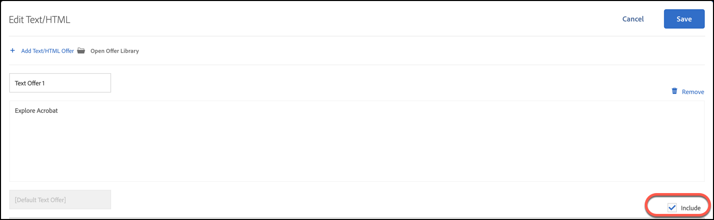
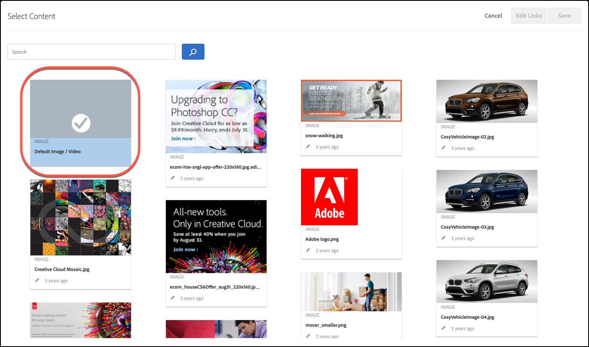
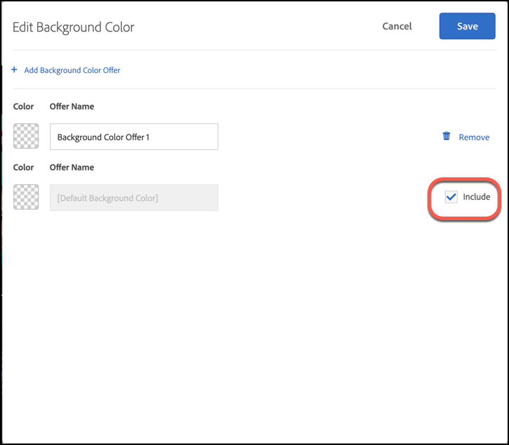
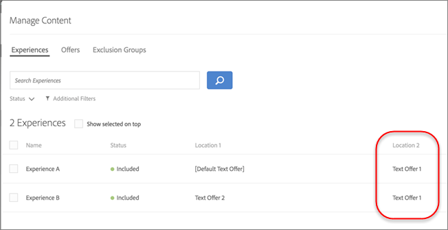
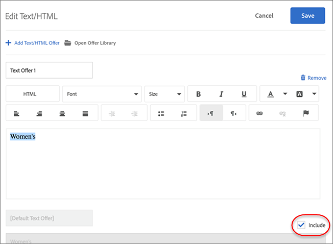
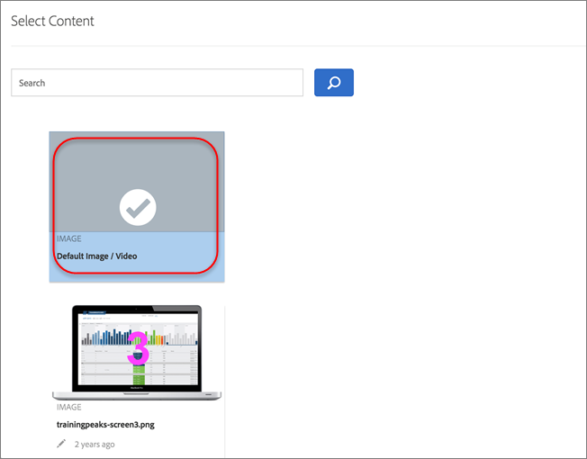
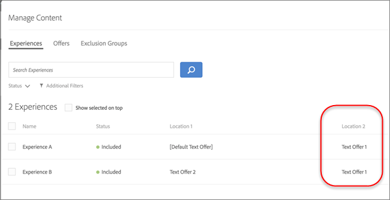

# Manage exclusions {#manage-exclusions}

>[!BEGINSHADEBOX]

**On this page:** Learn how to prevent duplicate offers, exclude specific experiences, and exclude default content in **[!UICONTROL Automated Personalization]** activities.

>[!ENDSHADEBOX]

Exclusions control which offers and experiences an **[!UICONTROL Automated Personalization]** (AP) activity serves. They prevent the same offer from displaying twice, remove offer combinations that do not work together, and remove default content, so that the activity delivers cleaner and more relevant experiences that align with your goals and your audience.

## Allow or disallow duplicate offers {#allow-duplicate-offers}

Prevent offers from the offer library from being duplicated when used in different locations in AP activities.

An activity can have, for example, six locations on a page with 12 offers, so the same offer could be placed in more than one location. Disallowing duplicate offers prevents the same offer from displaying at the same time in different locations within the same activity.

1. While [creating or editing an AP activity](/help/main/c-activities/t-automated-personalization/create-ap-activity.md#create-ap-activity), click the **[!UICONTROL Configure]** icon (  ).

1. Click **[!UICONTROL Allow Duplicate Offers]** to toggle this feature on or off, depending on your needs.

    

## Exclude specific experiences {#exclude-experiences}

Exclude specific experiences to remove certain offer combinations from your AP activity. Some combinations might not work together, or you might limit the number of experiences tested to decrease the traffic requirements of the activity.

1. While [creating or editing an AP activity](/help/main/c-activities/t-automated-personalization/create-ap-activity.md#create-ap-activity), click the **[!UICONTROL Manage Content]** icon (  ).

   The **[!UICONTROL Experiences]** list shows each experience generated from the permutations of all content and location options.

1. Exclude the experiences that you do not want to test.

   * To exclude a single experience, click the **[!UICONTROL More Actions]** icon (  ), then click **[!UICONTROL Exclude]**.
   * To exclude several experiences at once, select the checkbox for each experience, then click **[!UICONTROL Exclude]**. The **[!UICONTROL Exclude]** icon displays when one or more experiences are selected.

   

   The experiences are now excluded from the activity, and their **[!UICONTROL Status]** shows as **[!UICONTROL Excluded]**.

## Exclude default content {#exclude-default-content}

Exclude default content when you do not want it to be part of your AP activity, so that a location contains only one offer that differs from your default content. This approach also lets you change the look and feel of the rest of the page to suit the offers that you test. For example, to match the color palette of the offers, you can change the background color of the page and exclude the default background color.

1. While [creating or editing an AP activity](/help/main/c-activities/t-automated-personalization/create-ap-activity.md#create-ap-activity), select the content that you want to replace, then click **[!UICONTROL Change Text/HTML]**, **[!UICONTROL Change Image Offer]**, or **[!UICONTROL Change Background Color]**. The available options vary depending on the type of content.

   

1. Create your new content.

1. Click the **[!UICONTROL More Actions]** icon (  ), then click the **Exclude Default Offer/Include Default Offer** toggle to exclude or include the default offer.

   <!--
   Depending on the content or offer type, the [!UICONTROL Include] checkbox is in a slightly different place. 

   For Text/HTML content: 

   

   For Image/Video content: 

   

   For background color: 

   
   -->

<!--
1. Click **[!UICONTROL Save]**.

   You can see the experiences created from the offers you specified under [!UICONTROL Manage Content]. You notice that no experiences are created in [!UICONTROL Manage Content] using the default offer you excluded. 

   

**To exclude default content using the [!UICONTROL Form-Based Experience Composer]:** 

1. While creating or editing an AP activity, click **[!UICONTROL Change Text/HTML]** or **[!UICONTROL Change Image Offer]** under **[!UICONTROL Content]**. 
1. In the dialog box, create your new content and uncheck **[!UICONTROL Include]** to the right of the default content (or uncheck the Default Image/Video in the [!UICONTROL Select Content] screen). 

   Depending on the content or offer type, the [!UICONTROL Include] checkbox is in a slightly different place. 

   For Text/HTML content: 

   

   For Image/Video content: 

   

1. Click **[!UICONTROL Save]**. 

   You can see the experiences created from the offers you specified under [!UICONTROL Manage Content]. You notice that no experiences are created in [!UICONTROL Manage Content] using the default offer you excluded. 

   
-->
