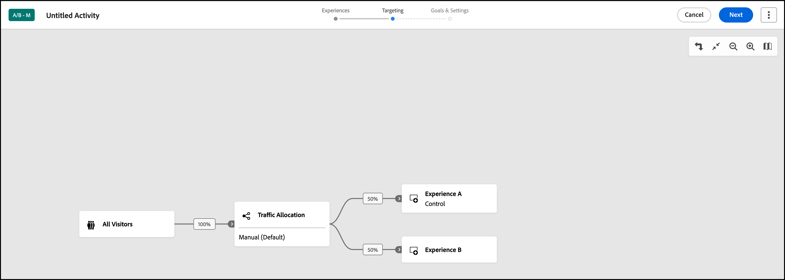

# Select audience {#select-audience}

>[!BEGINSHADEBOX]

**On this page:** Learn how to select, create, combine, view, edit, and copy the audience of an A/B activity, and how to set the percentage of visitors to include.

>[!ENDSHADEBOX]

The audience determines which qualifying visitors are entered into your [!DNL Adobe Target] activity.

The **[!UICONTROL Targeting]** step of the three-part guided workflow when [creating an activity](/help/main/c-activities/t-test-ab/t-test-create-ab/test-create-ab.md) displays a flow diagram that leads you through the steps of assigning an audience and its traffic percentage, selecting the traffic allocation method, and specifying the traffic allocation for each experience in the activity.

For more information about all the options in the flow diagram, see [Create an A/B Test activity](/help/main/c-activities/t-test-ab/t-test-create-ab/test-create-ab.md).

## Select an audience for the activity

The audience controls who sees your activity. Only visitors who match the audience can enter it, and you decide what share of those visitors take part. By default, the activity targets all visitors. 

1. Click the **[!UICONTROL All Visitors]** control to select another audience for the activity.

   **[!UICONTROL All Visitors]** is the default audience. For an A/B test without specific audience targeting, keep the default. If you select another audience, its name displays in the leftmost control.

1. Click the **[!UICONTROL Replace] icon** (  ).

    

1. In the **[!UICONTROL Add Audience]** dialog box, browse through audiences selected from the **[!UICONTROL Audience Library]**, or you can create an activity-only audience. 

    The **[!UICONTROL Audience Library]** contains audiences that have previously been defined, including some common audiences that are pre-built as a part of [!DNL Target].

    

1. Click the **[!UICONTROL Information]** icon (  ) next to an audience to view details about that audience, including its source and attributes.

    

    You can also click **[!UICONTROL View Full Details]** to view additional details about the audience. 

1. (Conditional) Click **[!UICONTROL Combine Audiences]** to [create an audience that combines multiple audiences](/help/main/c-target/combining-multiple-audiences.md).

   +++ Steps to create a new audience

   To create a new audience that is not already in the **[!UICONTROL Audience Library]**, click **[!UICONTROL Create Audience]**, define the audience, then click **[!UICONTROL Done]**.

   During the [create-audience workflow](/help/main/c-target/c-audiences/audiences.md), you can choose from the following options:

   * **[!UICONTROL Audience Library]**: Create an on-demand audience that is saved to the **[!UICONTROL Audience Library]** and can be reused in other activities.
   * **[!UICONTROL This activity only]**: Create an [activity-specific audience](/help/main/c-target/creating-activity-only-audience.md) that is not saved to the **[!UICONTROL Audience Library]** and can be used in the current activity only.

   +++
  
1. You can edit or copy an audience by clicking the **[!UICONTROL More Actions]** icon (  ) next to the desired audience.

1. After selecting your Audience, click **[!UICONTROL Assign Audience]**.

1. Click **[!UICONTROL Visitor Percentage]** in the right pane, then specify the percentage of qualifying visitors to include in the activity.

1. When you are satisfied with your audience, click **[!UICONTROL Next]** to move to the third step of the three-step guided workflow.

>[!NOTE]
>
>Audiences are automatically imported in the background when you open the **[!UICONTROL Audience]** list and the imported audiences are more than 10 minutes old.
