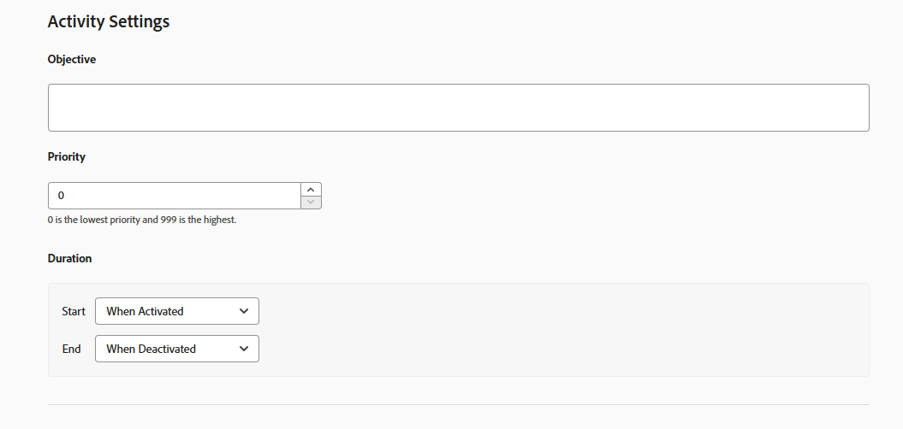

# Goals and settings {#ab-goals-and-settings}

>[!BEGINSHADEBOX]

**On this page:** Learn what you can set on the **[!UICONTROL Goals & Settings]** page of an A/B, Experience Targeting (XT), or Multivariate Test (MVT) activity: the activity settings, the reporting settings, the advanced settings, and notes.

>[!ENDSHADEBOX]

The **[!UICONTROL Goals & Settings]** page in [!DNL Adobe Target] is where you specify information about the goals of the activity.

The available settings depend on whether you use Target or [Analytics as the reporting source](/help/main/c-integrating-target-with-mac/a4t/a4t.md).

The same settings apply to [!UICONTROL Experience Targeting] (XT) and [!UICONTROL Multivariate Test] (MVT) activities, except for [Statistical Methodology](#section_statistical-methodology), which is available only for A/B activities.

* [Activity Settings](#section_DCBDC354261F420EBD4B43EA34947BAC): objective, priority, and duration
* [Reporting Settings](#section_13119392051044FBA6387D9B3B1C43CF): reporting source, goal metric, additional metrics, and audiences
* [Advanced Settings](#section_E2FE441AFB324E498793ABB025ED9974): dependencies and what happens after a visitor reaches the goal
* [Statistical Methodology](#section_statistical-methodology): how results are analyzed
* [Other Metadata](#section_2E8917BEFB954480A4206B9E9E917F80): notes

## [!UICONTROL Activity Settings] {#section_DCBDC354261F420EBD4B43EA34947BAC}

The **[!UICONTROL Activity Settings]** section of the **[!UICONTROL Goals & Settings]** page lets you configure the following options.

### Objective {#objective}

Type an optional objective. The objective can be any information that helps you and your team members identify the activity.

### Priority {#priority}

The priority is used if multiple activities are assigned to the same location with the same audience. If two or more activities are assigned to the location, the activity with the highest priority displays.

Depending on your settings, the [!DNL Target] UI and options for **[!UICONTROL Priority]** vary:

* **Legacy priorities (default):** If this option is not enabled in **[!UICONTROL Administration]** (the default), specify a priority of **[!UICONTROL Low]**, **[!UICONTROL Medium]**, or **[!UICONTROL High]**.
* **Fine-grained priorities:** Specify a value from 0 through 999, where 0 = **[!UICONTROL Low]** and 999 = **[!UICONTROL High]**. 

  To enable [fine-grained priorities](/help/main/administrating-target/reporting.md), access **[!UICONTROL Administration]** > **[!UICONTROL Reporting]**, then toggle the **[!UICONTROL Enable Fine-Grained Priorities]** option.

For activities created in previous versions of [!DNL Target], **[!UICONTROL Low]** priority is converted to 0, **[!UICONTROL Medium]** is converted to 5, and **[!UICONTROL High]** is converted to 10. You can adjust these values as necessary.

>[!NOTE]
>
>Before you can disable fine-grained priorities after using them, all priorities must be set back to 0, 5, and 10.

### Duration {#duration}

The activity can start when approved, or you can set a specific date and time. Likewise, the activity can either end when it is deactivated or you can set a date and time.

The time picker uses a 24-hour clock, with 00:00 being midnight. The time zone is set to the time zone configured in your browser. To use a different time zone, set your browser to another time zone and restart the browser.

## [!UICONTROL Reporting Settings] {#section_13119392051044FBA6387D9B3B1C43CF}

The **[!UICONTROL Reporting Settings]** section of the **[!UICONTROL Goals & Settings]** page lets you configure the following options.

### Reporting Source {#reporting-source}

Specify which solution data is collected from:

* [!DNL Adobe Target]

* +++ Analytics

  See [Adobe Analytics as the Reporting Source for Target](/help/main/c-integrating-target-with-mac/a4t/a4t.md) to learn about the differences between the reporting solutions and the advantages of each. When selecting [!DNL Analytics] as the reporting source for [!DNL Target], you select an [!DNL Analytics] report suite to receive [!DNL Target] activity data.

  To specify a reporting source, first choose from any of the [!DNL Analytics] companies your account is tied to, and then select the appropriate report suite for the activity. Only report suites that are provisioned to connect to [!DNL Adobe Target] are available for selection. If you do not see the report suites that you expect, first try logging out and logging back in to the [!DNL Adobe Experience Cloud] to try again. If the report suite is still missing from the list, contact Customer Care.

  [!DNL Analytics for Target] (A4T) requires a tracking server to report results correctly. A default tracking server displays in the **[!UICONTROL Tracking Server]** field. If you use more than one tracking server, ensure you include the correct tracking server in this field. See [Using an Analytics Tracking Server](/help/main/c-integrating-target-with-mac/a4t/analytics-tracking-server.md#task_72077BA7E93C4A65A715A18F32228823) for more information.
 +++

* +++ Customer Journey Analytics

  See [[!DNL Target] reporting in [!DNL Adobe Customer Journey Analytics]](/help/main/c-integrating-target-with-mac/cja/target-reporting-in-cja.md) for supported activity types, sandbox and data view selection, goal metrics, and reporting setup in [!DNL Customer Journey Analytics].
 +++

If a reporting source is specified in your [account settings](/help/main/administrating-target/reporting.md), the specified source is used and this setting is not visible.

You cannot change your reporting source after the activity goes live to keep reports consistent.

### Goal Metric {#goal-metric}

>[!NOTE]
>
>If the reporting solution is set to [!DNL Analytics], the only available goal metric is **[!UICONTROL Conversion]**. [!DNL Analytics] metrics cannot be selected as a goal.

Select the action taken by a visitor to achieve the goal. For example, choose a **[!UICONTROL Conversion]** metric, then set the parameters that determine when success is achieved. 

For more information about setting metrics, see [Set Metrics](/help/main/c-activities/t-test-ab/t-test-create-ab/ab-set-metrics.md).

For more options, click the **[!UICONTROL More]** icon next to the goal metric, then click **[!UICONTROL Advanced Settings]**. See [Advanced Settings](#section_E2FE441AFB324E498793ABB025ED9974).

If enabled, the **[!UICONTROL Estimated Value of the Conversion]** field provides a value for your goal, but not for other metrics. The following points apply to this field:

* The value enables [!DNL Target] to calculate an estimated lift in revenue.
* The field is optional; however, incremental revenue for any non-revenue metric cannot be calculated without it.
* The field is not available for the **[!UICONTROL Page Score]** metrics.
* For all revenue metrics (**[!UICONTROL Revenue per Visitor]**, **[!UICONTROL Average Order Value]**, **[!UICONTROL Total Sales]**, and **[!UICONTROL Orders]**), the estimate uses **[!UICONTROL Revenue per Visitor]**. The data type is currency.

### Additional Metrics {#additional-metrics}

This setting is not available if the reporting solution is set to [!DNL Analytics]. In this case, the metrics defined for the [!DNL Analytics] report suite are applied.

### Audiences for Reporting {#audiences-for-reporting}

By default, reports show results for all qualified visitors. You can add report audiences to show information about only specific audiences.

Note that this setting is not available if you choose [!DNL Analytics] as your reporting solution. The audience defined for the [!DNL Analytics] report suite is applied.

## Advanced Settings {#section_E2FE441AFB324E498793ABB025ED9974}

The **[!UICONTROL Advanced Settings]** section of the **[!UICONTROL Goals & Settings]** page lets you configure the advanced options.

To specify advanced settings, click the **[!UICONTROL More]** icon (  ) in the **[!UICONTROL My Primary Goal]** section, then click **[!UICONTROL Advanced Settings]**.

>[!NOTE]
>
>If you use [!DNL Adobe Analytics] as your reporting source, settings are managed by the [!DNL Analytics] server. The advanced settings option is not available.

### Which success metric must be reached before incrementing this metric? {#dependencies}

Use this option to only count someone as reaching the success metric if they have previously reached a different success metric. For example, an activity conversion might only be valid if the visitor clicks the offer, or reaches a particular page before converting.

You can provide dependency on multiple metrics along with the flexibility to choose whether the metric should be reached or not reached for the count to increase. Define both (or multiple) success metrics before you can make one dependent on another. The **[!UICONTROL Add Dependency]** option allows the success metric to increment if another success metric has been reached or has not been reached.

To add a dependency:

1. After adding additional metrics, click **[!UICONTROL Advanced Settings]**.

1. Click the **[!UICONTROL Add Dependency]** option.

1. Drag and drop the desired metrics, then click **[!UICONTROL Reached]** to toggle the setting between **[!UICONTROL Reached]** and **[!UICONTROL Not Reached]**.

You can edit or remove dependencies after adding them.

### What will happen after a user encounters this goal metric? {#after-goal}

After reaching the activity goal, a visitor continues to see the activity content, unless that visitor qualifies for a higher-priority activity. If the visitor reaches the goal again, it is counted as another conversion. This is different from the default behavior in [!DNL Target Classic], which counted visitors as new if they see the activity again.

There are three options for what happens after a visitor reaches the goal metric:

* **[!UICONTROL Increment Count & Keep User in Activity]** to specify how the count is incremented.
* **[!UICONTROL Increment Count, Release User & Allow Reentry]** to specify the experience the user sees if they reenter the activity.
* **[!UICONTROL Increment Count, Release User & Bar from Reentry]** to specify what the user sees instead of the activity content.

### How will the count be incremented? {#count-increment}

There are three options for how the count is incremented:

* **[!UICONTROL Once per Entrant]**
* **[!UICONTROL On Every Impression (Excluding page refreshes)]**
* **[!UICONTROL On Every Impression]**

See [Success Metrics](/help/main/c-activities/r-success-metrics/success-metrics.md#overview) for more information about advanced settings.

## Statistical Methodology {#section_statistical-methodology}

The **[!UICONTROL Statistical Methodology]** section of the **[!UICONTROL Goals & Settings]** page lets you choose how experiment results are analyzed.

### Methodology options {#methodology-options}

This choice determines the statistical framework, the result metrics, and the decision criteria used for this activity's **[!UICONTROL Conversion]** goal metric:

* **[!UICONTROL Bayesian]:** Probability-based decisioning that updates beliefs as data arrives and supports continuous monitoring and smaller sample sizes. Results are expressed as the probability that one variant is better than another, for example "92% probability that Variant B beats Control".
  * Best suited for smaller sample sizes, continuous monitoring, stakeholders who prefer probabilities, or when you have prior knowledge from past tests to apply.
  * Not ideal when you require strict regulatory or compliance sign-off, or need traditional p-values.
  * Reports show **[!UICONTROL Chance to Beat Control]** and a credible interval instead of the frequentist **[!UICONTROL Confidence]** column.
* **[!UICONTROL Welch's t-test (Frequentist)]:** The existing, traditional hypothesis-testing methodology. Uses p-values and requires a fixed sample size. Reports show a **[!UICONTROL Confidence]** percentage and confidence interval.

This setting is only available for activities whose primary goal metric is **[!UICONTROL Conversion]**. Activities with a **[!UICONTROL Revenue]** or **[!UICONTROL Engagement]** primary goal always use **[!UICONTROL Welch's t-test]**.

For more information about how each methodology is calculated and reported, see [Statistical calculations in A/Bn tests](/help/main/c-reports/statistical-methodology/statistical-calculations.md).

### Bayesian Configuration {#bayesian-configuration}

This setting is displayed only when **[!UICONTROL Bayesian]** is selected as the **[!UICONTROL Statistical Methodology]**. Configure the following options:

* **[!UICONTROL Credible Interval]**: Sets the range within which the true effect is expected to fall.
* **[!UICONTROL Decision Threshold]**: Sets the minimum probability a variant must reach, relative to **[!UICONTROL Control]**, before it can be declared a winner.
* **[!UICONTROL Use prior knowledge from past tests?]**: Toggle this option on to provide prior knowledge from past performance to inform the **[!UICONTROL Bayesian]** calculation.

## Other Metadata {#section_2E8917BEFB954480A4206B9E9E917F80}

The **[!UICONTROL Other Metadata]** section of the **[!UICONTROL Goals & Settings]** page lets you specify any information about your activity that is useful to keep on hand for yourself or other team members.
