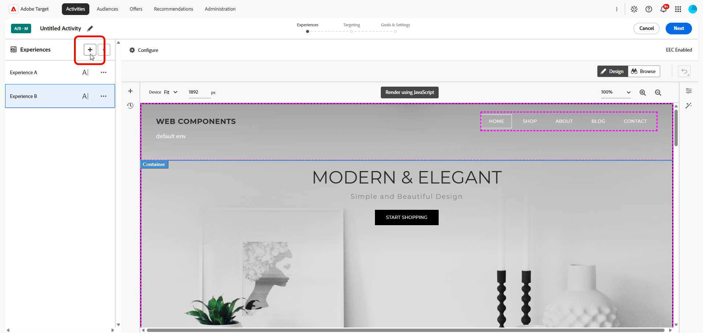
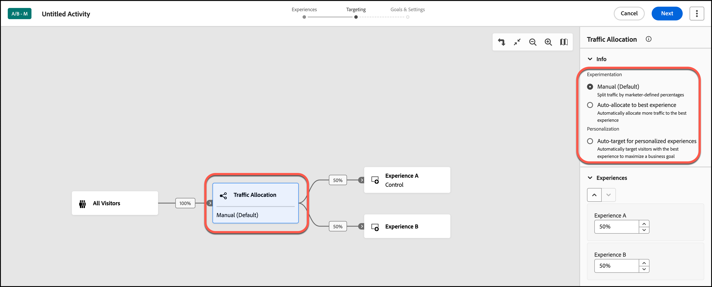

# Create an A/B Test activity {#create-ab-activity}

>[!BEGINSHADEBOX]

**On this page:** Learn how to create a manual **[!UICONTROL A/B Test]** activity in the **[!UICONTROL Visual Experience Composer]** (VEC). You build your experiences, set targeting and traffic allocation, then configure goals and settings.

>[!ENDSHADEBOX]

Leverage the **[!UICONTROL Visual Experience Composer]** (VEC) in [!DNL Adobe Target] to create **[!UICONTROL A/B Test]** activities directly on a [!DNL Target]-enabled page and to modify page sections within [!DNL Target].

>[!NOTE]
>
>In addition to the **[!UICONTROL Manual]** (Default) **[!UICONTROL A/B Test]** activity (discussed in this article), [!DNL Target] provides two additional types of **[!UICONTROL A/B Test]** activities: **[!UICONTROL Auto-Allocate]** and **[!UICONTROL Auto-Target]**.
>
>See [Types of A/B Testing activities](/help/main/c-activities/t-test-ab/test-ab.md#types) in *A/B Test overview*.

The activity follows the three-step guided workflow in the VEC:

1. [Build experiences](#build-experiences)
1. [Set targeting and traffic allocation](#set-targeting)
1. [Configure goals and settings](#configure-goals-and-settings)

## Step 1: Build experiences {#build-experiences}

Create the activity, then design the alternate experiences that you want to test against the control.

### Create the activity {#create-activity}

Open the page that you want to test in the **[!UICONTROL Visual Experience Composer]** and name the activity.

1. From the **[!UICONTROL Activities]** list, click **[!UICONTROL Create Activity]** > **[!UICONTROL A/B Test]**.

   

1. From the **[!UICONTROL Create A/B Test Activity]** dialog, choose your Experience Composer:

    * **[!UICONTROL Visual]**.
    * **[!UICONTROL Form-Based Experience Composer]**, see [Form-Based Experience Composer](/help/main/c-experiences/form-experience-composer.md) for more information.

   >[!NOTE]
   >
   >In addition to the VEC and **[!UICONTROL Form-Based Experience Composer]**, [!DNL Target] offers the **[!UICONTROL Single Page Application]** VEC. For more information about the various composers, see [Experiences and Offers](/help/main/c-experiences/experiences.md).
   >
   >For troubleshooting information about the VEC, see [Troubleshooting the Visual Experience Composer](/help/main/c-experiences/c-visual-experience-composer/r-troubleshoot-composer/troubleshoot-composer.md).

1. (Conditional) If you are a [Target Premium customer](/help/main/c-intro/intro.md#premium), from the **[!UICONTROL Choose Workspace]** drop-down list, choose a [workspace](/help/main/administrating-target/c-user-management/property-channel/property-channel.md).

1. In the **[!UICONTROL Enter Activity URL]** box, specify your [activity URL](/help/main/c-activities/t-test-ab/t-test-create-ab/ab-activity-url.md).

   If your account is [configured with a default URL](/help/main/administrating-target/visual-experience-composer-set-up.md), that URL appears by default. You can change from the default to another URL if necessary.

1. Click **[!UICONTROL Create]**. The **[!UICONTROL Visual Experience Composer]** opens, showing the page specified in the URL.

1. To name the activity, click the **[!UICONTROL Edit]** icon (  ) and specify a descriptive name for the activity, and then click **[!UICONTROL Save]**.

   {{activity-name-rules}}

    

### Design the experiences {#design-experiences}

Create new experiences by changing the elements on the page.

After you create a new activity, the **[!UICONTROL Visual Experience Composer]** displays two tabs on the left side: Experience A and Experience B.

* **Experience A** is the control experience. You can delete it if you do not want to include a default site experience as an option.
* **Experience B** is the alternate experience that you add to your test. Your focus is on this tab, which you can modify as desired.

To add more experiences to the test, click the **[!UICONTROL Add]** icon (  ).

For more information about adding and modifying experiences in the **[!UICONTROL Visual Experience Composer]**, see [Add Experience](/help/main/c-activities/t-test-ab/t-test-create-ab/ab-add-experience.md#ab-add-experience). 

## Step 2: Set targeting and traffic allocation {#set-targeting}

After accessing the **[!UICONTROL Targeting]** menu, the flow diagram opens.

The flow diagram leads you through assigning an audience and its traffic percentage, selecting the traffic allocation method, and specifying the traffic allocation for each experience in the activity.

1. (Conditional) Click the **[!UICONTROL All Visitors]** control to select another audience for the activity.

   The **[!UICONTROL All Visitors]** audience is set as the default. If you select another audience, its name displays in the leftmost control. For example, you might limit entries to 50% of all visitors or 45% of your "Californians" audience.

   +++ Steps to select a different audience

   The right frame displays, which lets you add or delete an audience and assign the visitor percentage for the activity.

   1. To change the audience, click the **[!UICONTROL Replace]** icon (  ) in the right frame.
   1. In the **[!UICONTROL Add Audience]** dialog box, [select the desired audience](/help/main/c-activities/t-test-ab/t-test-create-ab/ab-audience.md), then click **[!UICONTROL Assign Audience]**.

      To create an audience that combines several audiences, click **[!UICONTROL Combine Audiences]**. For details, see [Combine multiple audiences](/help/main/c-target/combining-multiple-audiences.md).

      To create a new audience that is not already in the **[!UICONTROL Audience Library]**, click **[!UICONTROL Create Audience]**. In the [create-audience workflow](/help/main/c-target/c-audiences/audiences.md), choose one of the following options:

      * **[!UICONTROL Audience Library]**: Create an on-demand audience that is saved to the **[!UICONTROL Audience Library]** and can be reused in other activities.
      * **[!UICONTROL This activity only]**: Create an [activity-specific audience](/help/main/c-target/creating-activity-only-audience.md) that is not saved to the **[!UICONTROL Audience Library]** and can be used in the current activity only.

   1. Click **[!UICONTROL Visitor Percentage]** in the right frame, then choose the percentage of qualifying visitors that you want to enter the activity.

   +++

1. Click the **[!UICONTROL Traffic Allocation]** control, then choose a traffic allocation method in the right pane. See [Traffic allocation methods](#traffic-allocation-methods).

   

    +++Traffic allocation options

      |Method|What it does|
      |---|---|
      |**[!UICONTROL Manual (Default)]**|Specify the percentage of entrants that you want to see each experience. You can split the percentages evenly between all experiences, or specify higher or lower percentages for each experience. The total for all experiences must equal 100%.|
      |**[!UICONTROL Auto-Allocate to best experience]**|Most activity entrants are automatically directed to higher-performing experiences. Some visitors are allocated to all experiences, to maintain exploration of experiences and to recognize changes in performance trends. For more information, see [**[!UICONTROL Auto-Allocate]** overview](/help/main/c-activities/automated-traffic-allocation/automated-traffic-allocation.md#concept_A1407678796B4C569E94CBA8A9F7F5D4).|
      |**[!UICONTROL Auto-Target for personalized experiences]**|[!DNL Target] uses advanced machine learning to personalize content and drive conversions by identifying multiple high-performing, marketer-defined experiences, and then serving the most tailored experience to visitors based on their individual customer profiles and past behaviors of similar visitors. For more information, see [Auto-Target overview](/help/main/c-activities/auto-target/auto-target-to-optimize.md).|

    +++

1. Click **[!UICONTROL Experiences]** in the right pane, then specify the desired traffic allocation for each experience.

1. When you are satisfied with your audience, experience choices, and traffic allocation choices, click **[!UICONTROL Next]** to move to the third step of the three-step guided workflow.

## Step 3: Configure goals and settings {#configure-goals-and-settings}

On the **[!UICONTROL Goals & Settings]** page, you tell [!DNL Target] how to measure the activity. The available settings depend on whether you use [!DNL Target] or [Analytics as the reporting source](/help/main/c-integrating-target-with-mac/a4t/a4t.md).

1. Review the sections of the page and set what you need. See [What you set on the Goals & Settings page](#goals-settings-overview).

    |Section|What you set|
    |---|---|
    |**[!UICONTROL Activity Settings]**|An optional objective, the **[!UICONTROL Priority]** (used when several activities share a location and an audience), and the **[!UICONTROL Duration]** (start and end dates).|
    |**[!UICONTROL Reporting Settings]**|The reporting source, the goal metric (for example, a **[!UICONTROL Conversion]** metric), additional metrics, audiences for reporting, and the statistical methodology.|
    |**[!UICONTROL Advanced Settings]**|Dependencies between success metrics, what happens after a visitor reaches the goal metric, and how the count is incremented.|
    |**[!UICONTROL Other Metadata]**|Notes about the activity that are useful for you or for other team members.|

1. Click **[!UICONTROL Save & Close]** or **[!UICONTROL Save]**.

After you create the activity, the **[!UICONTROL Overview]** tab shows information about the activity, including a diagram of your activity.
