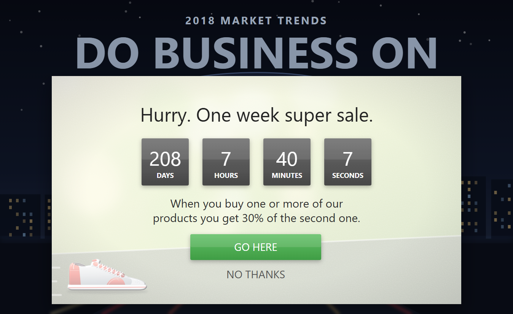

# Experience Templates {#experience-templates}

>[!BEGINSHADEBOX]

**On this page:** Find the [!DNL Adobe Target] Experience Templates that are available for use in custom code, and what each template is commonly used for.

>[!ENDSHADEBOX]

[!DNL Adobe Target] Experience Templates are pre-coded samples with configurable inputs, used to execute common marketer use cases. They are provided free to developers and marketers as a starting point to execute common use cases, either through the VEC or the Form-based Experience Composer.

The following templates are currently available on the Adobe Marketing Cloud GitHub: [Target-Experience-Templates](https://github.com/Adobe-Marketing-Cloud/target-experience-templates).

## Banner Carousel with Thumbnails {#banner-carousel-thumbnails}

The [Banner Carousel with Thumbnails experience template](https://github.com/Adobe-Marketing-Cloud/target-experience-templates/tree/master/banner-carousel-thumbnails) is a rotating carousel, commonly used on home pages and landing pages or other high-volume entry pages. This carousel does not rotate automatically through the images. It can be interacted with directly by clicking the smaller images below the primary image.

## Banner Carousel {#banner-carousel}

The [Banner Carousel experience template](https://github.com/Adobe-Marketing-Cloud/target-experience-templates/tree/master/banner-carousel) is a rotating carousel, commonly used on home pages and landing pages or other high-volume entry pages. This carousel does not rotate automatically through the images. It can be interacted with directly by clicking the left and right arrows.

## Banner Countdown {#banner-countdown}

The [Banner Countdown experience template](https://github.com/Adobe-Marketing-Cloud/target-experience-templates/tree/master/banner-countdown) is a large banner with a central countdown, commonly used on home pages and landing pages or other high-volume entry pages.

## Button Builder {#button-builder}

The [Button Builder experience template](https://github.com/Adobe-Marketing-Cloud/target-experience-templates/tree/master/button) is a small button with a text call to action. The button is configurable. It can be placed anywhere on the page to add a new call to action, or to replace an existing button with a more configurable alternative.

## Lightbox with Countdown {#lightbox-countdown}

The [Lightbox with Countdown experience template](https://github.com/Adobe-Marketing-Cloud/target-experience-templates/tree/master/lightbox-countdown) is a lightbox overlay popup with a central countdown, commonly used on home pages and landing pages or other high-volume entry pages.

## Lightbox with Exit Intent {#lightbox-exit-intent}

The [Lightbox with Exit Intent experience template](https://github.com/Adobe-Marketing-Cloud/target-experience-templates/tree/master/lightbox-exit-intent) is a lightbox overlay popup that is triggered on exit intent (moving the mouse to the top right of the screen). It can be deployed on any web property where a last chance to capture attention is wanted.

## Lightbox {#lightbox}

The [Lightbox experience template](https://github.com/Adobe-Marketing-Cloud/target-experience-templates) is a lightbox overlay popup with a built-in delay, commonly used on home pages and landing pages or other high-volume entry pages.

## Ribbon {#ribbon}

The [Ribbon experience template](https://github.com/Adobe-Marketing-Cloud/target-experience-templates/tree/master/ribbon) is a 100% width ribbon that is inserted at the very top of the web page. It is typically used to indicate a flash sale, free shipping, a safety or weather event, or another important announcement.

 
