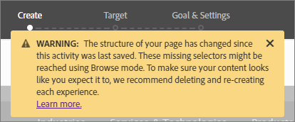

# Get started with modifications {#vec-code-editor}

>[!BEGINSHADEBOX]

**On this page:** Learn how to view, edit, delete, and add modifications in the **[!UICONTROL Modifications]** panel of the [!UICONTROL Visual Experience Composer] (VEC), and how to use custom code.

>[!ENDSHADEBOX]

The **[!UICONTROL Modifications]** panel in [!DNL Adobe Target] shows all changes that have been made to the page in the [!UICONTROL Visual Experience Composer] (VEC), and allows additional changes by clicking each element on the page and [selecting an action](/help/main/c-experiences/c-visual-experience-composer/viztarget-options.md). Each change appears as a separate action or element in the **[!UICONTROL Modifications]** list. Modifications can also be added directly, of the following types: CSS Selector, Mbox, and Custom Code.

## Modifications overview {#modifications-overview}

The **[!UICONTROL Modifications]** page makes small changes to the selector that [!DNL Target] chooses when the VEC configures how content is delivered. Either the content or an HTML attribute can be changed. The code can also be edited to create the equivalent of an HTML offer within an mbox.


The **[!UICONTROL Modifications]** page can be used to:

* View an action taken in the visual composer.

  

* Edit an existing action. Access the advanced menu and select **[!UICONTROL Edit]**.

  

  Make the changes.

  

* Delete an existing action. Access the advanced menu and select **[!UICONTROL Delete modification]**.

  

* Add a new modification. Access the **[!UICONTROL Modifications]** menu advanced menu and select **[!UICONTROL Add a modification]**, then specify the changes as described in [Add modifications](#add-modifications).

  

## Add modifications {#add-modifications}

Modifications are added from the **[!UICONTROL Modifications]** panel for the experience that is selected in the VEC.

1. To display the **[!UICONTROL Modifications]**, click **[!UICONTROL Show Modifications]**.

   

   To open the **[!UICONTROL Modifications]** panel in the Form-based Experience Composer, create or edit an HTML offer. For more information, see [Form-Based Experience Composer](/help/main/c-experiences/form-experience-composer.md).

1. To add a modification:

    * If no previous modifications for the experience have been made, click **[!UICONTROL Add Modification]** from the **[!UICONTROL Modifications]** panel.
    * If there are previous modifications for the experience, access the **[!UICONTROL Modifications]** menu advanced menu and select **[!UICONTROL Add a modification]**.

   The **[!UICONTROL Modifications]** panel displays:

   

1. From the **[!UICONTROL Modification Type]** drop-down list, choose the desired type:

    | Modification Type | Details |
    |--- |--- |
    |CSS Selector|In the **[!UICONTROL CSS Element Selector]** box, specify the CSS element to modify, select an action type (**[!UICONTROL Set Content]** or **[!UICONTROL Set Attribute]**), then fill in the required information and the desired content.|
    |Mbox|Specify the mbox name and the desired content.|
    |Custom Code|Specify an optional name, select or deselect the **[!UICONTROL Add Code in the `<HEAD>` Section]** check box, as desired, then add the custom code. For more information, see [Custom code](#custom-code).|

   >[!NOTE]
   >
   >Mboxes are no longer supported in the VEC in pages that use at.js 2.*x*. As workarounds:
   >
   >* If using at.js 2.*x*, add a CSS Selector modification instead of an Mbox modification, and add the content on the selector that the mbox was using.
   >* Use form-based activities (works with mboxes and at.js 1.*x* and at.js 2.*x*).
   >* Use at.js 1.*x* in the VEC.

1. Add additional modifications as necessary.

## Custom code {#custom-code}

Custom code provides a non-visual interface to view, edit, and add new actions within the VEC, the Form-based Experience Composer, and the HTML offers editor. The panel provides a code view of an experience, to help build more complex experiences, fine-tune existing experiences, and troubleshoot issues.

Custom code is intended for advanced users who are comfortable with HTML, JavaScript, and CSS. The code view can help tweak or fine-tune changes, or fix selector issues. It can also be used to add new custom code and actions. More than one custom code can be added, and each one can optionally be named.


Custom code behaves as follows:

* When **[!UICONTROL Add Code in the `<HEAD>` Section]** is selected, custom code is added to the `<head>` section, and its execution does not wait for body or page-load events. Add only `<script>` and `<style>` elements. Adding `<div>` tags and other elements might cause remaining `<head>` elements to pop into the `<body>`. If at.js is used, all offers deliver asynchronously.
* When **[!UICONTROL Add Code in the `<HEAD>` Section]** is deselected, custom code executes immediately following the `<body>` tag. Wrap all code in a single `<div>` to preserve the DOM structure. If at.js is used, all offers deliver asynchronously.
* If the HTML for `<BODY>` contains `<SCRIPT>` and `<DIV>`, then `<DIV>` is appended to `<BODY>` and `<SCRIPT>` is executed in `<HEAD>`. A `<SCRIPT>` that loads an external file is also appended to `<HEAD>`.
* Scripts are run asynchronously. This means that `document.write` and similar script methods cannot be used.
* Custom code is currently available for A/B and Experience Targeting (XT) activities only. Custom code is disabled for overlay and if a redirect offer is applied.

Custom code supports the following use cases:

* Add custom JavaScript, HTML, or CSS to be executed at the top of the page
* View or edit the code generated by the VEC after making modifications
* Set HTML content for a selector (CSS selectors only)
* Set an attribute on an HTML element
* Add offer content to be delivered in a regional mbox
* Swap on DOM-ready, using jQuery
* Swap on DOM-ready, no jQuery (does not support Internet Explorer 8)
* Swap with DOM-polling through the "elementOnLoad" plugin
* Custom redirect

Custom code provides:

* Line numbers for better usability.
* Syntax highlighting to help avoid incorrect syntax for HTML offers.
* The ability to create multiple custom codes and provide an optional name for each. Creating multiple custom codes makes future debugging easier. For example, instead of creating a single custom code to accomplish several modifications, a separate custom code can be created for each modification, with a descriptive name. Separate custom codes make the modifications more modular and manageable. The execution of multiple custom codes in an activity is not guaranteed to happen in the sequence in which they were created.

The **[!UICONTROL Modifications]** panel splits the screen between the visual mode and the code mode. Both modes remain in sync. Every modification made visually has a corresponding row in the code view. Similarly, every change that is committed in the code view displays in the visual experience. Clicking any row in the code view selects the corresponding element on the visual page.

Custom code supports HTML, scripts, and styles. Any valid HTML code or script can be added or edited.

## Custom code examples {#custom-code-examples}

The **[!UICONTROL Custom Code]** panel contains code that is executed at the beginning of the page load. The JavaScript code can be executed in the `<head>` tag. Execution of the code does not wait for the `<body>` tag to be present in the DOM. Selectors for subsequent visual actions depend on the HTML elements added in this tab.

The **[!UICONTROL Custom Code]** panel is commonly used to add JavaScript or CSS to the top of the page.

Use the **[!UICONTROL Custom Code]** tab to:

* Use JavaScript inline or link to an external JavaScript file

  For example, to change the color of an element:

  ```javascript
  <script type="text/javascript"> 
  document.getElementById("element_id").style.color = "blue"; 
  </script> 
  ```

* Configure a style inline or link to an external stylesheet

  For example, to define a class for an overlay element:

  ```html
  <style> 
  .overlay 
  { position: absolute; top:0; left: 0; right: 0; bottom: 0; background: red; } 
  </style> 
  ```

* Add HTML snippets to define new elements

  For example, use the following HTML snippet to create an overlay `<div>` that uses the CSS class defined above:

  ```html
  <div class="overlay"></div>
  ```

* Swap on DOM-ready, using jQuery

  The following example assumes that the website of the customer has jQuery available on the page when [!DNL Target] executes the offers.

  ```javascript
  <style>#default_content {visibility:hidden;}</style> 
  <script> 
  jQuery( document ).ready(function() { 
      jQuery("#default_content").html( "<span style='color:red'>Hello <strong>Again</strong></span>" ); 
      jQuery("#default_content").css("visibility","visible"); 
  }); 
  </script> 
  ```

* Swap on DOM-ready, no jQuery (does not support Internet Explorer 8)

  ```javascript
  <style>#default_content {visibility:hidden;}</style> 
  <script> 
  document.addEventListener("DOMContentLoaded", function(event) {  
      document.getElementById("default_content").innerHTML = "<span style='color:red'>Hello <strong>Again</strong></span>"; 
      document.getElementById("default_content").style.visibility="visible"; 
  }); 
  </script> 
  ```

* Custom redirect that passes existing parameters, the `s_tnt` parameter (for the legacy integration with Analytics), the referrer parameter, and the mbox session

  ```javascript
  <style type="text/css">body{display:none!important;}</style> 
  <script type="text/javascript"> 
   var qs='';window.location.search?qs=window.location.search+'&':qs='?'; 
   window.location.replace('//www.mywebsite.com/'+qs+'s_tnt=${campaign.id}:${campaign.recipe.id}:${campaign.recipe.trafficType}&s_tntref='+encodeURIComponent(document.referrer)+'&mboxSession='+mboxFactoryDefault.getSessionId().getId()+''+window.location.hash+''); 
  </script> 
  ```

* Add [!DNL Adobe Target] Experience Templates for use in custom code

  Experience Templates are pre-coded samples with configurable inputs, used to execute common marketer use cases. They are provided free to developers and marketers as a starting point to execute common use cases, either through the VEC or the Form-based Experience Composer. Use cases include lightboxes, carousels, countdowns, and more. For more information, see [Experience Templates](/help/main/c-experiences/c-visual-experience-composer/c-vec-code-editor/experience-templates.md).

## Custom code best practices {#custom-code-best-practices}

* **Always wrap the custom code in one element.**

  For example:

```html
<div id="custom-code"> 
// My Code goes here 
</div>
```

  If modifications are needed, make the changes inside this container. If the custom code is no longer needed, leave this container empty, but do not remove it. This ensures that other experience modifications are not affected.

* **Do not use the element ID "CDQID" for modifications to the page made in the Code Editor.**

  [!DNL Target] applies a new element ID with the value "CDQID" to any element on the page that is modified by [!DNL Target]. This ID is applied by [!DNL Target], so it should not be used for any further modifications or adjustments in the Code Editor.

* **Do not perform `document.write` actions in custom code scripts.**

  Scripts are executed asynchronously. This often causes `document.write` actions to appear in the wrong place on the page. Using `document.write` in scripts created in custom code is not recommended.

* **If an element is created and then modified, do not delete the original element.**

  Each change creates a new element in the **[!UICONTROL Modifications]** panel. The second action modifies Element 1, so if Element 1 is deleted, that action no longer has anything to modify, and the change no longer works. See [Troubleshooting custom code](#troubleshooting-custom-code) for more information.

* **Be careful when using the custom code feature for two activities that target the same URL.**

  When the custom code feature is used for two activities that target the same URL, the JavaScript is injected into the page from both activities. [!DNL Target] automatically determines the order of delivered content. Make sure that the code does not depend on placement. The author of the code is responsible for making sure that there are no conflicts in the code.

## Troubleshooting custom code {#troubleshooting-custom-code}

+++ Why is custom code not executed when using `triggerView`?

Custom Code offers in the VEC are not re-rendered when `triggerView()` is called with `{page: false}` as the option.

+++

+++ What does the warning that an action cannot be applied due to structural changes in a page mean?

This message indicates that the structure of the page has changed since the activity was last saved.



The missing selectors might be reached using Browse mode. Adobe recommends deleting and then re-creating each experience to ensure that the content looks as expected, as indicated in the warning message.

+++

+++ What does the warning "Deleting this action may impact subsequent actions" mean?

For example, two actions might have been taken:

* Added a class to Element 1
* Edited the HTML for Element 1

Each change creates a new element in the **[!UICONTROL Modifications]** panel. The second action modifies Element 1, so if Element 1 is deleted, the second action no longer has anything to modify, and the change no longer works.

In other words, if an element is added with text, and the element is then edited with different text in a separate action, the **[!UICONTROL Modifications]** panel shows both actions as separate elements. Editing the element creates a new element that modifies the original one and contains the edited text. If the original element is then deleted, the edited text cannot find the element that was edited, and does not display. The second element remains in the list of elements, but it does not affect the page, because the element it changes no longer exists.

+++

+++ Why does an element created with `document.write` in a script not appear where expected?

Scripts are executed asynchronously. This often causes `document.write` actions to appear in the wrong place on the page. Adobe does not recommend using `document.write` in scripts created in the custom code.

+++

+++ Why does the JavaScript display errors in the custom code?

Any inline JavaScript that is not valid JavaScript shows errors in the custom code.

+++

+++ Why can a change in the custom code not be undone?

Currently, undo is not supported for edit and delete actions from the **[!UICONTROL Modifications]** panel and in custom code. Undoing one of these operations could cause the experience in the VEC to appear inconsistent with the actual actions visible in the custom code. However, the actions in the custom code are in the correct state, and there is no impact on delivery. This is a UI issue. To refresh the experience, save it and open it again, or go to the next step and come back. Either of these actions reloads the experience, so it appears as expected and is consistent with the actions in the **[!UICONTROL Modifications]** panel.

+++

+++ Why does custom code not produce the expected results in Internet Explorer 8?

[!DNL Target] no longer supports Internet Explorer 8. 

+++
