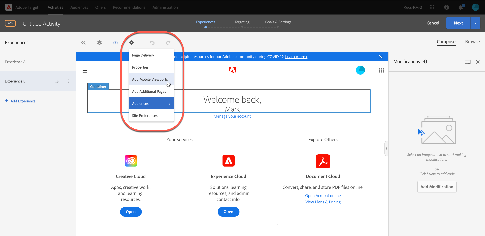
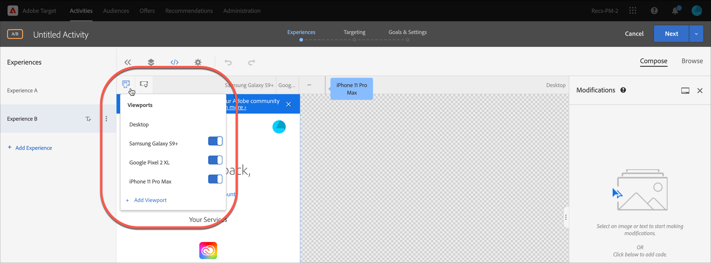
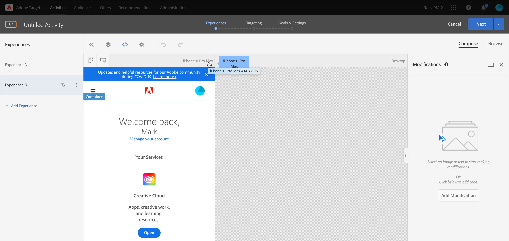
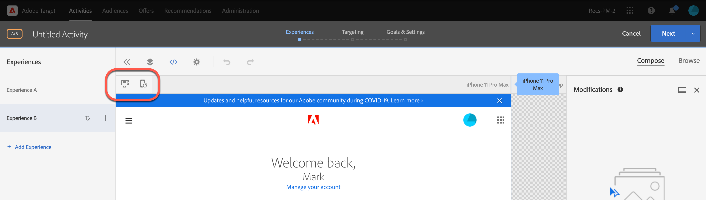

# Mobile viewports for responsive experiences {#mobile-viewports}

>[!BEGINSHADEBOX]

**On this page:** Learn how to configure mobile viewports and use them to preview and build experiences for screens of various sizes.

>[!ENDSHADEBOX]

Mobile viewports display [!DNL Adobe Target] activities at the screen sizes of various devices. They are designed for responsive sites, which adapt automatically to desktops, laptops, tablets, and mobile phones, and they make it possible to check that an experience renders well on each of them.

>[!NOTE]
>
> * Use mobile viewports when the site is responsive and the mobile page reuses the elements of the desktop page in a different layout. When the mobile site is separate and has its own structure, such as `m.mysite.com`, use a [multipage activity](/help/main/c-experiences/c-visual-experience-composer/multipage-activity.md#multipage-activity) instead.
>
>* Mobile viewports are not available when a redirect offer overlay overlaps them.

## Viewports and CSS breakpoints

A viewport is the area of the screen that a web page fills: the size of the browser window, minus the scroll bars and toolbars. Browsers measure it in CSS pixels, so on many devices, such as those with retina screens, the viewport is smaller than the advertised device resolution. Always use the viewport size in [!DNL Target]. The following table lists both values for popular devices.

+++ Viewports and resolutions of popular devices

>[!NOTE]
>
>Various websites list viewport sizes for popular devices. For example, see `https://viewportsizer.com/devices/`. Consult the device maker's website for the most accurate, up-to-date information.
>
>Viewport sizes marked "est." are estimates.

|Device|Viewport Size (width x height)|Device Resolution (width x height)|
|---|---|---|
|iPhone 18 Pro Max|440 x 956|1320 x 2868|
|iPhone 18 Pro|402 x 874|1206 x 2622|
|iPhone 17 Pro Max|440 x 956|1320 x 2868|
|iPhone 17 Pro|402 x 874|1206 x 2622|
|iPhone Air|420 x 912|1260 x 2736|
|iPhone 17|402 x 874|1206 x 2622|
|iPhone 16e|390 x 844|1170 x 2532|
|iPad (A16)|820 x 1180|1640 x 2360|
|iPad mini (A17 Pro)|744 x 1133|1488 x 2266|
|iPad Air 11″ (M3 / M4)|820 x 1180|1640 x 2360|
|iPad Pro 11″ (M5)|834 x 1210|1668 x 2420|
|Google Pixel 11|412 x 924 (est.)|1080 x 2424|
|Google Pixel 11 Pro|410 x 914 (est.)|1280 x 2856|
|Google Pixel 11 Pro XL|448 x 997 (est.)|1344 x 2992|
|Google Pixel 10|412 x 924|1080 x 2424|
|Google Pixel 10 Pro|410 x 914 (est.)|1280 x 2856|
|Google Pixel 10 Pro XL|448 x 997 (est.)|1344 x 2992|
|Samsung Galaxy S26|360 x 780|1080 x 2340|
|Samsung Galaxy S26 Ultra|412 x 891|1440 x 3120|
|iPhone Duo (unfolded)|890 x 626 (est.)|2670 x 1878|
|iPhone Duo (folded)|466 x 678 (est.)|1398 x 2034|
|Samsung Galaxy Z Fold 7 (folded)|412 x 960 (est.)|1080 x 2520|
|Samsung Galaxy Z Flip 8|360 x 840 (est.)|1080 x 2520|
|Google Pixel 11 Pro Fold (unfolded)|791 x 820 (est.)|2076 x 2152|

+++

A responsive site switches to a different layout at specific screen sizes. These sizes are called CSS breakpoints, or [media queries](https://developer.mozilla.org/en-US/docs/Web/CSS/Media_Queries/Using_media_queries). Saving the CSS breakpoints of the site in [!DNL Target] makes it possible to preview each view, and clicking a viewport along the top of the display opens the view for that screen size.

To deliver an activity to a particular device, select the audience for that device in the activity diagram, then edit the page for that device in the Mobile Web Composer. The same tool is used to view a site that is not responsive when the activity targets a specific device. To run an activity on all devices, apply no targeting and preview the activity at each screen size with mobile viewports.

>[!IMPORTANT]
>
>Experiences can be edited from within mobile viewports, but the changes apply to all viewports and devices, not only to the viewport in use. In the same way, editing an experience in the desktop view changes the page for all screen sizes. [!DNL Target] does not currently support viewport-specific page changes.

## Mobile viewport configuration {#task_B4B161499DC0470584ED922A4D20FCAB}

Define the mobile viewports that are available when creating experiences.

1. Click **[!UICONTROL Administration]** > **[!UICONTROL Visual Experience Composer]**.
1. In the **[!UICONTROL Mobile viewports configuration]** section, click **[!UICONTROL Add]**.

   

   Or

   To change the configuration of an existing mobile viewport, select that viewport, then click the **[!UICONTROL Edit]** (pencil) icon.

1. Type a descriptive name for the mobile viewport. The name can be up to 36 characters long.
1. Enter the screen size of the mobile device. The width can be 150 to 968 pixels and the height can be 150 to 1280 pixels.
1. (Optional) Select the operating system of the device.

   Options:

   * Android
   * iOS
   * Windows
   * Symbian
   * Blackberry

   If the [Enhanced Experience Composer](/help/main/c-experiences/c-visual-experience-composer/experience-composer-best-practices.md#enable-eec) is enabled and an operating system is selected, [!DNL Target] emulates that device when the page is viewed. For example, if the responsive site has a different look and feel for Android than for iOS, [!DNL Target] mimics that behavior.

1. Click **[!UICONTROL Save]**.

>[!NOTE]
>
>Attempting to delete a mobile viewport that is in use displays the following message: "This viewport is currently associated to one or multiple activities. You need to remove the viewport from those activities before being able to delete it."

## Create a responsive experience {#task_D6332438B5EE48CCA8AF199270F1CAEF}

Add mobile viewports to [!DNL Target] activities to create responsive experiences for mobile screens.

1. Create the [desired activity](/help/main/c-activities/activities.md).
1. In the **[!UICONTROL Visual Experience Composer]** (VEC), click the **[!UICONTROL Settings]** gear icon, then select **[!UICONTROL Add Mobile Viewports]**.

   

1. Click the **[!UICONTROL Devices]** icon, then enable each device that should have a mobile viewport.

   

   The mobile viewports are listed from smallest to largest according to width.

1. Edit the experience in the mobile viewports as needed. Any change applies to the experience on all devices, for example a change to the text of a heading. Hover over the name of a viewport to see the size of the viewport.

   

1. (Optional) Toggle between portrait and landscape modes by clicking the orientation icon.

   

## Training videos

The following videos contain more information about mobile viewports.

### Visual Experience Composer (2 of 2) (7:29) 

The following demo video includes information about using the Visual Experience Composer to work with mobile viewports:

* Rename and duplicate an experience
* Create a redirect experience
* Target an activity to a single URL or a group of URLs
* Create a multi-page activity
* Preview and build experience for responsive websites
* Use overlays to highlight types of elements

>[!VIDEO](https://video.tv.adobe.com/v/17401)

### Account Preferences in Adobe Target 

This video includes information about setting up mobile viewports, beginning at 4:40 in the video.

>[!VIDEO](https://video.tv.adobe.com/v/17379)
