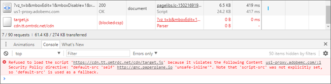
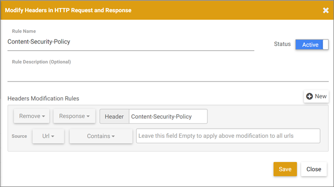

# Troubleshooting issues related to the [!DNL Adobe Target] [!UICONTROL Visual Experience Composer] and [!UICONTROL Enhanced Experience Composer] {#vec-eec-issues}

>[!BEGINSHADEBOX]

**On this page:** Learn how to resolve the issues that affect both the **[!UICONTROL Visual Experience Composer]** (VEC) and the **[!UICONTROL Enhanced Experience Composer]** (EEC).

>[!ENDSHADEBOX]

Display problems and other issues sometimes occur in the [!DNL Target] **[!UICONTROL Visual Experience Composer]** (VEC) and the **[!UICONTROL Enhanced Experience Composer]** (EEC) under certain conditions. The following items describe the issues that affect both composers and how to resolve them.

## Browser and security

### Google Chrome SameSite cookie policies {#samesite}

The SameSite cookie enforcement policies of [!DNL Google Chrome] affect the VEC and EEC in the following releases.

>[!NOTE]
>
>The following change applies to all three releases. The VEC cannot be used on password-protected pages of the site unless the [VEC Helper extension](/help/main/c-experiences/c-visual-experience-composer/r-troubleshoot-composer/visual-editing-helper-extension.md) is installed and enabled. The login cookies of the site are considered third-party cookies, so they are not sent with login requests inside the VEC editor in **[!UICONTROL Browse]** mode. The only exception is when the login cookies already have the `SameSite=None` and `Secure` attributes set.

* **Chrome 94 (September 21, 2021):** For all users with Chrome 94 and later, the command-line flag `--disable-features=SameSiteByDefaultCookies,CookiesWithoutSameSiteMustBeSecure` has been removed.
* **Chrome 91 (May 25, 2021):** For all users with Chrome 91 and later, the flags `#same-site-by-default-cookies` and `#cookies-without-same-site-must-be-secure` have been removed from `chrome://flags`. This behavior is now enabled by default.
* **Chrome 80 (August 2020):** For all users with Chrome 80 and later:

  * [!DNL Target] libraries cannot be downloaded while an activity is edited if they are not already on the site. The download call is made from the customer domain to a secured [!DNL Adobe] domain and is rejected as unauthenticated.
  * The EEC does not function, because it cannot set the SameSite attribute for cookies on the `adobemc.com` domain. Without this attribute, the browser rejects these cookies, causing the EEC to fail.

+++ Determine which cookies are blocked

To determine which cookies are blocked by the SameSite cookie enforcement policies, use the [!DNL Developer Tools] in [!DNL Chrome].

1. While viewing the VEC in [!DNL Chrome], click the **[!UICONTROL ellipsis]** icon at the top-right corner of Chrome > **[!UICONTROL More Tools]** > **[!UICONTROL Developer Tools]**.
1. Click the **[!UICONTROL Network]** tab, then look for blocked cookies.

   >[!NOTE]
   >
   >Use the **[!UICONTROL Has blocked cookies]** check box to make blocked cookies easier to find.

+++

+++ Content Security Policy (CSP) headers block the [!DNL Target] libraries on the website

If the CSP headers of the website block the [!DNL Target] libraries, the website loads but editing is prevented. Make sure that the [!DNL Target] libraries are not blocked.

>[!NOTE]
>
>In addition to the following information, the [Adobe Target VEC Helper browser extension](/help/main/c-experiences/c-visual-experience-composer/r-troubleshoot-composer/vec-helper-browser-extension.md) for [!DNL Google Chrome] can be used.

As a workaround, configure a [!DNL Requestly] rule to remove the CSP headers, as shown in the following illustration.

A similar [!DNL Requestly] rule can be configured for any header that causes a resource to not load inside the VEC. Whenever headers need to be removed with [!DNL Requestly], do one of the following:

* Add URL rules for the URL to open in the VEC, so that headers are removed for those URLs only.
* Enable the rule while editing in the VEC and disable the rule when the VEC is not in use.

+++

+++ Multi-level iframes are not supported

[!DNL Target] does not support multi-level iframes. If the website loads an iframe that has a child iframe, at.js interacts with the parent iframe only. [!DNL Target] libraries do not interact with the child iframe.

As a workaround, add a page in the experience with the URL of the child iframe.

+++

+++ Experiences cannot be edited on an iFrame-busting site or on pages without the [!DNL Target] implementation

Enable the **[!UICONTROL Enhanced Experience Composer]** (EEC) to address this issue. Click **[!UICONTROL Administration]** > **[!UICONTROL Visual Experience Composer]**, then select the check box that enables the **[!UICONTROL Enhanced Experience Composer]**.

The EEC uses an [!DNL Adobe]-managed proxy to load the page for editing. This proxy allows editing on iFrame-busting sites and on sites and pages where [!DNL Adobe Target] code has not yet been added. The activities do not deliver to the site until the code has been added. Some sites might not load through the EEC, in which case clearing this option loads the page through an iFrame.

>[!NOTE]
>
>Locally hosted pages and pages that are not accessible outside the network are not accessible to the [!DNL Adobe] proxy server and cannot be opened in the EEC. These pages might include staging URLs, User Acceptance Testing (UAT) URLs, or locally hosted pages.

+++

## Page loading and display

+++ A spinner displays instead of the page when a page is edited

This situation can happen if the URL contains a # character. To fix the issue, switch to **[!UICONTROL Browse]** mode in the VEC or EEC, then switch back to **[!UICONTROL Compose]** mode. The spinner should go away and the page should load.

+++

+++ The VEC or EEC appears broken or does not initialize when a saved activity is edited again

If the website has changed outside of the VEC after the experience was defined, the selectors on which actions were taken earlier cannot be found when the activity is opened for re-editing. The page appears broken, and no warning displays.

+++

+++ Rotating banners and other content that contains JavaScript do not display in the VEC or EEC

By default, the VEC blocks JavaScript elements. Disabling JavaScript makes it possible to work with these elements. Depending on how the site is set up, some items might continue to display incorrectly or to remain unavailable.

+++

+++ For Automated Personalization activities, image swapping appears broken in the VEC or EEC

Adding an image offer to a location takes the full dimension of the original image space in the VEC or EEC. On delivery, the image is not expanded and is shown as it is, so there is no impact on delivery.

+++

## Editing results

+++ Changing one element on the page changes multiple elements

If the same DOM element ID is used on multiple elements on the page, changing one of those elements changes all elements with that ID. To prevent this, use an ID only once on each page. This is a standard HTML best practice. For more information, see [Page modification scenarios](/help/main/c-experiences/c-visual-experience-composer/r-troubleshoot-composer/vec-scenarios.md#vec-scenarios).

+++

+++ Bold and italic text styles do not display, or the text disappears, after applying Edit Text/Edit HTML or Change Text/Change HTML

When **[!UICONTROL Edit Text]**/**[!UICONTROL Edit HTML]** is used in the VEC for **[!UICONTROL A/B Test]** or **[!UICONTROL Experience Targeting]** activities, or **[!UICONTROL Change Text]**/**[!UICONTROL Change HTML]** is used for **[!UICONTROL Automated Personalization]** or **[!UICONTROL Multivariate Test]** activities, to make text bold or italic, the styles might not be applied on the page, or the text might disappear from the page in the VEC. This happens because the way that the rich-text editor applies these styles might interfere with the website markup.

If this issue occurs:

1. Click the **[!UICONTROL HTML]** button in the rich-text editor to enter source editing mode.
1. Find the styled text elements.

   * For bold text, change `<strong>` elements to `<b>`.
   * For italic text, change `<em>` elements to `<i>`. 

+++
