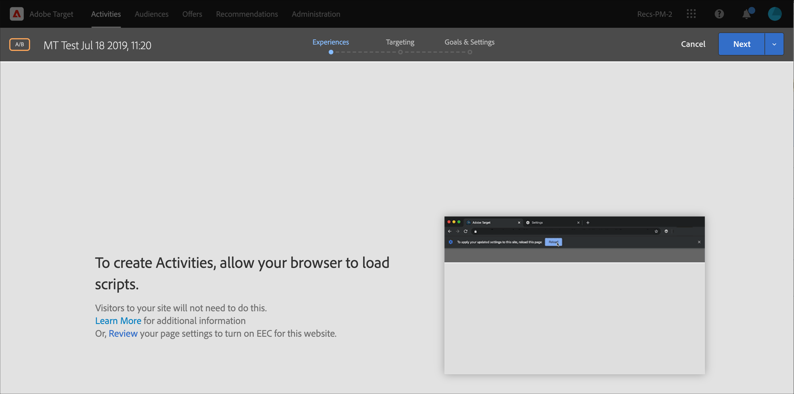
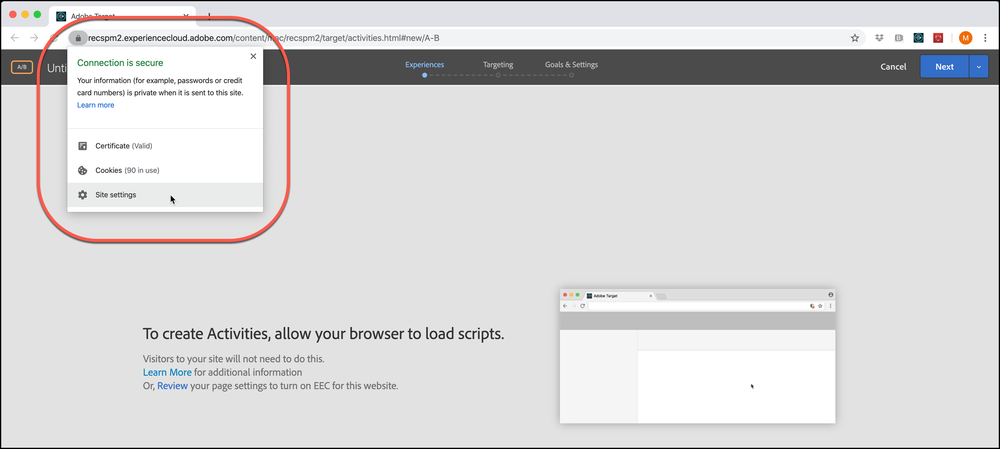
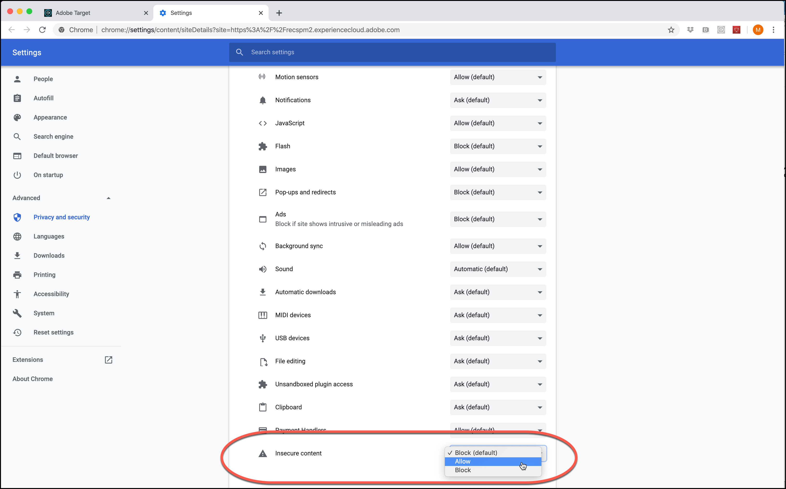
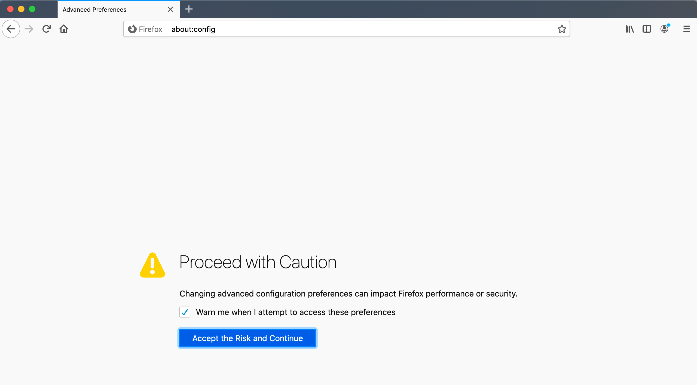
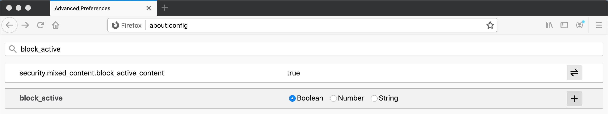
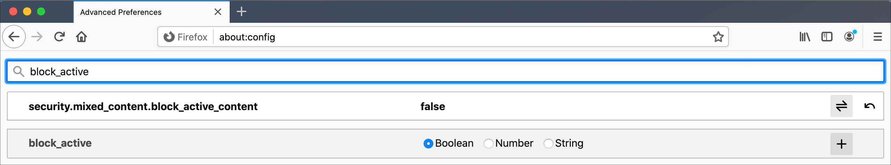

# Enabling mixed content in the browser {#mixed-content}

>[!BEGINSHADEBOX]

**On this page:** Learn how to enable mixed content in [!DNL Google Chrome], [!DNL Mozilla Firefox], and [!DNL Microsoft Edge], so that the **[!UICONTROL Visual Experience Composer]** (VEC) can open HTTP sites and sites that contain mixed content.

>[!ENDSHADEBOX]

A page contains mixed content when it is requested securely over HTTPS but loads both HTTPS and HTTP content. HTTPS content is secure, whereas HTTP content is not, so modern browsers might block such a page or display a warning message.

When the **[!UICONTROL Visual Experience Composer]** (VEC) in [!DNL Adobe Target] tries to open a page that contains mixed content, a warning message displays with instructions to disable the blocking in the browser. Disabling the blocking makes it possible to open an HTTP site or a site that has mixed content (HTTPS and HTTP).

Previously, some actions in Step 1 of the three-step guided workflow remained available when mixed content was not allowed. [!DNL Target] now blocks all actions in Step 1, so mixed content must be enabled before the activity creation can continue.

The security settings of the browser might block insecure (HTTP) content that is loaded into a secure (HTTPS) page or frame, such as the VEC. The alternative to changing these settings is an HTTPS website. If the website runs on an insecure (HTTP) domain, the VEC must be allowed to load active mixed content.

>[!IMPORTANT]
>
>Allowing mixed content affects the VEC only and not the live website.

For more information, see [Mixed Content](https://developer.mozilla.org/en-US/docs/Web/Security/Mixed_content) on the *Mozilla Developer Network* (MDN) website.

## Enable mixed content in [!DNL Google Chrome]

[!DNL Chrome] checks that the content of a page requested through a secure connection has been transmitted safely. See "[Manage warnings about unsafe sites](https://support.google.com/chrome/answer/99020?hl=en)" in Google Chrome Help.

To use the VEC with the latest version of [!DNL Chrome] (version 79.0.3945.117 or later), update the site settings as follows. Visitors to the site do not need to complete these steps.

1. Click the lock (caution) icon, then click **[!UICONTROL Site settings]**.

   

1. Under **[!UICONTROL Insecure content]**, change "Block (default)" to "Allow" in the drop-down list.

   

1. Reload the VEC page.

## Enable mixed content in [!DNL Mozilla Firefox]

By default, [!DNL Firefox] blocks pages that mix secure and insecure content, so this setting must be changed permanently to use [!DNL Target]. Visitors to the site do not need to complete these steps.

1. In [!DNL Firefox], enter `about:config` in the address bar.
1. Acknowledge the warning message that [!DNL Firefox] displays.

   

1. In the search bar, enter `block_active`.

   

1. Double-click `security.mixed_content.block_active_content`.

   The value changes from "True" to "False". When the value shows "False", the change is complete.

   

1. Restart the computer after changing this setting.

## Enable mixed content in [!DNL Microsoft Edge]

[!DNL Edge] checks that the content of a page requested through a secure connection has been transmitted safely. To use the VEC with the latest version of [!DNL Edge], update the site settings as follows. Visitors to the site do not need to complete these steps.

1. In [!DNL Edge], click **[!DNL Microsoft Edge]** in the menu bar, click **[!UICONTROL Settings]**, then click **Cookies and Site Permissions**.
1. Scroll to **[!UICONTROL Insecure content]** and click it.
1. Next to **[!UICONTROL Allow]**, click **[!UICONTROL Add]**, enter the site on which to allow insecure content, then click **[!UICONTROL Add]**.
1. Reload the VEC page.
