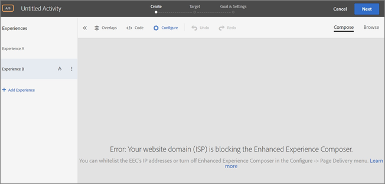
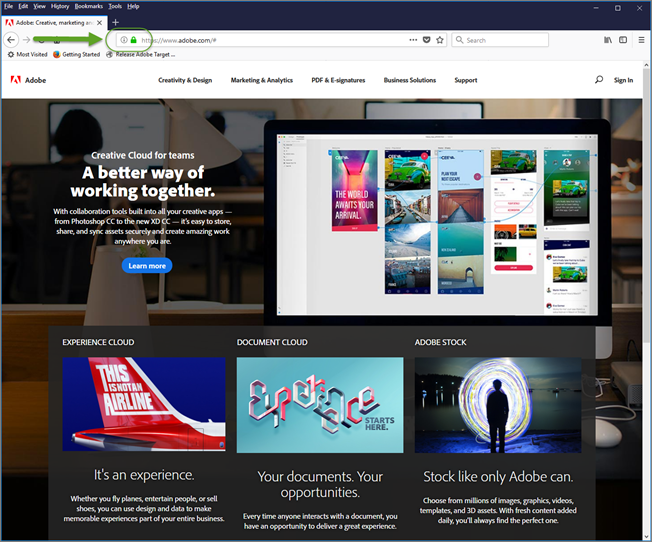
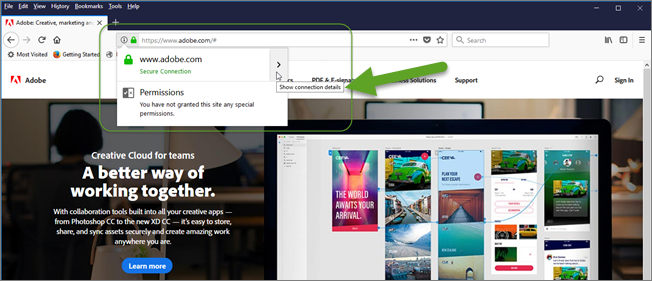
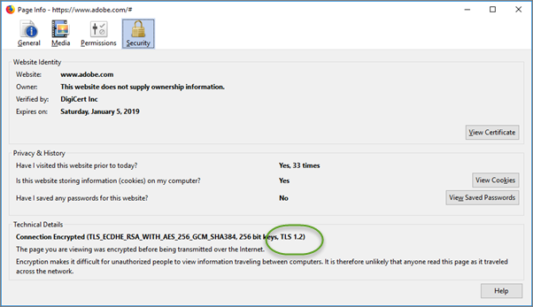

# Troubleshooting issues related to the [!UICONTROL Enhanced Experience Composer] {#eec-issues}

>[!BEGINSHADEBOX]

**On this page:** Learn how to resolve the issues that affect only the **[!UICONTROL Enhanced Experience Composer]** (EEC), such as pages that do not load because the IP addresses of the EEC proxy are blocked.

>[!ENDSHADEBOX]

Display problems sometimes occur in the [!DNL Adobe Target] **[!UICONTROL Enhanced Experience Composer]** (EEC) under certain conditions. The following items describe the issues that affect only the EEC and how to resolve them.

## Allowlist the IP addresses of the EEC proxy {#eec-ip-addresses}

The EEC does not load an internal QA URL that is not accessible on a public IP address. Allowlisting the IP addresses of the [!DNL Adobe] server used for the EEC proxy resolves this issue. These IP addresses are required only for activity editing, and visitors to the site do not need them allowlisted. Ask the IT team to allowlist the following IP addresses.

### US (va7)

```
40.70.154.136/29
52.254.106.240/28
52.254.106.160/28
52.254.107.16/28
20.186.185.181
20.22.83.112
20.186.185.227
52.254.106.192/28
52.254.106.0/28
52.254.107.128/28
52.254.107.80/28
52.254.106.176/28
52.254.107.32/28
52.254.105.192/28
52.254.107.64/28
52.254.106.208/28
52.254.107.0/28
52.254.106.224/28
20.14.241.153
20.186.185.239
4.152.211.251
52.254.107.144/28
52.254.106.144/28
```

### EMEA (nld2)

```
51.138.17.16/28
51.138.17.48/28
51.138.16.128/28
51.138.17.32/28
51.138.16.240/28
51.138.17.112/28
51.138.16.160/28
51.138.16.208/28
51.138.17.80/28
51.138.17.0/28
51.138.17.96/28
51.138.16.144/28
20.31.145.248
20.126.189.248
51.138.16.224/28
51.138.16.192/28
51.138.12.94
51.138.12.11
51.138.16.176/28
51.138.12.100
51.138.17.64/28
51.138.12.160/28
```

### APAC (aus)

```
20.43.104.160/28
20.227.35.177
20.40.188.227
20.43.104.112/28
20.43.104.128/28
20.43.104.144/28
20.40.188.166
20.53.206.128
20.43.104.80/28
20.43.104.16/28
20.43.105.48/28
20.43.104.96/28
20.43.104.48/28
20.40.188.194
20.43.104.32/28
20.40.191.224/28
20.43.105.16/28
20.40.191.96/28
20.43.104.176/28
20.40.191.240/28
20.43.104.64/28
20.43.105.32/28
20.43.104.192/28
20.43.105.0/28
20.43.104.0/28
```

### Legacy IP addresses

The following legacy IP addresses should continue to be allowlisted until further notice.

```
34.254.77.200
54.73.207.147
54.229.152.123
3.224.194.242
54.90.51.39
34.228.136.112
54.150.116.11
18.178.142.8
54.199.107.77
99.80.139.221
54.78.56.224
54.247.179.246
54.80.219.243
34.201.235.54
54.196.224.236
35.75.212.45
52.199.184.130
18.180.161.176
```

+++ The EEC displays an error message that the website domain is blocking it

The following error message can display in [!DNL Target]:

`Error: Your website domain (ISP) is blocking the Enhanced Experience Composer. You can allowlist the Enhanced Experience Composer's IP addresses or turn off Enhanced Experience Composer in Configure > Page Delivery menu.`



This error message has two possible causes:

* The website domain (ISP) blocks the EEC. To resolve the issue, allowlist the IP addresses listed in [Allowlist the IP addresses of the EEC proxy](#eec-ip-addresses).
* The IP addresses are allowlisted, but the website does not support TLS 1.2. To resolve the issue, see the following item.

+++

+++ The EEC does not load on secure pages of a site that uses TLS 1.0

The error message described in the previous item can display when the IP addresses are allowlisted but the website does not support TLS 1.2. [!DNL Target] currently uses version 1.2 as the default configuration. Before [!DNL Target] 18.4.1 (April 25, 2018), the default configuration supported TLS 1.0. For more information, see [TLS (Transport Layer Security) Encryption Changes](https://experienceleague.adobe.com/docs/target-dev/developer/implementation/tls-transport-layer-security-encryption.html){target=_blank}.

To check the TLS version of a website in Firefox (other browsers have similar steps):

1. Open the affected website in Firefox.
1. Click the **[!UICONTROL Show Site Information]** icon on the address bar of the browser.

   

1. Click **[!UICONTROL Show Connection Details]** > **[!UICONTROL More Information]**.

   

1. Examine the TLS version information under **[!UICONTROL Technical Details]**.

   

1. If the website shows TLS 1.0, see [TLS (Transport Layer Security) Encryption Changes](https://experienceleague.adobe.com/docs/target-dev/developer/implementation/tls-transport-layer-security-encryption.html){target=_blank} for information about the TLS support policy of [!DNL Target]. To remedy the situation for now (valid until September 12, 2018), reach out to [Customer Care](/help/main/cmp-resources-and-contact-information.md#reference_ACA3391A00EF467B87930A450050077C) for configuration with the TLS version and the domain.

+++

+++ Timeouts or "access denied" errors display when sites are loaded with the proxy enabled

Make sure that the proxy IP addresses are not blocked in the environment. The addresses are listed in [Allowlist the IP addresses of the EEC proxy](#eec-ip-addresses).

+++
