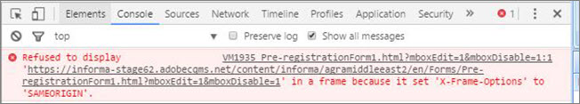
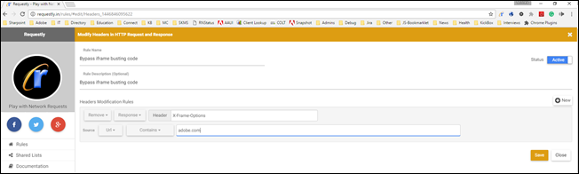
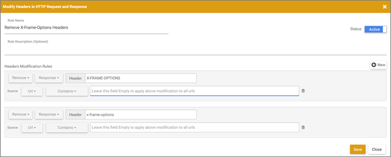
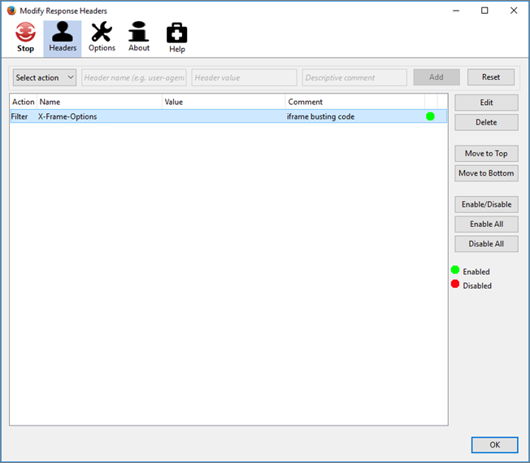

# Troubleshooting issues related to the [!UICONTROL Visual Experience Composer] {#vec-issues}

>[!BEGINSHADEBOX]

**On this page:** Learn how to resolve the issues that affect only the **[!UICONTROL Visual Experience Composer]** (VEC).

>[!ENDSHADEBOX]

Display problems sometimes occur in the [!DNL Adobe Target] **[!UICONTROL Visual Experience Composer]** (VEC) under certain conditions. The following items describe the issues that affect only the VEC and how to resolve them.

+++ The [!DNL Target] libraries do not load when the website is opened in the VEC

When a website is opened in the **[!UICONTROL Visual Experience Composer]**, [!DNL Target] adds the parameters `mboxEdit=1` and `mboxDisable=1` to the URL.

A website that trims or removes these parameters while navigating from one page to another without a page reload, especially a Single Page Application, breaks the [!DNL Target] functionality, and the [!DNL Target] libraries do not load. To avoid this problem, keep both parameters in the URL.

+++

+++ A page does not open in the EEC or loads slowly, or activities and experiences load slowly in the VEC

Several issues can affect page performance in the [!DNL Target] experience composers. The most common are the following:

* The page has no mbox.
* The site uses proxy blocking, which prevents the page from opening in either experience composer.
* The site does not allow itself to be opened in an iFrame.

When an issue occurs in the **[!UICONTROL Enhanced Experience Composer]**, turn it off and use the **[!UICONTROL Visual Experience Composer]** instead. To do so, go to **[!UICONTROL Administration]** > **[!UICONTROL Visual Experience Composer]** and turn off the **[!UICONTROL Enable Enhanced Experience Composer]** option.

The following error message can display in the console:

When neither composer works, a browser extension that overwrites the X-Frame-Options header of the site, such as [!DNL Requestly] ([!DNL Chrome] or [!DNL Firefox]) or Modify Response Headers ([!DNL Firefox]), allows the site to load in iFrames and so enables the VEC. When browser extensions cannot be used, use the [Form-based Experience Composer](/help/main/c-experiences/form-experience-composer.md). The [[!DNL Adobe Target] **[!UICONTROL Visual Editing Helper]** extension](/help/main/c-experiences/c-visual-experience-composer/r-troubleshoot-composer/visual-editing-helper-extension.md) for [!DNL Google Chrome] can also be used, in addition to the procedures that follow.

>[!NOTE]
>
>These extensions are intended only for VEC editing.
>
>With [!DNL Requestly], whenever headers need to be removed, do one of the following:
>
>* Add URL rules for the URL to open in the VEC, so that headers are removed for those URLs only.
>* Enable the rule while editing in the VEC and disable the rule when the VEC is not in use.
>
>With **[!UICONTROL Modify Response Headers]** ([!DNL Firefox]), URL rules are not available, so the rule must be enabled while editing in the VEC and disabled when the VEC is not in use.

Once an extension is set up, pages load in the **[!UICONTROL Visual Experience Composer]** even when the **[!UICONTROL Enhanced Experience Composer]** is disabled.

+++

+++ Remove the X-Frame-Options header with Requestly (Chrome or Firefox)

1. Turn off the **[!UICONTROL Enhanced Experience Composer]**.
1. Install the [!DNL Requestly] browser extension on [!DNL Chrome] or [!DNL Firefox].
1. Open the extension and select **[!UICONTROL Modify headers]**.
1. Enter a rule name.
1. In the modification rules, create a rule that removes the header:

   * Toggle **[!UICONTROL Add]** to **[!UICONTROL Remove]**.
   * Toggle **[!UICONTROL Request]** to **[!UICONTROL Response]**.
   * Enter "X-Frame-Options" as the header name.

1. Repeat the previous step and enter "x-frame-options" as the header name.

   >[!NOTE]
   >
   >Headers that are manipulated with [!DNL Requestly] are case sensitive.

1. Change **[!UICONTROL Equals]** to **[!UICONTROL Contains]** as the condition for the source URL and enter the URL of the activity to load in the VEC.

   

1. Click **[!UICONTROL Save]**.

   

The page should now load quickly in the **[!UICONTROL Visual Experience Composer]**.

+++

+++ Remove the X-Frame-Options header with Modify Response Headers (Firefox)

1. Install the [!DNL Modify Response Headers] extension on [!DNL Firefox] and restart the browser.
1. From the [!DNL Firefox] extensions, select the [!DNL Modify Response Headers] extension.
1. Click **[!UICONTROL Preferences]**.
1. Select **[!UICONTROL Filter]** from the **[!UICONTROL Action]** drop-down list.
1. In the **[!UICONTROL Header Name]** field, enter **[!UICONTROL X-Frame-Options]**.
1. Repeat the previous two steps to add a filter with **[!UICONTROL x-frame-options]**.
1. Click **[!UICONTROL Add]**.
1. Click **[!UICONTROL Start]**.

+++

+++ A page does not display in the VEC

Check the following causes:

* **Extension version:** the newest version of the [[!DNL Adobe Experience Cloud] **[!UICONTROL Visual Editing Helper]** extension](/help/main/c-experiences/c-visual-experience-composer/r-troubleshoot-composer/visual-editing-helper-extension.md) provides the best compatibility with the VEC. To verify the installed version, go to **[!UICONTROL Extensions]** > **[!UICONTROL Manage Extensions]**, then click **[!UICONTROL Details]**.
* **Authoring libraries:** the VEC needs authoring libraries to modify the web page. They are embedded in the at.js library, which the extension downloads from [!DNL Adobe] servers each time the VEC is used, whether or not at.js or the [!DNL Adobe Experience Platform Web SDK] is already on the page. Check that the at.js headers configured in **[!UICONTROL Administration]** > **[!UICONTROL Implementation]** contain no invalid changes.
* **Blocked requests:** the page must not block the requests that are mandatory for loading when it is embedded in an iFrame. Such blocking includes `frame-ancestors` CSP directives, custom JavaScript code in the website, meta HTML tags, and the `x-frame-options` header.
* **Reserved file names:** the JavaScript of the page must not interfere with the authoring libraries. Do not use or include files with the following reserved names:

  * `target-vec-helper.js`
  * `target-vec.js`
  * `target.js`
  * `admin.css`
  * `sizzle.js`
  * `mixContentCheck.html`

  Accidentally overriding variables or events defined in these files can also cause issues with the VEC.

* **Non-secure page on a secure site:** the browser blocks the page. Click the icon to the left of the URL in the address bar, then click **[!UICONTROL Disable protection on this page]**.
* **Invalid URL:** the URL entered is invalid.
* **Cookies:** if the website fails to load in the VEC or behaves unexpectedly, accepting its cookies in the browser before loading the website in [!DNL Target] can resolve the issue.

+++

+++ The VEC appears broken in Browse mode

In **[!UICONTROL Browse]** mode, the VEC appears broken when a URL is opened that lacks the [!DNL Target] libraries ([at.js](https://experienceleague.adobe.com/docs/target-dev/developer/client-side/at-js-implementation/overview.html){target=_blank} or [Adobe Experience Platform Web SDK](https://experienceleague.adobe.com/docs/target-dev/developer/client-side/aep-web-sdk.html){target=_blank}) or that contains a frame-buster header. For browser security reasons, [!DNL Target] cannot properly access the URL that was navigated to, or the VEC URL does not update consistently when the page loads.

The VEC loads the web page in an `<iframe>`, and the current security mechanisms of browsers prevent the [!DNL Target] UI from accessing the elements of the frame under the same-origin policy. Browsers block scripts that attempt to access a frame with a different origin, including information such as `location.href`.

Use the new [Visual Editing Helper extension](/help/main/c-experiences/c-visual-experience-composer/r-troubleshoot-composer/visual-editing-helper-extension.md) to inject the [!DNL Target] library into the pages, so that the pages can be browsed optimally.

+++

+++ Issues are caused by CSS conflicts in the VEC

Check whether any CSS files affect visibility while the page loads in the editor. For example, the `overflow: hidden` property on the page body can cause scrolling issues or trigger click events that interfere with the authoring menu. 

+++
