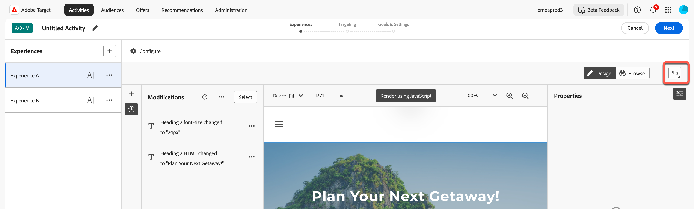

# [!UICONTROL Visual Experience Composer] changes {#vec-changes}

>[!BEGINSHADEBOX]

**On this page:** Learn how the updated [!UICONTROL Visual Experience Composer] (VEC) introduced in the [!DNL Adobe Target Standard/Premium] 25.2.1 release differs from the previous version.

>[!ENDSHADEBOX]

The [!DNL Adobe Target Standard/Premium] 25.2.1 release (February 17, 2025) introduces an updated [!UICONTROL Visual Experience Composer] (VEC). This article explains the differences between the previous and updated versions of the VEC.

>[!IMPORTANT]
>
>The updated [!UICONTROL Visual Experience Composer] requires the [!DNL Adobe Experience Cloud] [**[!UICONTROL Visual Editing Helper]** extension](/help/main/c-experiences/c-visual-experience-composer/r-troubleshoot-composer/visual-editing-helper-extension.md) available in the [!DNL Chrome Web Store].

The VEC displays when an activity is created or an existing activity is edited.

## Major changes to the VEC

The following sections explain the major changes in the updated VEC compared to the previous version.

### [!UICONTROL Experiences] rail

As in the previous version, the **[!UICONTROL Experiences]** rail remains on the left side of the VEC. The **[!UICONTROL Experiences]** rail cannot be collapsed.

Experiences are created, renamed, or removed using the **[!UICONTROL Experiences]** rail. 

Click the **[!UICONTROL Add]** icon (  ) to add a new experience. Click the **[!UICONTROL More Actions]** icon (  ) to duplicate, delete, or redirect an experience.

### [!UICONTROL Components] rail (new)

The new **[!UICONTROL Components]** rail adds a number of components to the web page, which can then be edited as needed.

To add a new component, select the desired component from the **[!UICONTROL Components]** rail, hover over an existing element in the page, then choose to insert the component before or after the selected element.

If the **[!UICONTROL Modifications]** rail displays in this area instead of the **[!UICONTROL Components]** rail, click the **[!UICONTROL Show Components]** icon (  ). The **[!UICONTROL Show Components]** icon (  ) and the **[!UICONTROL Show Modifications]** icon (  ) act as toggles that show the appropriate options.

To collapse the **[!UICONTROL Components]** rail and enlarge the **[!UICONTROL Design]** canvas while the **[!UICONTROL Components]** rail is open, click the (  ) icon.

### [!UICONTROL Modifications] rail

To open the **[!UICONTROL Modifications]** rail, click the **[!UICONTROL Show Modifications]** icon (  ) in the **[!UICONTROL Components]** rail. The **[!UICONTROL Modifications]** rail changed position from the right side to the left side of the editing canvas.

>[!NOTE]
>
>To collapse the **[!UICONTROL Modifications]** rail and enlarge the **[!UICONTROL Design]** canvas while the **[!UICONTROL Modifications]** rail is open, click the **[!UICONTROL Show Modifications]** icon (  ).

The **[!UICONTROL Modifications]** rail shows all changes that have been made to the page in the VEC, and allows additional changes (such as CSS Selector, Mbox, and Custom Code).

Click the **[!UICONTROL More Options]** icon (  ) to add a modification, delete all modifications, or delete all invalid modifications. Click **[!UICONTROL Select]** to perform bulk operations: **[!UICONTROL Apply to All Pages]** or **[!UICONTROL Delete]**.

To display the **[!UICONTROL Modifications]** rail again, click the **[!UICONTROL Hide Modifications]** icon (  ) in the **[!UICONTROL Modifications]** rail.

### [!UICONTROL Properties] rail (new)

The **[!UICONTROL Properties]** rail changes the properties of selected elements on the page, whether these elements are HTML elements or objects specific to [!DNL Target], such as recommendations or offers.

Click the icons on top of the rail to edit HTML code or to delete, duplicate, or hide elements. Changes appear in the **[!UICONTROL Modifications]** rail.

The **[!UICONTROL Properties]** rail is collapsible in the right rail. Click the **[!UICONTROL Show/Hide Properties]** icon (  ) to the right of the rail to collapse or display the **[!UICONTROL Properties]** rail.

### Activity settings/configuration

Click the **[!UICONTROL Configure]** icon (  ) displayed on top of the design canvas to display the activity properties menu.

The different options assign properties, edit page delivery rules, specify site preferences, add additional pages, and enable or disable multi-page or multiple audience activities. Assign **[!UICONTROL Properties]** is a [[!DNL Target Premium]](/help/main/c-intro/intro.md#premium) feature.

The position and functionality are similar to the previous VEC UI.

### [!UICONTROL Design]/[!UICONTROL Browse] modes

Use the **[!UICONTROL Design]**/**[!UICONTROL Browse]** toggles displayed on top of the **[!UICONTROL Properties]** rail to switch between design and browse mode.

Use the **[!UICONTROL Browse]** mode to navigate the site and to pick the view or page to update. Switch back to **[!UICONTROL Design]** mode to add or edit changes.

### [!UICONTROL Undo]/[!UICONTROL Redo]

Changes can be undone by clicking the **[!UICONTROL Undo]** icon (  ).

To redo an action, expand the **[!UICONTROL Undo]**/**[!UICONTROL Redo]** button group and choose **[!UICONTROL Redo]**.

### [!UICONTROL Design] canvas

The **[!UICONTROL Design]** canvas allows selecting viewports, including fit-to-screen, **[!UICONTROL Desktop]**, **[!UICONTROL Tablet]**, **[!UICONTROL Mobile Landscape]**, and **[!UICONTROL Mobile Portrait]**.

The updated VEC also allows zooming in or out by clicking the appropriate icon (  or  ).

## Visual illustration showing UI changes

The following illustration shows the high-level UI changes made to the updated VEC. The left side of the illustration shows the previous VEC UI, and the right side shows the updated UI. Matching numbers show where various elements have moved or changed.

{width="800" zoomable="yes"}

## More information about the updated UI

* [[!DNL Target Standard/Premium] 25.2.1 (February 17, 2025) release notes](/help/main/r-release-notes/release-notes-for-previous-releases.md#ui-update-2): Provides a summary of the key UI changes in [!DNL Target] for **[!UICONTROL Activities]**, **[!UICONTROL Recommendations]**, and the [!UICONTROL Visual Experience Composer] (VEC).

* [[!DNL Target Standard/Premium] 25.1.1 (January 9, 2025) release notes](/help/main/r-release-notes/release-notes-for-previous-releases.md#ui-update-1): Provides a summary of the key UI changes in [!DNL Target] for the **[!UICONTROL Offers Library]**.

* [Understand the [!DNL Target] UI](/help/main/c-intro/understand-the-target-ui.md): Provides a brief overview of [!DNL Target], with links for more in-depth information and step-by-step instructions.

* [[!UICONTROL Visual Experience Composer] options](/help/main/c-experiences/c-visual-experience-composer/viztarget-options.md): Explains the updated VEC UI and its options.

* [[!DNL Target] UI update FAQs](/help/main/c-intro/updated-ui-faq.md): Addresses common questions about the new [!DNL Target] UI and [!UICONTROL Visual Experience Composer] (VEC), including navigation changes, feature locations, and the deprecation of the temporary UI version toggle.
