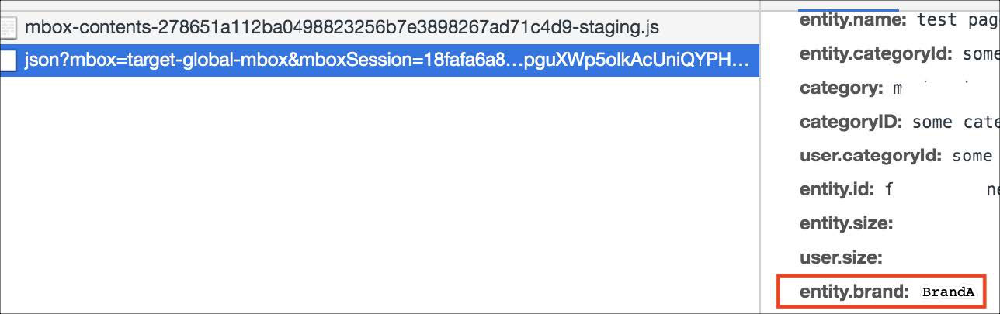
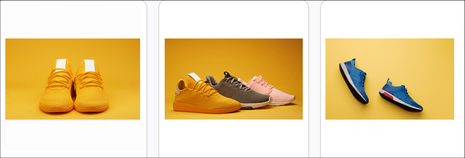
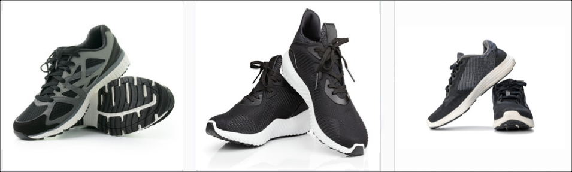

# Entity attribute matching {#entity-attribute-matching}

>[!BEGINSHADEBOX]

**On this page:** Learn how to filter recommendations dynamically in [!DNL Adobe Target Recommendations] by comparing a pool of potential recommended items to a specific item that the visitor has interacted with.

>[!ENDSHADEBOX]

**[!UICONTROL Entity Attribute Matching]** recommends only the items that match an attribute of an item that the visitor has interacted with. The process for creating and using inclusion rules for criteria and promotions is similar, as are the use cases and examples. For more information, see [Use dynamic and static inclusion rules](/help/main/c-recommendations/c-algorithms/use-dynamic-and-static-inclusion-rules.md).

## Entity attribute matching examples

**[!UICONTROL Entity Attribute Matching]** can recommend only the items that match, for example:

* An attribute from the item that the visitor is currently viewing
* The item that the visitor most recently viewed
* The item that the visitor most recently purchased
* The item that the visitor most frequently viewed
* An item stored in a custom attribute in the profile of the visitor

### Recommending items based on brand

After the entity attribute rules are built, they filter out all recommendations with attributes that do not match the entity value passed on the page. The `entity.brand` value must be delivered in the mbox on the pages for this process to work.

With this type of dynamic inclusion rule, only one recommendation rule has to be specified to return relevant brand results across all brand pages, instead of a collection or a static filter for each brand name.

For example, when a page that features a Brand A product is displayed, the page sets the value of the `entity.brand` parameter to "BrandA". On a Brand Landing Page, the mbox returns `entity.brand=brandA`.



The recommendations on the page then contain only Brand A products.



When a Brand B product page is displayed, the `entity.brand` value is reset to "BrandB", and only Brand B products are recommended. Similarly, on the Brand Landing Page for Brand B, only Brand B products are returned.



### Upselling to a more expensive product

To encourage visitors to consider higher-priced and, therefore, more profitable items, the "equals" and "is between" operators can promote more expensive items from the same category and the same brand. For example, a shoe retailer can promote more expensive running shoes to up-sell a visitor who is looking at running shoes, as in the following sample:


```
Entity Attribute Matching
category - equals - current item's - category 
And 
Entity Attribute Matching
brand - equals - current item's - brand 
And 
Entity Attribute Matching
value - is between - 100% and 1000% of - current item's - value
```

### Promoting private-label products

Dynamic and static filters can be mixed to promote private-label products. For example, an office supply company can promote toner cartridges of the company's house brand to drive a more profitable sale for a visitor who is looking at toner, and pens of the company's house brand for a visitor who is looking at pens, as in the following sample:


```
Entity Attribute Matching
category - equals - current item's - category 
And
Static Filter
IsHouseBrand - equals - true
```
