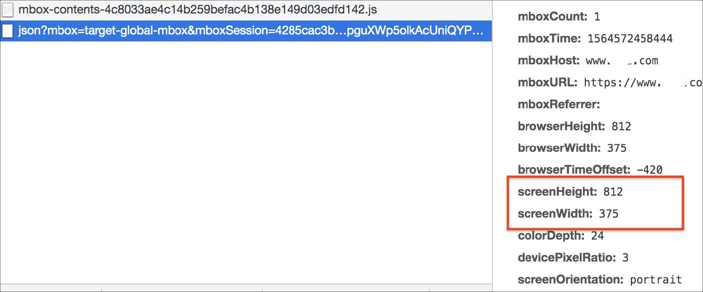

# Parameter matching {#parameter-matching}

>[!BEGINSHADEBOX]

**On this page:** Learn how to filter recommendations dynamically in [!DNL Adobe Target Recommendations] by comparing items (entities) against a value in the request (API or mbox).

>[!ENDSHADEBOX]

**[!UICONTROL Parameter Matching]** recommends only the content that matches the page parameters or the parameters of the visitor, such as device dimensions or geo-location. For example, only content that matches the "industry" page parameter can be recommended. The process for creating and using inclusion rules for criteria and promotions is similar, as are the use cases and examples. For more information, see [Use dynamic and static inclusion rules](/help/main/c-recommendations/c-algorithms/use-dynamic-and-static-inclusion-rules.md).

Other examples include:

* Mbox parameters for screen width and height can be used to target mobile visitors and recommend only mobile devices and accessories.
* A recommendations rule can return only the top-selling mobile phones that match or exceed the screen height of the mobile device that the visitor uses to view the page.
* Regional geo-location parameters can be used to return recommendations for tools during the winter. Snow blowers and other snow abatement tools can be recommended for visitors in areas where it snows but not for visitors in areas where it does not snow.

## Parameter matching examples

[!DNL Recommendations] can match parameter values sent in the [!DNL Target] call. In the following example, [!DNL Target] detects that a visitor is using a mobile device, based on the screen height and width parameters sent in the [!DNL Target] call, and recommends only items that are mobile devices.

Consider the following example [!DNL Target] call:

On the page that a visitor is viewing, mobile device products are displayed.

