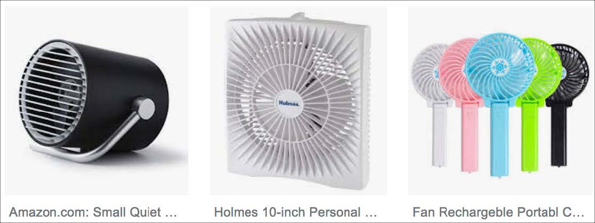

# Profile attribute matching {#profile-attribute-matching}

>[!BEGINSHADEBOX]

**On this page:** Learn how to filter recommendations dynamically in [!DNL Adobe Target Recommendations] by comparing items (entities) against a value in the profile of the visitor.

>[!ENDSHADEBOX]

Use **[!UICONTROL Profile Attribute Matching]** to show recommendations that match a value stored in the profile of the visitor, such as size or favorite brand. The process for creating and using inclusion rules for criteria and promotions is similar, as are the use cases and examples. For more information, see [Use dynamic and static inclusion rules](/help/main/c-recommendations/c-algorithms/use-dynamic-and-static-inclusion-rules.md).

The following scenarios show how **[!UICONTROL Profile Attribute Matching]** can be used:

* A company that sells eyeglasses stores the favorite frame color of a visitor as "walnut." For that visitor, recommendations are set up to return only eyeglass frames that match "walnut" in color.
* A profile parameter can be defined for the clothing size (for example, Small, Medium, or Large) of a visitor as the visitor navigates the website of the company. A recommendation can be set up to match that profile parameter and return only the products in the preferred clothing size of the visitor.

## Profile attribute matching examples

**[!UICONTROL Profile Attribute Matching]** recommends only the items that match an attribute from the profile of the visitor, as in the following examples.

### Recommending items from the user's favorite brand

The **[!UICONTROL Profile Attribute Matching]** option can create a rule that recommends items only where the brand equals the value or text stored in `profile.favoritebrand`. With such a rule, if a visitor is looking at running shorts from a particular brand, only the recommendations that match the favorite brand of that visitor (the value stored in `profile.favoritebrand` in the profile of the visitor) are displayed.


```
Profile Attribute Matching
brand - equals - the value/text stored in - profile.favoritebrand
```

### Matching jobs to job seekers

To match jobs to job seekers, only the jobs that are in the same city as the job seeker are recommended. Inclusion rules can match the location of a job seeker from the profile of the visitor to a job listing, as in the following example:


```
Profile Attribute Matching
jobCity - equals - the value/text stored in - profile.usersCity
```

### Recommending items based on size

The following example shows how profile attribute matching affects recommendations on a website that sells electric fans.

When a visitor clicks various images of fans on this website, each page sets the value of the `entity.size` parameter based on whether the size of the fan in the image is small or large. A profile script tracks and counts the number of times the value of `entity.size` is set to small versus large.

If the visitor then returns to the Home Page, filtered recommendations are displayed based on whether more small fans or large fans were clicked.

Recommendations based on viewing more small fans on the website:



Recommendations based on viewing more large fans on the website:


