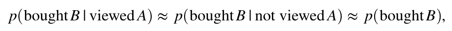
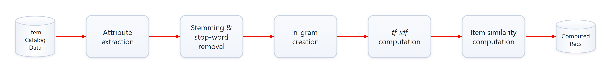
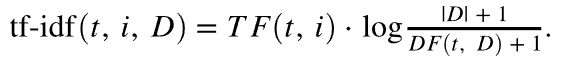
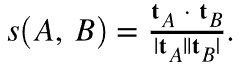
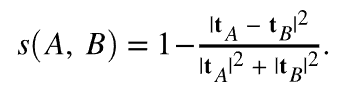

# The science behind Target's recommendations algorithms {#recommendations-algorithms}

>[!BEGINSHADEBOX]

**On this page:** Learn how the algorithms in [!DNL Adobe Target Recommendations] work, including the logic and mathematical details of model training and model serving.

>[!ENDSHADEBOX]

Model training is the process by which the [!DNL Adobe Target] learning algorithms generate recommendations. Model serving, also known as content delivery, is how [!DNL Target] delivers those recommendations to site visitors.

[!DNL Target] offers the following types of algorithms in [!DNL Recommendations]:

* **Item-Based algorithms**: Follow the logic "People who viewed/bought this item also viewed/bought these items." These algorithms are grouped under the term item-item collaborative filtering. This type also includes the **[!UICONTROL Items with Similar Attributes]** algorithms.

* **User-Based algorithms**: Include the **[!UICONTROL Recently Viewed Items]** and **[!UICONTROL Recommended for You]** algorithms.

* **Popularity-Based algorithms**: Return the top-viewed or top-purchased items across the website, or by category or item attribute.

* **Cart-Based algorithms**: Make multi-item recommendations with the logic "people who viewed/bought these items also viewed/bought those items."

* **Custom Criteria**: Use custom files uploaded to [!DNL Target] as the source of recommendations.

For more information about each algorithm type and its algorithms, see [Base the recommendation on a recommendation key](/help/main/c-recommendations/c-algorithms/base-the-recommendation-on-a-recommendation-key.md).

Many of these algorithms rely on one or more keys, which [!DNL Target] uses at content delivery time (when recommendations are made) to retrieve similar items. Customer-specified keys can be the current item the visitor is viewing, the last item viewed or purchased, the top-viewed item, the current category, or the favorite category of the visitor. Other algorithms, such as the cart-based and user-based algorithms, use implicit keys that cannot be configured by the customer. For more information, see [Recommendation keys](/help/main/c-recommendations/c-algorithms/base-the-recommendation-on-a-recommendation-key.md#keys).

Keys apply only at model serving time (content delivery). They do not affect the offline model training logic.

The following sections group the algorithms by the similarity of their model training logic, so the groups differ slightly from the types above.

## Item-Item collaborative filtering

Algorithms include:

* **[!UICONTROL People Who Viewed This, Viewed That]**
* **[!UICONTROL People Who Viewed This, Bought That]**
* **[!UICONTROL People Who Bought This, Bought That]**

Item-item collaborative filtering algorithms use the behavioral patterns of many users (hence collaborative) to recommend items related to a given item, which filters the catalog of possible items. Many different algorithms fall under the general umbrella of collaborative filtering, and all of them use behavioral data as input. In [!DNL Target Recommendations], these inputs are the unique views and purchases of items by users.

For the "people who viewed/purchased this item also viewed/purchased these items" algorithms, the goal is to calculate a similarity s(A,B) between all pairs of items. For a given item A, the top recommendations are the items ordered by their similarity s(A,B).

One example of a similarity is the co-occurrence between items: a count of the users who purchased both items. This metric is intuitive but naive, because it is biased towards recommending popular items. For example, at a grocery retailer where most people purchase bread, bread has a high co-occurrence with all items, but it is not necessarily a good recommendation. [!DNL Target] instead uses the log likelihood ratio (LLR). This quantity is large when the probability of two items, A and B, co-occurring is very different from the probability of them not co-occurring. For example, with the **[!UICONTROL People Who Viewed This, Bought That]** algorithm, the LLR similarity is large when the probability that someone purchased B is *not* independent of whether they viewed A.

Item B is not recommended with item A when the following holds:

For full details of the log likelihood ratio similarity calculation, see [this PDF](/help/main/c-recommendations/c-algorithms/assets/log-likelihood-ratios-recommendation-algorithms.pdf).

The following schematic diagram shows the logical flow of the algorithm implementation:

The steps are as follows:

* **Input data**: Behavioral data in the form of visitor views and purchases, collected when you [implement Target](https://experienceleague.adobe.com/docs/target-dev/developer/recommendations.html){target=_blank} or from [Adobe Analytics](/help/main/c-recommendations/c-algorithms/use-adobe-analytics-with-recommendations.md){target=_blank}.

* **Model training**:

  * **Data cleansing and sampling**: For algorithms with an N-day lookback, the behavioral data is first filtered to include only those N days of data. Collection rules and global exclusions are then applied to remove any items that should not be recommended. Finally, the usage data of any visitor who interacted with more than 1,000 items is sampled down to 1,000 items.
  * **Item similarity computation**: The core computational step. [!DNL Target] calculates the log likelihood ratio similarity between all candidate item pairs and ranks the pairs by this score.
  * **Offline filtering**: Any further applicable dynamic filters are applied (for example, dynamic category exclusions). The pre-computed recommendations are then cached globally, ready for serving.

* **Model serving**: Recommendations are delivered from the [global "Edge" network](/help/main/c-intro/how-target-works.md#concept_0AE2ED8E9DE64288A8B30FCBF1040934) of [!DNL Target]. When an mbox request is made to [!DNL Target] and it is determined that recommendations content should be delivered to the page, the [item key](/help/main/c-recommendations/c-algorithms/base-the-recommendation-on-a-recommendation-key.md#keys) that the algorithm needs is either parsed from the request or looked up from the visitor profile. [!DNL Target] uses this key to retrieve the recommendations computed in the previous steps, applies further dynamic filters, and then renders the appropriate [design](/help/main/c-recommendations/c-design-overview/create-design.md).

## Content similarity

Algorithm included:

* **[!UICONTROL Items with Similar Attributes]**

With this algorithm, two items are related if their names and textual descriptions are semantically similar. Unlike most recommendations algorithms, which require behavioral data, content similarity algorithms derive the similarity between items from product catalog metadata. [!DNL Target] can therefore make recommendations in so-called "cold-start" scenarios, where no behavioral data has been collected yet (for example, at the beginning of a [!DNL Target] activity).

Model serving and content delivery for content similarity algorithms are identical to those of the other item-based algorithms. Model training is very different: it involves a series of natural language processing and preprocessing steps, shown in the following diagram. The core of the similarity calculation is the cosine similarity of modified tf-idf vectors that represent each item in the catalog.

The steps are as follows:

* **Input data**: This algorithm uses catalog data only, ingested to [!DNL Target] through a [catalog feed, the Entities API, or on-page updates](https://experienceleague.adobe.com/docs/target-dev/developer/recommendations.html){target=_blank}.

* **Model training**:

  * **Attribute extraction**: After static filters, catalog rules, and global exclusions are applied, the algorithm extracts the relevant textual fields from the entity schema. [!DNL Target] automatically uses the name, message, and category fields of the entity attributes. It also attempts to extract any string fields from custom [entity attributes](/help/main/c-recommendations/c-products/entity-attributes.md). A field is treated as a string field when the majority of its values cannot be parsed as a number, date, or boolean.
  * **Stemming and stop-word removal**: To make the text similarity matching more accurate, [!DNL Target] removes very common "stop" words that do not significantly alter the meaning of an item (for example, "was," "is," and "and"). Stemming reduces words with different suffixes to their root word, which has an identical meaning (for example, "connect," "connecting," and "connection" all have the root word "connect"). [!DNL Target] uses the Snowball stemmer. It performs automatic language detection first, and can remove stop words for up to 50 languages and perform stemming for 18 languages.
  * **n-gram creation**: After the previous steps, each word is treated as a token. Combining contiguous sequences of tokens into a single token is called n-gram creation. [!DNL Target] considers up to 2-grams.
  * **tf-idf computation**: The next step creates tf-idf vectors that reflect the relative importance of tokens in the item description. For each token or term t in an item i, in a catalog D with |D| items, [!DNL Target] first computes the term frequency TF(t, i), which is the number of times the term appears in item i, and the document frequency DF(t, D), which is the number of items in which the token t exists. The tf-idf measure is then:

    

    [!DNL Target] uses the *tf-idf* featurization implementation of Apache Spark, which hashes each token to a space of 218 tokens. In this step, the attribute boosting and burying specified in the [criteria](/help/main/c-recommendations/c-algorithms/create-new-algorithm.md#similarity) is also applied, by adjusting the term frequencies in each vector.

  * **Item similarity computation**: The final item similarity is computed with an approximate cosine similarity. For two items, *A* and *B*, with vectors tA and tB, the cosine similarity is defined as:

    

    To avoid the significant complexity of computing similarities between all N x N items, the *tf-idf* vector is truncated to its largest 500 entries, and cosine similarities between items are computed from this truncated representation. This approach is more robust for sparse vector similarity computations than other approximate nearest neighbor (ANN) techniques, such as locality sensitive hashing.

* **Model serving**: This process is identical to the one for item-item collaborative filtering, described in the previous section.

## Multi-key recommendations

Algorithms include:

* Cart-Based recommendations
* **[!UICONTROL Recommended for You]**

**[!UICONTROL Recommended for You]** and the Cart-Based algorithms use collaborative filtering techniques to form individual item-based recommendations. At serve time, multiple items are then used as keys to retrieve these item-based recommendations: the items in the visitor's browsing history (for **[!UICONTROL Recommended for You]**) or in the visitor's current cart (for Cart-Based recommendations). The retrieved recommendations are merged to form the final list. With a multi-key algorithm, recommendations are available as soon as a visitor has any browsing history, and they update to reflect the latest visitor behavior.

These algorithms build on the collaborative filtering techniques described in the item-based recommendations section, and also use hyperparameter tuning to determine the optimal similarity metric between items. The algorithm splits the behavioral data of each user chronologically and trains recommendation models on the earlier data, while attempting to predict the items that the user views or purchases later. The similarity metric with the best Mean Average Precision is then chosen.

The following diagram shows the logic of the model training and scoring steps:

The steps are as follows:

* **Input data**: Identical to the item-item collaborative filtering (CF) methods. Both **[!UICONTROL Recommended for You]** and Cart-Based algorithms use behavioral data in the form of user views and purchases, collected when you [implement Target](https://experienceleague.adobe.com/docs/target-dev/developer/recommendations.html){target=_blank} or from [Adobe Analytics](/help/main/c-recommendations/c-algorithms/use-adobe-analytics-with-recommendations.md){target=_blank}.

* **Model training**:

  * **Data cleansing and sampling**: The same as for the collaborative filtering methods. The lookback window filters the behavioral data to an appropriate date range, and catalog rules and global exclusions are then applied. For visitors who interacted with more than 1,000 items, only the most recent 1,000 usages are considered.
  * **Train test split**: The usages of each user are split chronologically. The first 80% are allocated to training data and the remaining 20% to test data.
  * **Item similarity model training**: The core item similarity computation differs between **[!UICONTROL Recommended for You]** and Cart-Based in how the candidate item vectors are constructed. For **[!UICONTROL Recommended for You]**, the item vectors have dimension NUsers, and each entry is the sum of the implicit ratings that the user gave to the item. Purchases have a weight of 2x that of views. For Cart-Based recommendations, the item vectors have binary entries. If only within-session behavior is considered, there is one entry for every session. Otherwise, there is one entry for every visitor.

    The training step computes several types of vector similarities: LLR similarity ([see the PDF](/help/main/c-recommendations/c-algorithms/assets/log-likelihood-ratios-recommendation-algorithms.pdf)), cosine similarity (defined previously), and a normalized L2 similarity, defined as:

    

  * **Item similarity model evaluation**: The recommendations generated in the previous step are evaluated by making predictions on the test data set. The online scoring phase is mimicked by ordering the item usages of each user in the test data set chronologically, and then making 100 recommendations for ordered subsets of items to predict subsequent views and purchases. The quality of these recommendations is evaluated with the Mean Average Precision, an information retrieval metric. This metric takes into account the order of the recommendations and favors relevant items higher in the list, which is an important property for ranking systems.
  * **Model selection**: After the offline evaluation, the model with the highest Mean Average Precision is selected, and all individual item-item recommendations are computed for it.
  * **Offline filtering**: The final stage of model training applies any applicable dynamic filters. The pre-computed recommendations are then cached globally, ready for serving.

* **Model serving**: Unlike the previous algorithms, which specify a single key for retrieval and then apply business rules, **[!UICONTROL Recommended for You]** and Cart-Based use a more complex runtime process:

  * **Multi-key retrieval and merging**: For Cart-Based recommendations, up to ten items passed in the cart are used as keys for retrieval, and the recommendations from each key are weighted equally. For **[!UICONTROL Recommended for You]**, up to the last five unique viewed items and the last five unique purchased items are used as keys, and recommendations from purchased items are weighted twice as much as those from viewed items. When recommendations are merged, the weighted similarity scores of an item that appears in several lists are added. The result is the merged list of re-weighted recommendations, ranked in descending order.
  * **Filtering**: Filtering rules, such as the removal of previously viewed or purchased items, and other dynamic business rules are then applied.

The following image illustrates these processes for a visitor who viewed item A and purchased item B. Individual recommendations are retrieved with the offline similarity scores shown beneath each item label, and then merged with the weighted similarity scores summed. Finally, when the customer has specified that previously viewed and purchased items must be filtered out, the filtering step removes items A and B from the list of recommendations.

## Popularity-Based

Algorithms include:

* **[!UICONTROL Most Viewed Across the Site]**
* **[!UICONTROL Most Viewed by Category]**
* **[!UICONTROL Most Viewed by Item Attribute]**
* **[!UICONTROL Most Viewed by Profile Attribute]**
* **[!UICONTROL Top Sellers Across the Site]**
* **[!UICONTROL Top Sellers by Category]**
* **[!UICONTROL Top Sellers by Item Attribute]**
* **[!UICONTROL Top Sellers by Profile Attribute]**

[!DNL Target] provides popularity-based algorithms for the most viewed items and for the top-selling items, either across the website or broken down by an item attribute or category. These algorithms rank items by the number of sessions in which the item was viewed or purchased in a given time frame.

All these algorithms combine aggregated behavioral data that records the total number of sessions in which items were viewed and purchased, at both hourly and daily resolutions. Each algorithm then finds the most viewed or most purchased items for the customer-configured lookback window.

The algorithms differ as follows:

* **[!UICONTROL Most Viewed Across the Site]** and **[!UICONTROL Top Sellers Across the Site]** rank items by the aggregate count of sessions in which the items were viewed or purchased, respectively. The output is a single (key-less) list of recommended items.
* Most Viewed and Top Sellers by Category or Item Attribute also order items by the aggregate session counts, but group them by item category or by a specific item attribute. The output is lists of recommended items, keyed by the values of the categories or item attributes.
* **[!UICONTROL Most Viewed by Profile Attribute]** and **[!UICONTROL Top Sellers by Profile Attribute]** also rank items by aggregate view or purchase counts, but they group by a visitor profile attribute, such as country, region, or membership tier, instead of an item property. The count of each session is attributed to the profile value that the visitor held at the time of the interaction, not to any attribute of the item. The result is a set of recommendation lists keyed by the distinct values of that profile attribute.

## Recently Viewed

The "recently viewed" algorithm provides in-session personalization of recommendations. It requires no offline model training. Instead, [!DNL Target] uses the unique [Visitor Profile](/help/main/c-target/c-visitor-profile/visitor-profile.md) to maintain a running list of the items viewed in a session, and can surface these items in recommendations activities. This allows real-time updates to recommendations and next-page personalization.

## Custom criteria

Custom criteria allow customers to [upload their own recommendations to Target](/help/main/c-recommendations/c-algorithms/recommendations-csv.md), which provides flexibility and allows "bring your own model" capabilities. Custom criteria replace the offline training portion of **[!UICONTROL Item-Based]** recommendations. During online content delivery, they behave like the Item-Based algorithms: a single key is used to retrieve recommendations, and business rules and filters are then applied.
