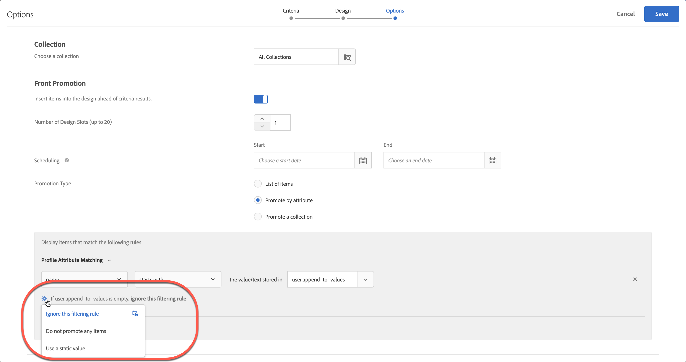
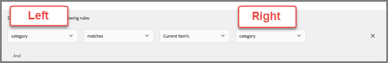

# Use dynamic and static inclusion rules {#inclusion-rules}

>[!BEGINSHADEBOX]

**On this page:** Learn how to add dynamic and static filtering rules to criteria and promotions in [!DNL Adobe Target Recommendations].

>[!ENDSHADEBOX]

Inclusion rules narrow the items that can appear in recommendations. They are created for criteria and promotions in [!DNL Adobe Target], with dynamic or static filtering rules. The process, the use cases, and the examples are similar for criteria and promotions, so this page covers both.

## Add filtering rules {#add-filtering-rules}

The following steps add a filtering rule to criteria.

1. While [creating criteria](/help/main/c-recommendations/c-algorithms/create-new-algorithm.md#create-criteria) (**[!UICONTROL Recommendations]** > **[!UICONTROL Criteria]** > **[!UICONTROL Create Criteria]** > **[!UICONTROL Create Criteria]**), click **[!UICONTROL Add Filtering Rule]** under **[!UICONTROL Inclusion Rules]**.

   

1. In the "What other rules should the recommendation obey" box, click the **[!UICONTROL Static Filter]** drop-down list, then select the desired option.

   

   The available options vary depending on the selected industry vertical and recommendation key.

To add a filtering rule to a promotion, select **[!UICONTROL Promote by Attribute]** while [creating the promotion](/help/main/c-recommendations/t-create-recs-activity/adding-promotions.md), then click **[!UICONTROL Add Filtering Rule]**.

## Filter types {#filter-types}

The following sections describe the filtering options for **[!UICONTROL Dynamic Filtering]** and **[!UICONTROL Filter by Value]**, for both criteria and promotions.

### Dynamic Filtering

Dynamic inclusion rules adapt to the visitor or to the request, whereas static inclusion rules use fixed values.

* Dynamic inclusion rules deliver recommendations by matching an attribute in a profile parameter of the user or in an mbox call.

  For example, a "Most Popular Criteria" recommendation can be created. From the set of returned recommendations, any recommendation can be filtered out (in real time) against an attribute that is passed when the user accesses a page where the recommendations are displayed.

* Any number of dynamic inclusion rules can be created. The inclusion rules are joined with an AND operator, so all rules must be met for an item to be included in a recommendation.

The following options are available for dynamic filtering:

|Dynamic filtering option|Details|
| --- | --- |
|[**[!UICONTROL Entity Attribute Matching]**](/help/main/c-recommendations/c-algorithms/entity-attribute-matching.md)|Filters dynamically by comparing a pool of potential recommended items to a specific item that the visitor has interacted with.
Use **[!UICONTROL Entity Attribute Matching]** to show recommendations that are most likely to appeal to the visitor, such as the favorite brand of the visitor.|
|[**[!UICONTROL Profile Attribute Matching]**](/help/main/c-recommendations/c-algorithms/profile-attribute-matching.md)|Filters dynamically by comparing items (entities) against a value in the profile of the visitor.
Use **[!UICONTROL Profile Attribute Matching]** to show recommendations that match a value stored in the profile of the visitor, such as size or favorite brand.|
|[**[!UICONTROL Parameter Matching]**](/help/main/c-recommendations/c-algorithms/parameter-matching.md)|Filters dynamically by comparing items (entities) against a value in the request (API or mbox).
Use **[!UICONTROL Parameter Matching]** to recommend content that matches the page parameters or the parameters of the visitor, such as device dimensions or geo-location.|

### Filter by Value

Static rules limit which items are included in the recommendation, instead of using collections. The following option is available for filtering by value:

|Filtering by value option|Details|
| --- | --- |
|[**[!UICONTROL Static Filter]**](/help/main/c-recommendations/c-algorithms/static-value.md)|Filters by one or more static values that are entered manually.|

## Available operators {#operators}

The following examples show how dynamic promotions and exclusions can be used for marketing.

>[!NOTE]
>
>The "list" operators require that both the entities and the profile attributes are stored as arrays. A comma-separated list does not work.

|Operator|Available with|Examples|
|--- |--- |--- |
|**[!UICONTROL equals any of]**|**[!UICONTROL Entity Attribute Matching]**, **[!UICONTROL Profile Attribute Matching]**, **[!UICONTROL Parameter Matching]**, and **[!UICONTROL Static Filter]**|When a visitor is viewing an item on the website (such as a product, article, or movie), dynamic promotions that use the "equals" operator can promote other items from:<ul><li>The same brand</li><li>The same category</li><li>The same category AND from the house brand</li><li>The same store</li></ul>|
|**[!UICONTROL does not equal any of]**|**[!UICONTROL Entity Attribute Matching]**, **[!UICONTROL Profile Attribute Matching]**, **[!UICONTROL Parameter Matching]**, and **[!UICONTROL Static Filter]**|When a visitor is viewing an item on the website (such as a product, article, or movie), dynamic promotions that use the "**[!UICONTROL does not equal any of]**" operator can promote other items from:<ul><li>A different TV series</li><li>A different genre</li><li>A different product series</li><li>A different style ID</li></ul>|
|**[!UICONTROL is greater than or equal to any of]**|**[!UICONTROL Entity Attribute Matching]**, **[!UICONTROL Profile Attribute Matching]**, **[!UICONTROL Parameter Matching]**, and **[!UICONTROL Static Filter]**|When a visitor is viewing an item on the website (such as a product), the "**[!UICONTROL is greater than or equal to any of]**" operator can promote other items that:<ul><li>Cost the same or are more expensive</li></ul>|
|**[!UICONTROL is less than or equal to any of]**|**[!UICONTROL Entity Attribute Matching]**, **[!UICONTROL Profile Attribute Matching]**, **[!UICONTROL Parameter Matching]**, and **[!UICONTROL Static Filter]**|When a visitor is viewing an item on the website (such as a product), the "**[!UICONTROL is less than or equal to any of]**" operator can promote other items that:<ul><li>Cost the same or are less expensive</li></ul>|
|**[!UICONTROL contains any of]**|**[!UICONTROL Entity Attribute Matching]**, **[!UICONTROL Profile Attribute Matching]**, **[!UICONTROL Parameter Matching]**, and **[!UICONTROL Static Filter]**|When a visitor is viewing an item on the website (such as a product), the "**[!UICONTROL contains any of]**" operator can promote other items that:<ul><li>Title contains the same brand</li></ul>|
|**[!UICONTROL does not contain any of]**|**[!UICONTROL Entity Attribute Matching]**, **[!UICONTROL Profile Attribute Matching]**, **[!UICONTROL Parameter Matching]**, and **[!UICONTROL Static Filter]**|When a visitor is viewing an item on the website (such as a product), the "**[!UICONTROL does not contain any of]**" operator can promote other items that:<ul><li>Title does not contain a swear word</li></ul>|
|**[!UICONTROL starts with any of]**|**[!UICONTROL Entity Attribute Matching]**, **[!UICONTROL Profile Attribute Matching]**, **[!UICONTROL Parameter Matching]**, and **[!UICONTROL Static Filter]**|When a visitor is viewing an item on the website (such as a product), the "**[!UICONTROL starts with any of]**" operator can promote other items that:<ul><li>Product name starts with iPhone</li></ul>|
|**[!UICONTROL ends with any of]**|**[!UICONTROL Entity Attribute Matching]**, **[!UICONTROL Profile Attribute Matching]**, **[!UICONTROL Parameter Matching]**, and **[!UICONTROL Static Filter]**|When a visitor is viewing an item on the website (such as a product), the "**[!UICONTROL ends with any of]**" operator can promote other items that:<ul><li>Content ends with EN, which indicates the English language</li></ul>|
|**[!UICONTROL is between]**|**[!UICONTROL Entity Attribute Matching]**, **[!UICONTROL Profile Attribute Matching]**, and **[!UICONTROL Parameter Matching]**|When a visitor is viewing an item on the website (such as a product, article, or movie), dynamic promotions that use the "**[!UICONTROL is between]**" operator can promote other items that are:<ul><li>More expensive</li><li>Less expensive</li><li>Cost plus or minus 30%</li><li>Later episodes in the same season</li><li>Prior books in a series</li></ul>|
|**[!UICONTROL list contains an item in]** (list on the right side)|**[!UICONTROL Profile Attribute Matching]** and **[!UICONTROL Parameter Matching]**|In profile attribute matching, when a visitor is viewing an item on the website (such as a product, article, or movie), the "**[!UICONTROL list contains an item in]**" operator can promote other items that are:<ul><li>Available in the geography of the visitor</li></ul>**Example**: Recommend items that are available only in the geographic area of the visitor.
The filter rule might look like this:
`availableGeographies list contains an item in user.currentGeography`
**Note**: When this operator is used, a list is expected on the [right side](#caveats) of the rule.|
|**[!UICONTROL list does not contain an item in]** (list on the right side)|**[!UICONTROL Profile Attribute Matching]** and **[!UICONTROL Parameter Matching]**|In profile attribute matching, when a visitor is viewing an item on the website (such as a product, article, or movie), the "**[!UICONTROL list does not contain an item in]**" operator can exclude other items that are:<ul><li>In the list of the last ten items that the visitor has viewed</li></ul>**Example**: Items that the visitor has recently viewed and has shown no interest in are not promoted.
The filtering rule might look like this:
`id is not contained in list user.lastViewedItems`
**Note**: When this operator is used, a list is expected on the [right side](#caveats) of the rule.|
|**[!UICONTROL list contains an item in]** (lists on both sides)|**[!UICONTROL Entity Attribute Matching]**, **[!UICONTROL Profile Attribute Matching]**, and **[!UICONTROL Parameter Matching]**|In profile attribute matching, when a visitor is viewing an item on the website (such as a sporting event or concert), the "**[!UICONTROL list contains an item in]**" operator can promote other items that are:<ul><li>Associated with one of the favorite teams of the visitor</li></ul>**Example**: Recommend games that are associated with one of the favorite teams of the visitor.
The filtering rule might look like this:
`teamsPlaying list contains an item in user.favoriteTeams`
**Note**: When this operator is used, a list is expected on [both sides](#caveats) of the rule.|
|**[!UICONTROL list does not contain an item in]** (lists on both sides)|**[!UICONTROL Entity Attribute Matching]**, **[!UICONTROL Profile Attribute Matching]**, and **[!UICONTROL Parameter Matching]**|In parameter matching, when a visitor is viewing an item on the website (such as a product, article, or movie), the "**[!UICONTROL list does not contain an item in]**" operator can exclude other items that are:<ul><li>Contained in a list of prohibited types</li></ul>**Example**: Items that are available only to adult visitors, such as tobacco and alcohol, are excluded.
The filtering rule might look like this:
`itemType is not contained in list mbox.prohibitedTypes`
**Note**: When this operator is used, a list is expected on [both sides](#caveats) of the rule.|
|**[!UICONTROL list contains all items in]**|**[!UICONTROL Entity Attribute Matching]**, **[!UICONTROL Profile Attribute Matching]**, and **[!UICONTROL Parameter Matching]**|In profile attribute matching, when a visitor is viewing an item on the website (such as a job posting or recipe), the "**[!UICONTROL list contains all items in]**" operator can promote other items that:<ul><li>Include a set of skills</li><li>Include a set of required ingredients</li></ul>**Example 1**: A visitor has a set of skills (Java, C++, and HTML). The items in the catalog are jobs with required skills (Java and HTML). The visitor profile must contain all the required skills before the job is recommended to the visitor.
The filtering rule might look like this:
`profile.jobSeekerSkills contains all items in entity.requiredSkills`
**Example 2**: A user has a list of pantry ingredients. The recipe has a list of required ingredients. The visitor profile must contain all the required ingredients before the recipe is recommended to the visitor.
The filtering rule might look like this:
`profile.ingredientsInPantry contains all items in recipe.ingredientsRequired`
**Note**: When this operator is used, a list is expected on [both sides](#caveats) of the rule.|
|**[!UICONTROL list does not contain all items in]**|**[!UICONTROL Entity Attribute Matching]**, **[!UICONTROL Profile Attribute Matching]**, and **[!UICONTROL Parameter Matching]**|In entity attribute matching, when a visitor is viewing an item on the website (such as a sporting event or concert), the "**[!UICONTROL list does not contain all items in]**" operator can promote other items that:<ul><li>Do not include a set of teams</li></ul>**Example**: A sporting event includes two teams. The profile of the visitor indicates that this visitor does not want to view games for these teams, so a game must not be recommended if these teams are playing.
The filtering rule might look like this:
`profile.leastfavoriteTeams does not contain all items in entity.teamsPlaying`
**Note**: When this operator is used, a list is expected on [both sides](#caveats) of the rule.|

## Handle empty values {#empty-values}

Several options are available to handle empty values when filtering by **[!UICONTROL Entity Attribute Matching]**, **[!UICONTROL Profile Attribute Matching]**, and **[!UICONTROL Parameter Matching]**, for criteria and promotions.

Previously, no results were returned if a value was empty. The "If *x* is Empty" drop-down list specifies the action to perform when the criteria has empty values, as shown in the following illustration:

To select the desired action, hover over the gear icon (  ), then choose the desired action:

| Action | Available for | Details |
|--- |--- |--- |
|**[!UICONTROL Ignore this filtering rule]**|**[!UICONTROL Profile Attribute Matching]** and **[!UICONTROL Parameter Matching]**|This action is the default for **[!UICONTROL Profile Attribute Matching]** and **[!UICONTROL Parameter Matching]**.
The rule is ignored. For example, if there are three filtering rules and the third rule does not pass any values, the third rule with the empty values can be ignored instead of returning no results.|
|**[!UICONTROL Do not show any results for this criteria]**
(Criteria only)|**[!UICONTROL Entity Attribute Matching]**, **[!UICONTROL Profile Attribute Matching]**, and **[!UICONTROL Parameter Matching]**|This action is the default for **[!UICONTROL Entity Attribute Matching]**.
This action is how [!DNL Target] handled empty values before this option was added: no results are shown for this criteria.|
|**[!UICONTROL Do not promote any items]**
(Promotions only)|**[!UICONTROL Entity Attribute Matching]**, **[!UICONTROL Profile Attribute Matching]**, and **[!UICONTROL Parameter Matching]**|This action is the default for **[!UICONTROL Entity Attribute Matching]**.
This action is how [!DNL Target] handled empty values before this option was added: no results are shown for this promotion.|
|**[!UICONTROL Use a static value]**|**[!UICONTROL Entity Attribute Matching]**, **[!UICONTROL Profile Attribute Matching]**, and **[!UICONTROL Parameter Matching]**|A static value can be used when a value is empty.|

## Caveats {#caveats}

>[!IMPORTANT]
>
>Different data type attributes might not be compatible in dynamic criteria or promotions at runtime with the "equals" and "does not equal" operators. When the left-hand side has predefined attributes or custom attributes, choose **[!UICONTROL Value]**, **[!UICONTROL Margin]**, **[!UICONTROL Inventory]**, and **[!UICONTROL Environment]** values on the right-hand side carefully.

The following table shows rules that are compatible and rules that might not be compatible at runtime:

| Compatible rules | Potentially incompatible rules |
|--- |--- |
|value - is between - 90% and 110% of current item's - salesValue|salesValue - is between - 90% and 110% of current item's - value|
|value - is between - 90% and 110% of current item's - value|clearancePrice - is between - 90% and 110% of current item's - margin|
|margin - is between - 90% and 110% of current item's - margin|storeInventory - equals - current item's - inventory|
|inventory - equals - current item's - inventory||
