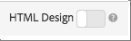
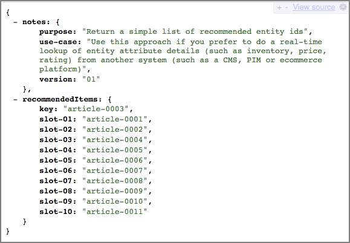

# Create a design {#create-design}

>[!BEGINSHADEBOX]

**On this page:** Learn how to create, edit, copy, and delete designs in [!DNL Adobe Target Recommendations], and how to return recommendations as JSON.

>[!ENDSHADEBOX]

A design defines how recommendations appear on a page. A design can be based on a default design or created as a custom design. The **[!UICONTROL Recommendations]** > **[!UICONTROL Designs]** screen displays both the default design cards and the designs that have been created in the account.

* A default design cannot be edited or deleted.
* A custom design can be edited, copied, or deleted.
* To create a design based on a default design, first copy the design, then edit the copy.

A design can be created during the activity-creation process from within the **[!UICONTROL Visual Experience Composer]** (VEC), or from the design library outside of activity creation. The following steps assume that the design is created from the library, but the steps are similar.

## Create a design from the library {#steps}

1. Click **[!UICONTROL Recommendations]** > **[!UICONTROL Designs]** to display the **[!UICONTROL Designs]** library.

1. Start the design in one of the following ways:

   * To base the design on a default design or on an existing design, click the More Actions icon (  ) for that design, then click **[!UICONTROL Copy]**. The **[!UICONTROL Create Design]** dialog box displays. The edited copy becomes a new custom design.
   * To create a custom design from scratch, click **[!UICONTROL Create Design]**.

      

1. Type a **[!UICONTROL Name]** and select an optional preview image to display on the design card.

   When a default design is used, the design name followed by "Copy" appears in the **[!UICONTROL Content Name]** field. The name can be edited.

1. (Conditional) Edit the design **[!UICONTROL Code]**, as desired.

   Recommendation designs use the open-source Velocity design language. For information about Velocity, see [https://velocity.apache.org](https://velocity.apache.org) and [Customize a design using Velocity](/help/main/c-recommendations/c-design-overview/customizing-a-template.md).

   A design can be HTML or non-HTML. By default, HTML designs are wrapped with a `<div>` tag to allow for click-tracking in a Web environment. Non-HTML designs are for non-Web environments where click-tracking is not possible. Slide the **[!UICONTROL HTML Design]** toggle to the "off" position to use non-HTML code.

   >[!NOTE]
   >
   >The maximum number of entities that can be referenced in a design, either hard-coded or through loops, is 99.

1. Click **[!UICONTROL Create]**.

1. Click the More Actions icon (  ) for the design to edit, copy, or delete, then click the appropriate option: **[!UICONTROL Edit]**, **[!UICONTROL Copy]**, or **[!UICONTROL Delete]**.

    

Designs are available across the entire account. The usage across accounts must be considered before a design is deleted. Deleted designs cannot be recovered.

## JSON example {#json-example}

The following example shows how JSON responses can be returned when an activity is configured with the [form-based editor](/help/main/c-experiences/form-experience-composer.md).

1. Create a design from within the **[!UICONTROL Design library]** or within the form-based workflow. A design that is created inside the **[!UICONTROL Visual Experience Composer]** (VEC) workflow can only be an HTML design, which is wrapped in a `<div>` for click-tracking purposes.

1. Ensure that the **[!UICONTROL HTML Design]** option is turned off:

   

1. Paste code such as the following example into the design:

   +++ Sample design code that returns a list of entity IDs

   ```javascript
       #* 
       * "Return a simple list of recommended entity ids"   
       *#

       {   
         "notes":{   
         "purpose": "Return a simple list of recommended entity ids",   
         "use-case": "Use this approach if you prefer to do a real-time lookup of entity attribute details (such as inventory, price, rating) from another system (such as a CMS, PIM or ecommerce platform)",   
         "version": "01"   
         },   
         "recommendedItems": {   
           "key": "$key.id",   
           "slot-01": "$entity1.id",   
           "slot-02": "$entity2.id",   
           "slot-03": "$entity3.id",   
           "slot-04": "$entity4.id",   
           "slot-05": "$entity5.id",   
           "slot-06": "$entity6.id",   
           "slot-07": "$entity7.id",   
           "slot-08": "$entity8.id",   
           "slot-09": "$entity9.id",   
           "slot-10": "$entity10.id"   
         }   
       }  
   ```

   +++

1. Set up a form-based [!DNL Recommendations] activity that uses this design.

    +++ Learn how to set up a form-based [!DNL Recommendations] activity 

    1. Navigate to the **[!UICONTROL Activities]** page.
    1. Click **[!UICONTROL Create Activity]** > **[!UICONTROL Recommendations]**.
    1. Under **[!UICONTROL Choose Experience Composer]**, select **[!UICONTROL Form]**, then click **[!UICONTROL Next]**.
    1. Under location, enter the text "Sample_Recs_Response".
    1. Under **[!UICONTROL Default Content]**, click the down-arrow, then click **[!UICONTROL Add Recommendation]**.
    1. Choose a Page Type. This determines the initial filtering of the next screen.
    1. Select a Criteria card, then click **[!UICONTROL Next]**.
    1. Select the design that was created in the previous step, then click **[!UICONTROL Next]**.
    1. Complete the setup process.
    1. Click the right arrow next to **[!UICONTROL Inactive]**, then select **[!UICONTROL Activate]**.

    +++

1. After the activity is set up and activated, a sample request can be set up to get back the clean JSON response.

   From the time that the activity is saved, [!DNL Target] needs to build a model to support the selected criteria configuration. Depending on a number of factors, this process might take some time. Results appear once the model has been built.

   For example:

   ```
   https://[YOUR_CLIENT_CODE].tt.omtrdc.net/m2/YOUR_CLIENT_CODE/ubox/raw?mbox=[YOUR_MBOX_NAME]&mboxContentType=text/html&mboxXDomain=disabled&entity.id=[ENTITY_ID]&mboxHost=rawbox_sample&at_property=[AT_PROPERTY_TOKEN]&mboxNoRedirect=true&mboxPC=1234-4321&mboxSession=9876-7000
   ```

   where

   | Parameter | Value |
   |--- |--- |
   |`[YOUR_CLIENT_CODE]`|The [!DNL Target] client code (available on /help/target/products.html#recsSettings  > Recommendations API Token > Client Code).|
   |`[YOUR_MBOX_NAME]`|The name that was selected in the "locations" section of the form-based Recommendations activity, in this case Sample_Recs_Response.|
   |`[ENTITY_ID]`|The `entity.id` of an item in the catalog.|
   |`[AT_PROPERTY_TOKEN]`|(Optional) Added when a Property (part of Enterprise Permissions) was selected during the activity setup.|

After the algorithm has run and results are available, the response looks similar to the following:

{width="575px"}

## Additional JSON object tips {#json-tips}

A simple comma-delimited list of items can also be sent back by setting up a design with the following syntax:

```
$entity1.id, $entity2.id, $entity3.id, $entity4.id, $entity5.id, 
```

Additional information can also be sent in the response. The following code is a more complex example that returns much more than the entity IDs with their associated slots (order). This design example also returns activity details, **[!UICONTROL Target Profile]** details (as applicable), and other `entity.attributes` associated with the items returned.

+++ Sample design code that returns activity, profile, and entity details
  
  ```javascript
    {   
     "adobeRecommendations": {   
      "notes": {   
       "purpose": "Return a list of entity ids with their associated entity.attributes",   
       "use-case": "Use this approach to avoid looking up attribute details after receiving a response from Target",   
       "version": "01"   
      },   
      "recommendedItems": {   
       "slot-01": "$entity1.id",   
       "slot-02": "$entity2.id",   
       "slot-03": "$entity3.id",   
       "slot-04": "$entity4.id",   
       "slot-05": "$entity5.id",   
       "slot-06": "$entity6.id",   
       "slot-07": "$entity7.id",   
       "slot-08": "$entity8.id",   
       "slot-09": "$entity9.id",   
       "slot-10": "$entity10.id"   
      },   
      "activityDetails": {   
       "mbox.name": "email-mbox",   
       "campaign.name": "\${campaign.name}",   
       "campaign.id": "\${campaign.id}",   
       "campaign.recipe.name": "\${campaign.recipe.name}",   
       "campaign.recipe.id": "\${campaign.recipe.id}",   
       "offer.name": "\${offer.name}",   
       "offer.id": "\${offer.id}",   
       "criteria.title": "$criteria.title",   
       "algorithm.name": "$algorithm.name",   
       "algorithm.dayCount": "$algorithm.dayCount"   
      },   
      "visitorProfile": {   
       "profile.favorite-category": "\${profile.favorite-category}",   
       "profile.test": "\${profile.test}",   
       "user.endpoint.lastPurchasedEntity": "\${user.endpoint.lastPurchasedEntity}",   
       "user.endpoint.lastViewedEntity": "\${user.endpoint.lastViewedEntity}",   
       "user.endpoint.mostViewedEntity": "\${user.endpoint.mostViewedEntity}",   
       "user.endpoint.categoryAffinity": "\${user.endpoint.categoryAffinity}",   
       "profile.geolocation.city": "\${profile.geolocation.city}",   
       "profile.geolocation.dma": "\${profile.geolocation.dma}",   
       "profile.geolocation.state": "\${profile.geolocation.state}",   
       "profile.geolocation.country": "\${profile.geolocation.country}",   
       "profile.sessionCount": "\${profile.sessionCount}",   
       "profile.averageDaysBetweenVisits": "\${profile.averageDaysBetweenVisits}",   
       "profile.browserTime": "\${profile.browserTime}",   
       "user.activeActivities": "\${user.activeActivities}",   
       "user.pcId": "\${user.pcId}",   
       "user.isFirstSession": "\${user.isFirstSession}",   
       "user.isNewSession": "\${user.isNewSession}",   
       "user.header": "\${user.header}",   
       "user.parameter": "\${user.parameter}"   
      },   
      "recKey": {   
       "recKeyDetails": {   
        "id": "$key.id",   
        "name": "$key.name",   
        "category": "$key.category",   
        "pageUrl": "$key.pageUrl",   
        "thumbnailUrl": "$key.thumbnailUrl"   
       }   
      },   
      "recDetailedResults": {   
       "recEntity1Details": {   
        "id": "$entity1.id",   
        "name": "$entity1.name",   
        "category": "$entity1.category",   
        "pageUrl": "$entity1.pageUrl",   
        "thumbnailUrl": "$entity1.thumbnailUrl"   
       },   
       "recEntity2Details": {   
        "id": "$entity2.id",   
        "name": "$entity2.name",   
        "category": "$entity2.category",   
        "pageUrl": "$entity2.pageUrl",   
        "thumbnailUrl": "$entity2.thumbnailUrl"   
       },   
       "recEntity3Details": {   
        "id": "$entity3.id",   
        "name": "$entity3.name",   
        "category": "$entity3.category",   
        "pageUrl": "$entity3.pageUrl",   
        "thumbnailUrl": "$entity3.thumbnailUrl"   
       },   
       "recEntity4Details": {   
        "id": "$entity4.id",   
        "name": "$entity4.name",   
        "category": "$entity4.category",   
        "pageUrl": "$entity4.pageUrl",   
        "thumbnailUrl": "$entity4.thumbnailUrl"   
       },   
       "recEntity5Details": {   
        "id": "$entity5.id",   
        "name": "$entity5.name",   
        "category": "$entity5.category",   
        "pageUrl": "$entity5.pageUrl",   
        "thumbnailUrl": "$entity5.thumbnailUrl"   
       },   
       "recEntity6Details": {   
        "id": "$entity6.id",   
        "name": "$entity6.name",   
        "category": "$entity6.category",   
        "pageUrl": "$entity6.pageUrl",   
        "thumbnailUrl": "$entity6.thumbnailUrl"   
       },   
       "recEntity7Details": {   
        "id": "$entity7.id",   
        "name": "$entity7.name",   
        "category": "$entity7.category",   
        "pageUrl": "$entity7.pageUrl",   
        "thumbnailUrl": "$entity7.thumbnailUrl"   
       },   
       "recEntity8Details": {   
        "id": "$entity8.id",   
        "name": "$entity8.name",   
        "category": "$entity8.category",   
        "pageUrl": "$entity8.pageUrl",   
        "thumbnailUrl": "$entity8.thumbnailUrl"   
       },   
       "recEntity9Details": {   
        "id": "$entity9.id",   
        "name": "$entity9.name",   
        "category": "$entity9.category",   
        "pageUrl": "$entity9.pageUrl",   
        "thumbnailUrl": "$entity9.thumbnailUrl"   
       },   
       "recEntity10Details": {   
        "id": "$entity10.id",   
        "name": "$entity10.name",   
        "category": "$entity10.category",   
        "pageUrl": "$entity10.pageUrl",   
        "thumbnailUrl": "$entity10.thumbnailUrl"   
       }   
      }   
     }   
    }  
  
  ```

+++

