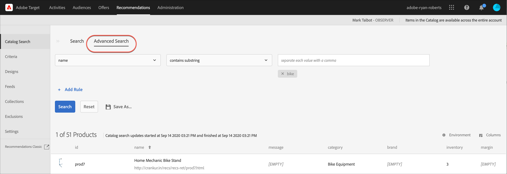
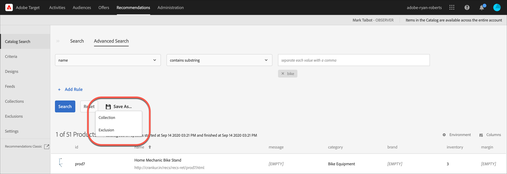
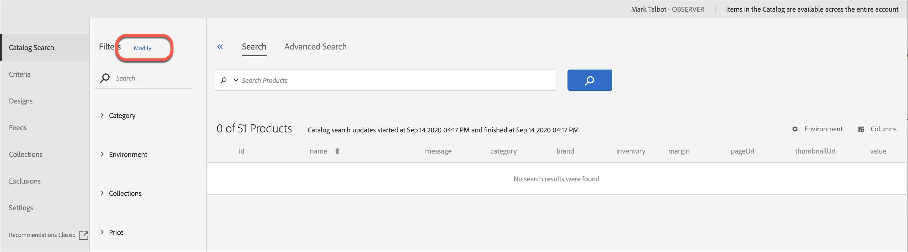
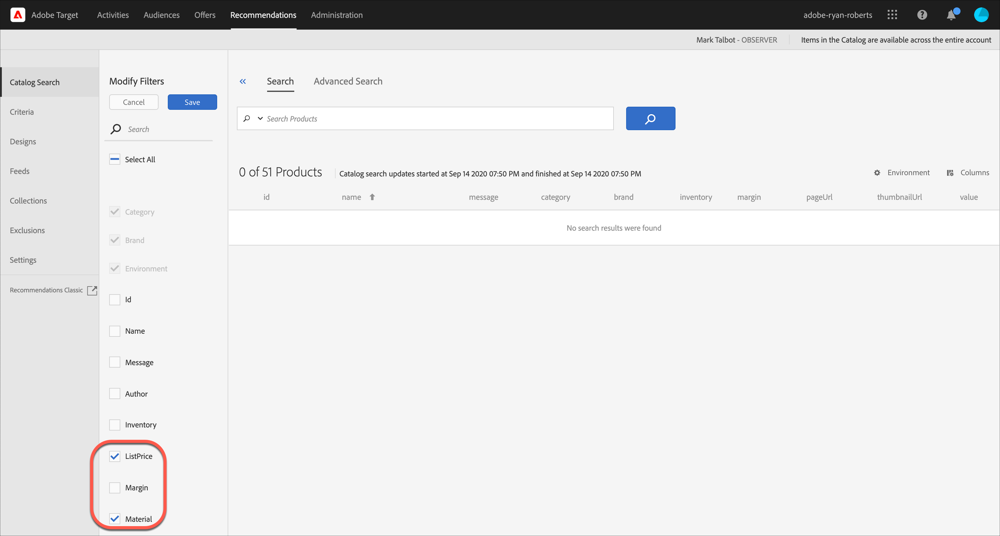

# [!UICONTROL Catalog Search] {#catalog-search}

>[!BEGINSHADEBOX]

**On this page:** Learn how to search the catalog in [!DNL Adobe Recommendations] to locate products or content, and how to filter, view, and remove items.

>[!ENDSHADEBOX]

The [!UICONTROL Catalog Search] page in [!DNL Adobe Recommendations] helps you locate the products or content in your catalog. The most basic task you can perform on this page is to search for an item. In addition, you can change the environment, filter facets, modify columns in the table, add new search facets, and more.

Catalogs refer to your entire product set (entities). Your catalog can contain many collections, a way to organize your products in logical buckets.

The index of your catalog is automatically created when you upload your first feed, and refreshed according to the [specified schedule](/help/main/c-recommendations/c-products/feeds.md#steps).

The catalog is automatically refreshed when updates are received via feed files, API, or mbox updates. Updates are usually completed within an hour. If updates are in progress, the time that the most recent update started displays. If no updates are in progress, the time that the most recent update started and finished displays.

## Search the catalog

Use the search results to review the items in your catalog and, if needed, remove items from it.

1. Click **[!UICONTROL Recommendations]** > **[!UICONTROL Catalog Search]**.

1. (Optional) To filter the results, click the **[!UICONTROL Show Filters]** icon (  ), then select the filters that you want to apply. You can filter by **[!UICONTROL Environment]**, **[!UICONTROL Collections]**, **[!UICONTROL Category]**, **[!UICONTROL Brand]**, **[!UICONTROL Inventory]**, and **[!UICONTROL Value]**.

   [Environments](/help/main/administrating-target/environments.md) let you organize your sites and pre-production environments for management and separated reporting. To change the environment, select the desired environment from the **[!UICONTROL Environment]** drop-down list.

   

1. Type a search term in the **[!UICONTROL Search In]** field.

1. (Optional) You can refine your search by selecting a search option from the options menu that displays when you click the down arrow in the **[!UICONTROL Search In]** field.

   Search options include the following:

   * ID
   * Name
   * Message

1. Click the **[!UICONTROL Customize Table]** icon (   ) to modify the active columns on the [!UICONTROL Catalog Search] page.

   

1. Scroll through the items in the search results to view thumbnails and other product information.

   >[!NOTE]
   >
   > When you perform a catalog search on a custom attribute with a numeric value, the results treat the custom attribute to be a string type instead of a numeric value.
   >
   >There is no functionality currently available that lets you change the type of an attribute. To make a change, [open a customer issue](/help/main/cmp-resources-and-contact-information.md#reference_ACA3391A00EF467B87930A450050077C) referencing the attributes that need the type changed from string to numeric.

1. Click an item in the search results to view its details, including its ID, name, message, category, and more.

   

1. To remove the item from the catalog, click **[!UICONTROL Remove from Catalog]**.

   All information about that item is then removed from the catalog index. The item will be included in your catalog only if it is added again in a data feed. A deleted item must be separately deleted from feeds.

   

<!--
### Perform an advanced search {#advanced-search}

You can use [!UICONTROL Advanced Search] to further refine your search results or to save your search results as a [collection](/help/main/c-recommendations/c-products/collections.md) or [exclusion](/help/main/c-recommendations/c-products/exclusions.md).

1. Click the **[!UICONTROL Advanced Search]** link.

   

1. Use the drop-down lists to specify the parameter, operator, and values for your search.

1. (Optional) Click **[!UICONTROL Add Rule]** to add an additional search rule.

   Each additional search rule is joined with the AND operator.

1. Click **[!UICONTROL Search]**.

1. (Optional) Click **[!UICONTROL Save As]**, then click **[!UICONTROL Collection]** or **[!UICONTROL Exclusion]**.

   

   For more information, see [Create a collection or exclusion based on Advanced Search](#save-as) below.
-->

<!--
## Modify the Catalog Search page (filters and columns)

You can temporarily modify the available filters and columns on the [!UICONTROL Catalog Search] page for the current session.

### Modify filters

You can add additional filter facets to the [!UICONTROL Catalog Search] page.

1. In the **[!UICONTROL Filters]** panel, click **[!UICONTROL Modify]**.

   

1. Select the desired search facets (ID, name, message, etc.), then click **[!UICONTROL Save]**.

   

Keep in mind that the additional filter facets are available in the current session only.
-->

<!--
## Create a collection or exclusion based on Advanced Search {#save-as}

You can create [collections](/help/main/c-recommendations/c-products/collections.md) or [exclusions](/help/main/c-recommendations/c-products/exclusions.md) using [!UICONTROL Advanced Search] on the [!UICONTROL Catalog Search] page ([!UICONTROL Recommendations] > [!UICONTROL Catalog Search] > [!UICONTROL Advanced Search]).

1. Perform an [advanced search](#advanced-search).

1. Click **[!UICONTROL Save As]**, then click **[!UICONTROL Collection]** or **[!UICONTROL Exclusion]**.

   

   >[!IMPORTANT]
   >
   >The [!UICONTROL Advanced Search] functionality is case-insensitive; however, products returned at the time of delivery are based on case-sensitive search. This mismatch might lead to confusion. Ensure that you consider case-sensitivity when you create collections or exclusions based on results using the [!UICONTROL Advanced Search] functionality. For example, if you perform a search for "Holiday," that initial search lists results containing "Holiday" and "holiday." If you then create a catalog with the intent to return products containing "holiday," only products containing "holiday" are returned. Products containing "Holiday" are not returned. Exclusions are handled in a similar fashion.
-->
