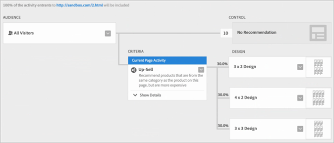

# Recommendations Classic versus Recommendations activities in [!DNL Target] Premium {#classic-versus-activities}

>[!BEGINSHADEBOX]

**On this page:** Learn how [!DNL Recommendations Classic] differs from [!DNL Recommendations] activities in [!DNL Target Premium], to choose between them.

>[!ENDSHADEBOX]

>[!NOTE]
>
>[!DNL Recommendations] activities are available as part of the [!DNL Target Premium] solution. They are not available in [!DNL Target Standard] without a [!DNL Target Premium] license.

In the classic [!DNL Recommendations] product, recommendations were displayed by creating a data collection mbox on a page, then adding a display mbox in a specific page location. The [!DNL Recommendations] activity in [!DNL Target Premium] collects visitor information and creates the recommendations anywhere on the page, without an mbox for each location where products or content are recommended. A JavaScript reference in the header of the page enables recommendations anywhere on the page. This reference passes keys, such as the `entity.id` and `entity.categoryId` keys, to the global [!DNL Target] mbox.

[!DNL Recommendations Classic] appears as its own card in the [!DNL Experience Cloud] UI. A [!DNL Recommendations] activity is available from within the [!DNL Target Premium] workflow.

[!DNL Recommendations Classic] users can continue to use their [!DNL Recommendations] mboxes in [!DNL Target Recommendations]. The classic and [!DNL Target] approaches can also be combined, by keeping the mboxes and using the JavaScript code in the header to activate [!DNL Recommendations] functionality for the other elements on the page. To gain full [!DNL Target] functionality, however, [!DNL Recommendations Classic] users might prefer to delete the old mbox and rely solely on [!DNL Target Recommendations].

The [!DNL Recommendations] activity in [!DNL Target] improves on [!DNL Recommendations Classic] in the following main areas.

## Recommendations as an offer {#recs-as-offer}

Recommendations can be included inside [!UICONTROL A/B Test] (including [!UICONTROL Auto-Allocate] and [!UICONTROL Auto-Target]) and [!UICONTROL Experience Targeting] (XT) activities. This allows testing and targeting recommendations and non-recommendations content within the same activity, among other capabilities. For more information, see [Recommendations as an offer](/help/main/c-recommendations/recommendations-as-an-offer.md).

## Criteria {#criteria-comparison}

[!DNL Target Recommendations] includes a criteria library with prepackaged sets of rules and configurations. In [!DNL Recommendations Classic], each recommendation was built manually by filling out a form and choosing from a large list of rules. When a [!DNL Recommendations] activity is created, a pre-configured criteria set is chosen. Custom recommendations can still be created, but the criteria library contains many of the most common configurations, pre-built to simplify the process and using language that people understand. The prepackaged criteria can be used as is, or copied and edited to fit specific needs.

Criteria are pre-configured and sorted by industry verticals, page types, and implementation. For example, the criteria that apply to the retail vertical can be found for use on a product page, showing products from within a particular category (as defined by the `entity.categoryID` parameter).

For more information about using and creating criteria, see [Criteria](/help/main/c-recommendations/c-algorithms/algorithms.md).

## Workflow {#workflow-comparison}

The [!DNL Recommendations] workflow is simplified. Instead of complicated forms, a visual workflow guides through the following steps:

1. Select the criteria.
1. Select a pre-configured [design](/help/main/c-recommendations/c-design-overview/create-design.md#create-design).
1. Preview the resulting recommendations.

## Visual preview {#visual-preview}

Recommendations can be previewed after they are set up, and any necessary changes can be made, without creating the recommendations on the page and then testing them. Previews are available from within [!DNL Target].

## Targeting {#targeting-comparison}

[!DNL Recommendations Classic] had six targeting options. [!DNL Recommendations] activities use the full range of [!DNL Target] targeting options. An audience is defined using [!DNL Target] or other [!DNL Adobe Experience Cloud] audiences (such as [!DNL Audience Manager] and [!DNL Analytics]). The percentage of activity entrants who see each design, and the percentage who see the control, is then selected.

## Reporting {#reporting-comparison}

In [!DNL Target], [!DNL Recommendations] provides improved reporting that takes advantage of the capabilities of [!DNL Target] and the [!DNL Experience Cloud]. Instead of showing only the lift that [!DNL Recommendations] provides compared to the results without them, the reports show complete information about the [!DNL Recommendations] activity. 

