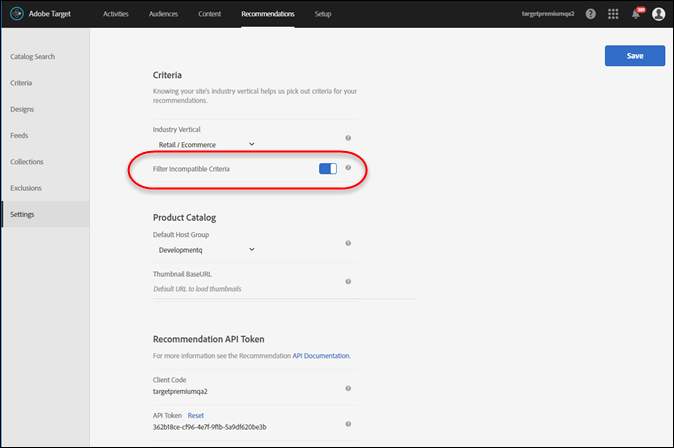
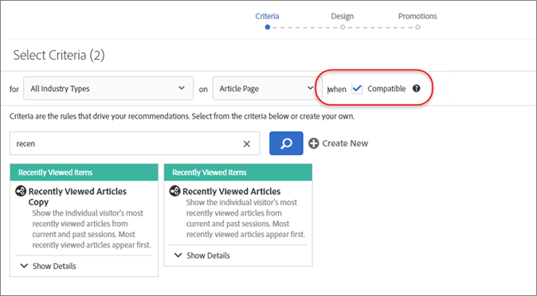
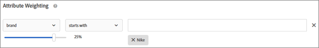
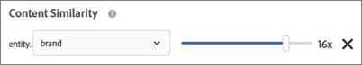
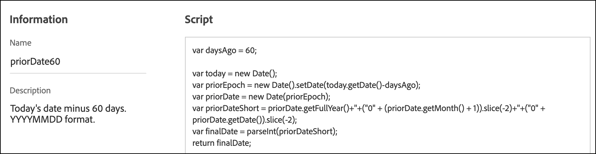
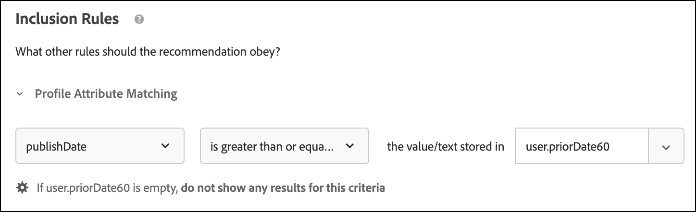

# Recommendations FAQ {#recommendations-faq}

>[!BEGINSHADEBOX]

**On this page:** Find answers to frequently asked questions about [!DNL Adobe Target] [!DNL Recommendations] activities.

>[!ENDSHADEBOX]

## Data and APIs {#data-and-apis}

+++ Do [!DNL Recommendations] objects created through the API display in the [!DNL Target] UI?

Yes. [!UICONTROL Recommendations] objects (**[!UICONTROL Criteria]**, **[!UICONTROL Designs]**, **[!UICONTROL Collections]**, and **[!UICONTROL Exclusions]**) created through the API are available in the UI, and can be edited through the API or the [!DNL Target] UI.

+++

+++ Can visual offers created in the [!DNL Target] UI be managed with the [!DNL Target] APIs?

No. [!DNL Recommendations] activities with visual offers created in the [!DNL Target] UI cannot be managed with the [!DNL Target] APIs. These activities display in the **[!UICONTROL Activities]** list, but they cannot be read or updated (with GET or PUT).

+++

+++ What is the size limit of an API call to insert or update products? Can 50,000 products be updated in one call instead of a feed?

[!DNL Target] imposes a 50-MB post limit at the application level, but only when the `application/x-www-form-urlencoded` content type header is passed.

A single call with 50,000 products can be attempted. If the call fails, it can be split into batches. Adobe recommends batches of 5,000 or 10,000 products to decrease the likelihood of a timeout due to system load.

+++

+++ What is the maximum size of a CSV file for a feed upload?

There is no hard limit on the number of rows or on the file size for a feed CSV file upload. As a best practice, Adobe recommends limiting the CSV file to 1 GB to avoid failures during the upload. A file that exceeds 1 GB can ideally be split into multiple feed files.

The maximum number of custom attribute columns is 100, and custom attributes are limited to 4096 characters. Other limits on the length of required columns are available on the [[!DNL Target] Limitations page](/help/main/r-troubleshooting-target/target-limits.md).

+++

+++ Why does **[!UICONTROL Catalog Search]** not show the correct results when searching on a custom attribute with a numeric value?

When a catalog search is performed on a custom attribute with a numeric value, the results treat the attribute as a string instead of a numeric value.

No functionality is currently available that allows customers to change the type of an attribute. To make a change, [open a customer issue](/help/main/cmp-resources-and-contact-information.md#reference_ACA3391A00EF467B87930A450050077C) that references the attributes whose type must change from string to numeric.

+++

## Update timing {#update-timing}

+++ How long does it take for updates to items in the catalog to be reflected on the site?

The time frame and results vary, depending on how the items are updated.

|Update|Recommendations|Catalog Search|
| --- | --- | --- |
|Item attributes updated through an mbox or the API|Within 15 minutes|After the catalog index (3-8 hours)|
|Item attributes updated through a feed|After the feed ingest (2-8 hours)|After the feed ingest (2-8 hours) and the subsequent catalog index (3-8 hours), within 5-16 hours in total|
|Item deleted from the catalog through the [!DNL Target] UI or API|Within 15 minutes|After the catalog index (3-8 hours)|
|Item added to the catalog through an mbox or the API|After the next algorithm run. Algorithm runs are scheduled every 12 hours for 1-2 day algorithms and every 24 hours for 7+ day algorithms|After the catalog index (3-8 hours)|
|Item added to the catalog through a feed|After the feed ingest (2-8 hours) and the subsequent algorithm runs, which are scheduled every 12 hours for 1-2 day algorithms and every 24 hours for 7+ day algorithms, within 2-32 hours in total|After the feed ingest (2-8 hours) and the catalog index (3-8 hours), within 5-16 hours in total|

Until the updates are available, the following content is shown:

* For updated or deleted items, the existing recommendations and item attributes are shown.
* For an added item, the existing recommendations are shown if the added item is not a requested key. Backup recommendations are shown if the added item is a requested key.

After a feed file is imported, or after entity updates are received through the API or an mbox, the following changes are reflected in under 60 minutes:

* If an item was previously excluded but should now be included, the item is included on the next algorithm run (12-24 hours).

  This situation occurs because [!DNL Target] applies exclusions both online and offline. When an item is newly excluded, the online exclusion applies quickly. When an item is newly included, the online exclusion goes away quickly, but the offline exclusion does not go away until the next algorithm run.

* If an item was previously included but should now be excluded, the item is excluded according to the time lines in the table, depending on the source: 15 minutes through an mbox or the API, or 12-24 hours through a feed.

The following changes are not reflected until the next algorithm run occurs (within 12-24 hours):

* Item attributes used in the collection rules of the activity.
* Item attributes used in a promotion that is based on an attribute or on a collection associated with the activity.
* The item category in which the item appears for a "Current Category" or "Favorite Category" in the **[!UICONTROL Top Sellers]** or **[!UICONTROL Most Viewed]** algorithm.
* The ranking of recommended items, when the changed attribute is a custom attribute that is used as the custom key for an algorithm.
* The ranking of recommended items based on one or more changed attributes, when the recommendation logic is "Items with similar attributes", or when "Content Similarity" or "Attribute Weighting" factors are used.

>[!NOTE]
>
>A feed file is considered imported when its status changes from "Importing Items" to "Preparing Search Index Updates". Updates can take more than 60 minutes to be reflected in the **[!UICONTROL Catalog Search]** user interface. **[!UICONTROL Catalog Search]** is up to date when the feed status changes to "Updates Completed". Even if **[!UICONTROL Catalog Search]** is not yet up to date, the site reflects the updates within the time frames listed above. The most recent **[!UICONTROL Catalog Search]** index update time is displayed on the **[!UICONTROL Catalog Search]** page.

+++

+++ How long does it take for a change to the configuration of a [!UICONTROL Recommendations] activity, offer, promotions, or criteria settings to be reflected on the site?

* A change to the promotion settings can take up to five hours to be reflected on the site.
* A change to other criteria settings might not be reflected until the next algorithm run:

  * Some criteria settings, for example the addition of a dynamic inclusion rule, are reflected instantly.
  * Other criteria settings, for example the removal of a dynamic inclusion rule or a change of the lookback window, cannot be incorporated until the next algorithm run.
  * These changes trigger an algorithm run, which can take up to 24 hours to complete. Algorithms also run on a schedule, every 12-24 hours.

+++

+++ How long does it take for the behavior of a user (for example, clicking product A and buying product B) to be reflected in the recommendations that same user receives?

* The product or content currently viewed or purchased influences the recommendations that the user receives on the same page view or [!DNL Target] content request.
* Historical user behavior, such as "last viewed product", "most viewed product", and the overall viewing and purchasing history, is updated with that request. It influences the recommendations that the user receives on the next page view or content request. For example, the **[!UICONTROL Recently Viewed Items]** and **[!UICONTROL Recommended For You]** algorithms update with each product view or purchase, and the update is reflected on the subsequent content request.

+++

+++ How long does it take for the behavior of a user to be reflected in the recommendations that other users receive?

The behavior of users in aggregate is incorporated into the offline algorithm processing. This processing occurs with every algorithm run, every 12-24 hours.

+++

+++ Do recommendations based on recently viewed items persist across multiple devices for a single visitor?

When a visitor initiates a session, the session ID is tied to a single edge machine, and a temporary profile cache is stored on this machine. Subsequent requests from the same session read this profile cache, including the recently viewed items.

When the session ends (generally when it expires after 30 minutes of no activity), the session state, including the recently viewed items, is persisted to a more permanent profile storage in the same geographic edge. Subsequent sessions from different devices can then access these recently viewed items, as long as the new session is linked to the customer profile through the same Marketing Cloud ID (MCID), Experience Cloud ID (ECID), or CustomerID or `mbox3rdPartyId`.

If a visitor has two active sessions at the same time, the recently viewed items on one device do not update the recently viewed items on the other device, unless the devices are forced to share the session ID. A potential workaround exists, but [!DNL Target] does not directly support sharing a session ID across multiple devices. The customer must manage this ID sharing.

This behavior also occurs when a visitor is active on one device and becomes active on the other device a few minutes later. The session of the first device does not expire for 30 minutes, and up to five minutes of delay can occur before the profile state is written to the permanent state and processed. When testing this behavior, allow 35 minutes for the session to expire and the profile to be stored.

If the visitor does not have two active sessions at the same time, the recently viewed items on one device update the recently viewed items on the other device, as long as the session has ended. When testing this behavior, allow 35 minutes for the session to expire.

+++

## Criteria, designs, and promotions {#criteria-designs-promotions}

+++ Why are not all criteria, including custom criteria, available for selection when creating a [!DNL Recommendations] activity?

The available criteria depend on the current category. When recommendations offers are created, the algorithm picker displays criteria based on the category ID. If the location where the criteria is applied does not contain the category ID, certain criteria are not available in the algorithm picker. If a location where the category ID is present in the mbox is used, the criteria picker contains all applicable criteria.

[!DNL Target] has a [Filter Incompatible Criteria](https://experienceleague.adobe.com/docs/target-dev/developer/recommendations.html){target=_blank} setting that controls the intelligent filtering of the algorithm picker. To access the **[!UICONTROL Filter Incompatible Criteria]** setting, click **[!UICONTROL Administration]** > **[!UICONTROL Recommendations]**.



* If the **[!UICONTROL Filter Incompatible Criteria]** setting is not enabled, [!DNL Target] does not filter the algorithms in the algorithm picker, and all algorithms are displayed.
* If the setting is enabled, in [!UICONTROL Visual Experience Composer] (VEC) activities, [!DNL Target] reads the entityId and the category ID from the selected location. It then displays algorithms based on `currentItem|currentCategory`, if the respective values are present on that location. As a result, only the algorithms that are compatible with the selected location are shown in the algorithm picker by default. The non-compatible algorithms can still be viewed by clearing the **[!UICONTROL Compatible]** check box while selecting criteria.

  

[!DNL Target] does not display the **[!UICONTROL Compatible]** check box in the following special cases:

* Both the entityId and the category ID are present on the location, so nothing is filtered.
* [!DNL mbox.js] version 55 or earlier is used.
* No mbox call is fired from the page (`!config.isAutoCreateGlobalMbox && !config.isRegionalMbox`).
* [!DNL Target] parameters are not defined.

>[!NOTE]
>
>The **[!UICONTROL Filter Incompatible Criteria]** setting applies to activities created in the [!UICONTROL Visual Experience Composer] (VEC) only. This setting does not apply to activities created in the **[!UICONTROL Form-Based Experience Composer]**, because [!DNL Target] does not have location context.

+++

+++ What is the difference between general attribute weighting and content similarity-specific attribute weighting?

Attribute weighting exists in two forms: "standard attribute weighting" and "content similarity attribute weighting".

* "Standard attribute weighting" applies to most criteria types, not only **[!UICONTROL Content Similarity]**. This type of weighting gives more weight to certain attribute values. In the following example, Nike products get a bump in the output recommendations.

  

* "Content similarity attribute weighting" applies to **[!UICONTROL Content Similarity]** criteria only. This type of weighting is more dynamic, and is based on the current "recommendation key" (the currently viewed item). In the following example (brand x 16), a visitor who views Nike sneakers is more likely to be recommended other Nike products (not necessarily only sneakers) than competitors' sneakers. A visitor who views Adidas sneakers is more likely to be recommended Adidas products.

  

+++

+++ Must the mbox name be specified when creating [!DNL Recommendations] criteria, promotions, or template testing rules?

When a [!DNL Recommendations] criteria, promotion, or template testing rule is created based on an mbox parameter, `mboxParameter` no longer prompts for `mboxName`. The mbox name is now optional. This change allows the use of parameters from multiple mboxes, or a reference to a parameter that has not yet been recorded on the edge.

To select the desired parameter, use one of the following methods:

* While creating a criteria, promotion, or template testing rule, select a parameter name from the list. Start typing the first characters of the parameter name, or type the full name.
* If the mbox name is known but the parameter name is not, use the check box to filter on a known mbox that passes the desired parameter.

With either method, there is no link between the mbox and the parameter. The criteria, promotion, or template testing rule works based on the parameter across all mboxes that pass that parameter.

When an existing criteria, promotion, or template testing rule is edited, the filtering displays the mbox name that was supplied during creation.

+++

+++ What can be done when special characters break an array?

Use escaped values in JavaScript. Quotation marks ( " ) can break the array. The following code snippet is an example of escaped values:

```
#set($String='') 
#set($escaper=$String.class.forName('org.apache.commons.lang.StringEscapeUtils')) 
<script type="text/javascript"> 
console.log("$escaper.escapeJavaScript($entity1.name)") 
console.log("$escaper.escapeJavaScript($entity2.name)") 
console.log('$escaper.escapeJavaScript($entity3.name)') 
names.push("$escaper.escapeJavaScript($entity4.name)") 
</script>
```

+++

+++ Can an entity be dynamically excluded?

Yes. Entity IDs for the entities to exclude from the recommendations can be passed in the query string. For example, items that are already in the shopping cart can be excluded.

To enable the exclusion functionality, use the `excludedIds` mbox parameter. This parameter points to a list of comma-separated entity IDs, for example `mboxCreate(..., "excludedIds=1,2,3,4,5")`. The value is sent when the recommendations are requested.

The exclusion is performed for the current [!DNL Target] call only. Items are not excluded on subsequent [!DNL Target] calls unless the `excludedIds` value is passed again. To exclude the items in the cart from the recommendations on every page, continue to pass the `excludedIds` value on every page.

To exclude `entityIds`, append the `&excludes=${mbox.excludedIds}` token to the offer content URL. When the content URL is extracted, the required parameters are substituted with the current mbox request parameters.

By default, this feature is enabled for newly created recommendations. Existing recommendations must be saved to support dynamically excluded entities.

>[!NOTE]
>
>If too many entities are excluded, recommendations behave as if there are not enough entities to fill the recommendation template.

+++

+++ Why can a legacy [!DNL Recommendations] activity not be saved after a new audience is defined?

Ensure that the audience has a unique name. If the audience has the same name as an existing audience, the legacy [!DNL Recommendations] activity (a [!DNL Recommendations] activity created before October 2016) cannot be saved.

+++

+++ Can an algorithm created in [!DNL Adobe Recommendations Classic] be used in [!DNL Recommendations Premium]?

An algorithm created in [!DNL Recommendations Classic] is not supported in [!DNL Recommendations Premium]. The legacy algorithm might be usable in [!DNL Target Premium], but it can create sync issues when the activity is deactivated or deleted in the [!DNL Target Premium] UI. For more information about the differences between the two solutions, see [[!DNL Recommendations Classic] versus [!DNL Recommendations] activities in [!DNL Target Premium]](/help/main/c-recommendations/c-recommendations-faq/recommendations-classic-versus-recommendations-activities-target-premium.md).

+++

+++ How can only new articles or videos be recommended?

Customers in media and publishing often want the recommended items to include only the newest articles or videos. For example, a [!DNL Target] customer used the following approach to recommend articles that are fewer than 60 days old:

1. Pass the article publish date, in YYYYMMDD format, as a custom entity attribute. For example:

   |Entity attribute|Example|
   | --- | --- |
   |issueDate|2021218|
   |lastViewDate|2021701|
   |parentCategory|commentary|
   |publishDate|20210113|
   |publishDateDisplay|Jan 13, 2021|

1. Create a profile script that returns today's date minus 60 days, also in YYYYMMDD format.

   

1. Use a dynamic inclusion rule in the criteria so that `publish date > today's date minus 60 days`.

   

This example could also be accomplished with parameter matching, by passing the `priorDate60` value as an mbox parameter.

+++

## Troubleshooting {#troubleshooting}

+++ Why is [!DNL Target] sometimes unable to show recommendations?

[!DNL Target] sometimes cannot show recommendations because of the low number of available recommendations.

The number of values generated for each criteria is three times the number of entities specified in the design. Runtime filtering (for example, inventory or mbox attribute matching) is applied after the 3x values are generated, so fewer than 3x values can remain at delivery time. To mitigate this situation, increase the number of entities in the design by hiding other entities.

The following JavaScript can be used at the beginning of the design to increase the number of requested entities. In this example, the requested entity count is 30 (3x10).

```
#foreach($entity in $entities) 
 #if( $foreach.count > 10 ) 
  #break 
 #end 
 #set ($foo = $entity.id) 
#end 
```

+++

+++ What does the NO_CONTENT response that is sometimes returned in the [!DNL Recommendations] content trace mean?

NO_CONTENT is returned when recommendations are unavailable for the requested algorithm and key combination. This situation generally occurs when backups are disabled for the algorithm and one or more of the following conditions is also true:

* Results are not yet ready.

  This situation typically occurs when a newly created activity is first saved, or after configuration changes are made to the collection, criteria, or promotions used in the activity.

* Results are ready, but not yet cached at the nearest edge server for the requested algorithm and key combination.

  The request initiates a caching operation, so this issue resolves after a few page reloads or after a few minutes.

* Results are ready, but not available for the provided key value.

  This situation typically occurs when recommendations are requested for an item that was added to the catalog after the most recent algorithm run. It resolves after the next algorithm run.

* Partial template rendering is disabled and not enough results are available to fill the template.

  This situation typically occurs with a dynamic inclusion rule that aggressively filters many items from the possible results. To avoid this situation, enable backups and do not apply the inclusion rule to backups, or use the criteria in sequence with a less aggressively filtered criteria.

+++

+++ What should be done when a collection in [!DNL Recommendations] goes to zero (0)?

Consider the following when a collection that previously was not at zero goes to zero:

* Resave the collection and check whether the number updates. Resaving reruns all algorithms that use that collection.
* Check that the right environment is displayed. Click **[!UICONTROL Administration]** > **[!UICONTROL Recommendations]**, then check the **[!UICONTROL Default Host Group]** setting in the **[!UICONTROL Product Catalog]** section.

  

* Check that the index is up to date. Click **[!UICONTROL Recommendations]** > **[!UICONTROL Catalog Search]** and check how many hours old the index is (for example, "Indexed 3 hours ago"). The index can be refreshed as needed.
* Check whether something changed in the feed or the data layer that resulted in the entities no longer matching the collection rules. Make sure the case matches (the rules are case-sensitive).
* Check whether the feed ran successfully, or whether someone changed the FTP directory, the password, and so forth.
* [!DNL Target] updates the delivery (on the customer page or app) as quickly as possible, and it also has to provide a representation in the UI for the marketer. [!DNL Target] does not delay delivery updates to wait for the UI updates to be in sync. Use [mboxTrace](/help/main/c-activities/c-troubleshooting-activities/content-trouble.md) to see what is in the system at the time a request comes in.

+++

+++ Why does the **[!UICONTROL Download data]** action fail in a [!DNL Recommendations] activity?

When **[!UICONTROL Download data]** is clicked on the **[!UICONTROL Activity Overview]** page of a [!DNL Recommendations] activity, the [!DNL Target] user interface might display the error `Error while fetching recommendation data file.`

This error typically occurs when the activity has a very large result set. The generated CSV exceeds the response size that can be returned through the user interface in a single download. The recommendation data itself is intact. Only the in-browser download path cannot deliver a file of that size.

+++

## Known issues {#known-issues}

The following are known issues with [!UICONTROL Recommendations] activities:

* When [!DNL Target] returns a JSON offer with `getOffer()`, it returns a type of JSON. A JSON [!DNL Recommendations] design, however, returns a type of HTML.
* Expired entities are correctly expired after 60 days of receiving no updates through a feed or the API. However, the expired entities are not removed from the **[!UICONTROL Catalog Search]** index after expiration. Entities deleted through a feed or the API are also not currently removed from the **[!UICONTROL Catalog Search]** index. (IRI-857)
* [!DNL Recommendations] offers in A/B and Experience Targeting activities do not show a visual preview of the [!DNL Recommendations] tray. (TGT-33426)
* The Custom Criteria feed status displayed in the criteria list (card) view is refreshed every ten minutes, and might be more than ten minutes out of date in rare circumstances. The status displayed in the Custom Criteria edit view is fetched in real time and is always up to date. (TGT-35896, TGT-36173) 
