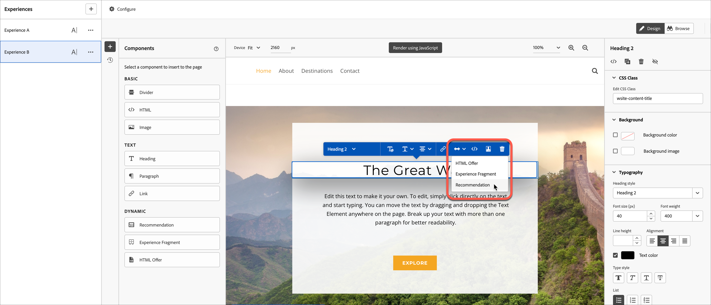

# Recommendations as an offer {#recommendations-as-an-offer}

>[!BEGINSHADEBOX]

**On this page:** Learn how to add, edit, and delete a recommendation as an offer in [!UICONTROL A/B Test] and [!UICONTROL Experience Targeting] (XT) activities.

>[!ENDSHADEBOX]

In addition to [!UICONTROL Recommendations] activities, recommendations can be included inside [!UICONTROL A/B Test] (including [!UICONTROL Auto-Allocate] and [!UICONTROL Auto-Target]) and [!UICONTROL Experience Targeting] (XT) activities. This allows the following:

* Test and target recommendations and non-recommendations content within the same activity.
* Experiment with the placement of recommendations on the page, including the order of multiple recommendations.
* Automatically push traffic to the best-performing recommendations experience with **[!UICONTROL Auto-Allocate]**.
* Dynamically assign visitors to tailored recommendations experiences based on their profile with **[!UICONTROL Auto-Target]**.

## Add a recommendation as an offer {#add-recs-offer}

A recommendation is added as an offer while an experience is created with the [!UICONTROL Visual Experience Composer] (VEC) in an [!UICONTROL A/B Test] or XT activity.

1. Start the three-step guided workflow of the VEC to create an [A/B Test](/help/main/c-activities/t-test-ab/t-test-create-ab/test-create-ab.md) or [Experience Targeting](/help/main/c-activities/t-experience-target/t-xt-create/xt-create.md) (XT) activity.

   >[!NOTE]
   >
   >For A/B Tests, the [Auto-Allocate](/help/main/c-activities/automated-traffic-allocation/automated-traffic-allocation.md) option automatically pushes traffic to the best-performing recommendations, and the [Auto-Target](/help/main/c-activities/auto-target/auto-target-to-optimize.md) option assigns visitors to tailored recommendations experiences based on their profile.

1. While creating an [experience](/help/main/c-experiences/c-visual-experience-composer/viztarget-options.md), add the recommendation as an offer in one of the following ways:

   * Click the element to which the recommendation is added, click **[!UICONTROL Replace Content]**, then select **[!UICONTROL Recommendation]**.

     

   * In the **[!UICONTROL Components]** rail, select **[!UICONTROL Recommendation]** under **[!UICONTROL Dynamic]**, hover over an existing element on the page, then click **[!UICONTROL Insert before]** or **[!UICONTROL Insert after]** to place the recommendation before or after that element.

1. Access the **[!UICONTROL Show properties]** menu and click **[!UICONTROL Select a recommendation]**.

1. Select the desired [criteria](/help/main/c-recommendations/c-algorithms/algorithms.md), then click **[!UICONTROL Next]**.

1. Select the desired [design](/help/main/c-recommendations/c-design-overview/design-overview.md), then click **[!UICONTROL Next]**.

1. In the **[!UICONTROL Options]** dialog box, specify the following:

   * Choose a [collection](/help/main/c-recommendations/c-products/collections.md).
   * If necessary, configure the [Front Promotion and Back Promotion](/help/main/c-recommendations/t-create-recs-activity/adding-promotions.md) options.

1. Click **[!UICONTROL Save]**.

1. Finish configuring the [!UICONTROL A/B Test] or XT activity with the three-step guided workflow.

## Edit a recommendations offer {#edit-recs-offer}

The criteria, design, collection, and promotions of a recommendations offer can be changed after the offer is added, from the **[!UICONTROL Recommendation]** pane.

1. Click the offer to edit and browse through the options in the right-pane menu.

   

1. Select one of the following options:

   * [Change Criteria](/help/main/c-recommendations/c-algorithms/algorithms.md)
   * [Change Design](/help/main/c-recommendations/c-design-overview/design-overview.md)
   * [Change Collection](/help/main/c-recommendations/c-products/collections.md)
   * [Change Promotion](/help/main/c-recommendations/t-create-recs-activity/adding-promotions.md)

1. Make the edits.

## Delete a recommendations offer {#delete-recs-offer}

A recommendations offer that is no longer needed can be deleted from the **[!UICONTROL Recommendation]** pane.

Click the offer to remove, then click the bin icon (  ) in the **[!UICONTROL Recommendation]** pane.

## View the status of a recommendations offer {#status}

The status of the recommendations offer (algorithm) displays at the bottom of the **[!UICONTROL Overview]** page for [!UICONTROL A/B Test] and XT activities that contain recommendations offers. The status is one of the following:

* **[!UICONTROL Results Ready]**
* **[!UICONTROL Results Not Ready]**
* **[!UICONTROL Feed Failure]**

## Training video: Recommendations as an offer 

>[!VIDEO](https://video.tv.adobe.com/v/28878)
