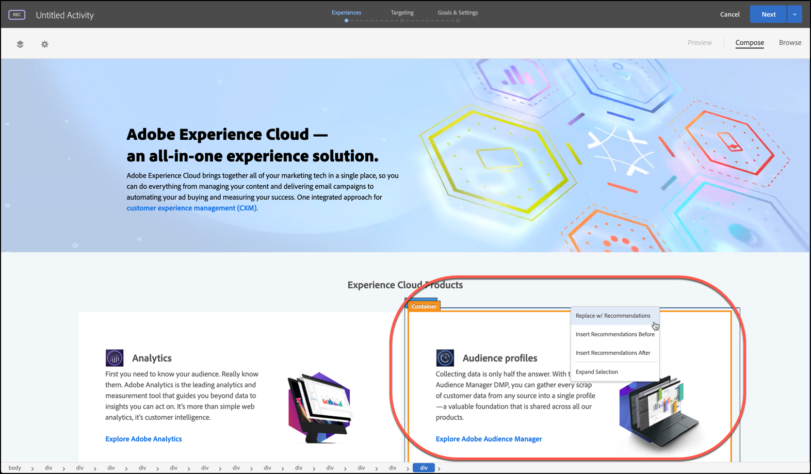
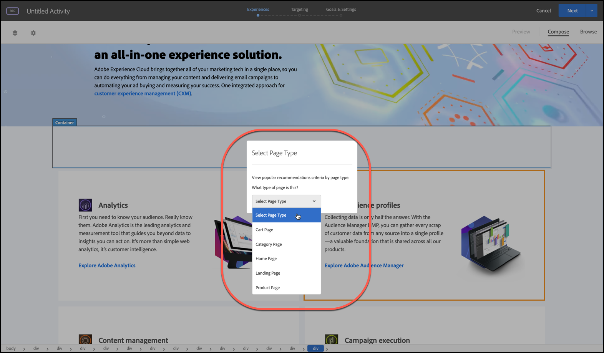

# Create a [!DNL Recommendations] activity {#create-recs-activity}

>[!BEGINSHADEBOX]

**On this page:** Learn how to create a [!DNL Recommendations] activity in the [!DNL Target] **[!UICONTROL Visual Experience Composer]** (VEC), from selecting the location to setting up the activity.

>[!ENDSHADEBOX]

A [!DNL Recommendations] activity displays recommended items on a page. Creating the activity in the [!DNL Target] **[!UICONTROL Visual Experience Composer]** (VEC) allows the recommendations to be placed directly on a [!DNL Target]-enabled page, in the exact location where visitors should see them.

## Create the activity and select the location {#create-activity}

The activity URL and the location define the page and the area of that page where the recommendations display.

1. From the **[!UICONTROL Activities]** menu, click **[!UICONTROL Create Activity]** > **[!UICONTROL Recommendations]**.

   

1. Select **[!UICONTROL Visual]**, if necessary.

   To use the **[!UICONTROL Form-Based Experience Composer]** instead, select **[!UICONTROL Form]**. See [Form-Based Experience Composer](/help/main/c-experiences/form-experience-composer.md). For a comparison of the composers, including the **[!UICONTROL Single Page Application]** VEC, see [Experiences and Offers](/help/main/c-experiences/experiences.md). For VEC issues, see [Troubleshooting the Visual Experience Composer](/help/main/c-experiences/c-visual-experience-composer/r-troubleshoot-composer/troubleshoot-composer.md).

1. (Conditional) Choose a [workspace](/help/main/administrating-target/c-user-management/property-channel/property-channel.md).

1. Specify the activity URL, then click **[!UICONTROL Create]**.

   The activity URL is the page where the recommendations display. [!DNL Target] does not differentiate between URL protocols ([!DNL https] and [!DNL http]), so `http://www.adobe.com` and `https://www.adobe.com` both match.

   The VEC opens and shows the page.

1. Click the element where the recommendations should display and select **[!UICONTROL Replace content]** > **[!UICONTROL Recommendation]**. 

   <!--
   * **[!UICONTROL Replace w/ Recommendations]**: Deletes the current content of the element and replaces it with the recommendations.
   * **[!UICONTROL Insert Recommendations Before]**: Places the recommendations before the element, above or to the left of it, depending on the page construction.
   * **[!UICONTROL Insert Recommendations After]**: Places the recommendations after the element, below or to the right of it, depending on the page construction.

   

   Use **[!UICONTROL Expand Selection]** to expand the selection to the parent container, so that it includes the desired page elements.
   -->

   Visitors who qualify for the recommendation see the recommended items in the specified area. Visitors who do not qualify see the default content.

   >[!NOTE]
   >
   >**[!UICONTROL Recommendations]** activities support only one modification or recommendation at a time. To display multiple recommendations, create several [!DNL Recommendations] activities, or use A/B or XT testing.

   

<!--
1. Select a page type: Cart Page, Category Page, Home Page, Landing Page, Product Page, Search Results Page, Thank You Page, or Other.

   

   The page type determines which criteria are suggested in the next section.
-->

1. Access the **[!UICONTROL Show properties]** menu and click **[!UICONTROL Select a recommendation]**.

   

## Select the criteria {#select-criteria}

Criteria determine which items are recommended and how they are chosen for each visitor.

1. Select the check box of one or more [criteria](/help/main/c-recommendations/c-algorithms/algorithms.md).

   

   When multiple criteria are selected, the traffic is split evenly between them, and the percentages cannot be changed for each criteria. For example, if two criteria are selected and the activity displays default content to 20% of entrants, then 40% of entrants see the recommendations of each criteria.

   >[!NOTE]
   >
   >Not every criteria runs correctly on every page. For current item or current category recommendations to be compatible, the page or mbox must pass in `entity.id` or `entity.categoryId`. It is best to show only compatible criteria. To make incompatible criteria available for the activity, clear the **[!UICONTROL Compatible]** check box. This check box might not display, depending on the **[!UICONTROL Administration]** > **[!UICONTROL Recommendations]** > **[!UICONTROL Filter Incompatible Criteria]** setting. For more information, see [Settings](https://experienceleague.adobe.com/docs/target-dev/developer/recommendations.html){target=_blank}.

1. Optionally, find or create criteria:

   * To search for an existing criteria when the list is long, type in the search field until the desired criteria appears. Some criteria are supplied with [!DNL Recommendations], and the team can also create custom criteria.
   * To create a new criteria, click **[!UICONTROL Create criteria]**, then enter the information for the new criteria. See [Create criteria](/help/main/c-recommendations/c-algorithms/create-new-algorithm.md).
   * To group criteria into a sequence, create a criteria sequence. See [Create criteria sequences](/help/main/c-recommendations/c-algorithms/create-criteria-sequence.md).

1. Click **[!UICONTROL Next]**.

## Select the design and promotions {#select-design}

A design is a template that determines the look of the recommendations in the selected location, and a collection determines which items are eligible to appear. Promotions can optionally be added to the recommendations.

1. Select a [design](/help/main/c-recommendations/c-design-overview/design-overview.md).

   

   * To use existing designs, select the check box of one or more designs, then click **[!UICONTROL Next]**. Only one design can be selected when multiple criteria were selected.
   * To create a custom design, click **[!UICONTROL Create design]** and enter the name and code of the new design. Click **[!UICONTROL Next]**, select or upload an image, then click **[!UICONTROL Done]** > **[!UICONTROL Done]**.

   [!DNL Target] includes several preconfigured designs. For more information about custom designs, see [Create a design](/help/main/c-recommendations/c-design-overview/create-design.md#create-design) and [Customize a design using Velocity](/help/main/c-recommendations/c-design-overview/customizing-a-template.md#customize-design).

1. Click **[!UICONTROL Next]**.

1. On the **[!UICONTROL Options]** page, select the collection.

   The collection determines which items are eligible to appear in the recommendations. For more information, including how to create a collection, see [Use a collection in an activity](/help/main/c-recommendations/c-products/collections.md#use-collection).

1. (Optional) Add front and back promotions to the recommendations. See [Add promotions](/help/main/c-recommendations/t-create-recs-activity/adding-promotions.md#add-promotions).

1. Click **[!UICONTROL Save]**.

   The VEC screen displays the recommendation design on the page.

## Review and complete the activity {#complete-activity}

Reviewing the recommendations and the activity flow before saving helps confirm that the right audience, criteria and design are in place.

1. (Optional) Click **[!UICONTROL Preview]** to see how the activity appears to visitors. This mode allows interaction with the recommendations, as a visitor would interact with them. Click **[!UICONTROL Compose]** to return to the VEC.

1. Review the recommendation in the VEC, then click **[!UICONTROL Next]**.

1. Review the activity in the flow diagram, and make any necessary changes. Click **[!UICONTROL Next]** when finished.

   

   The flow diagram covers the audience for the activity, the experiences and the success metrics. From the diagram, the following changes can be made:

   * **Audience**: All visitors see the recommendations by default, but an existing audience can be selected instead. As an alternative to creating a new audience, an [activity-only audience](/help/main/c-target/creating-activity-only-audience.md#concept_A6BADCF530ED4AE1852E677FEBE68483) can be created, or [multiple audiences can be combined](/help/main/c-target/combining-multiple-audiences.md#section_2F1CE9434CC04174B4BA2BFC89B85D77), to build an ad hoc audience.
   * **Criteria**: View the criteria, or change the collection (next to the **[!UICONTROL Criteria]** label).
   * **Control group**: Change the percentage of entrants who see the control experience. In a [!DNL Recommendations] activity, the control group sees the page without any recommendations.
   * **Design**: View the design code, or change or remove the design.

1. Specify the activity settings, for example a name (required) and an objective (optional). For the settings, including the rules for the activity name, see [Recommendations activity settings](/help/main/c-recommendations/t-create-recs-activity/recs-activity-settings.md#recs-activity-settings).

1. Click **[!UICONTROL Save & Close]**.

## Manage the activity {#manage-activity}

After the activity is saved, the **[!UICONTROL Overview]** page displays a summary of the activity. From this page, the following actions are available:

* Activate, edit, or QA the activity.
* Share the activity to the Experience Cloud feed.
* View the experience URLs and download data.
* Change the percentage of activity entrants who see the control experience.
* Show or hide the criteria details, and view the code for the designs.

Two additional pages are available from the activity:

* **[!UICONTROL Reports]**: Shows the report on the performance of the [!DNL Recommendations] activity.
* **[!UICONTROL Collisions]**: Shows any [activity collisions](/help/main/c-experiences/c-visual-experience-composer/activity-collisions.md) that might occur. Collisions occur when multiple activities deliver content to the same page, and can cause unexpected content to display.

## Training video: Create a Recommendations activity (7:15) 

>[!VIDEO](https://video.tv.adobe.com/v/27688)
