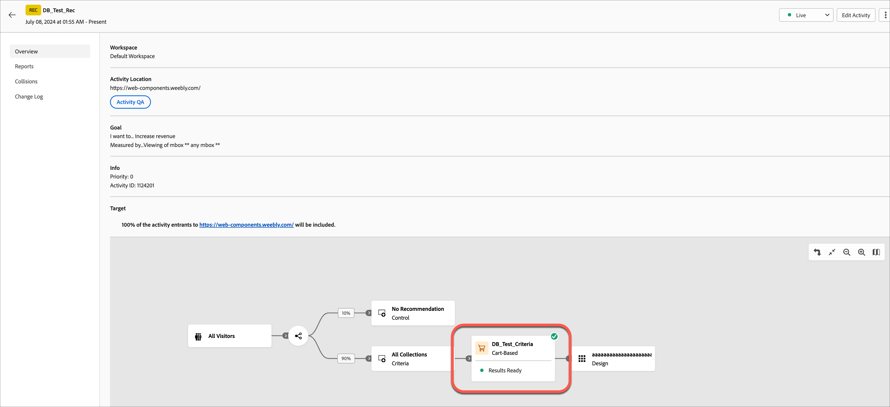
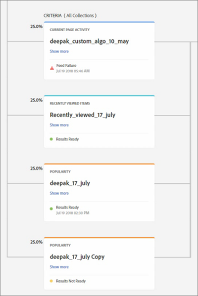
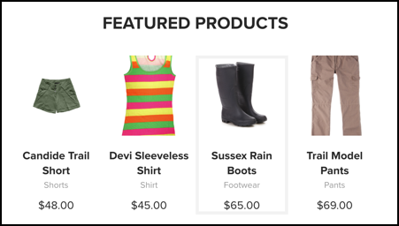
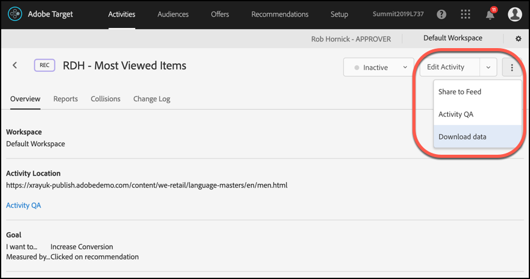
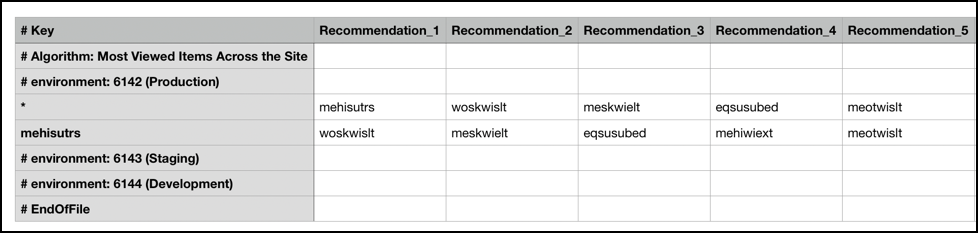

# Preview and launch your Recommendations activity {#preview-launch-recs-activity}

>[!BEGINSHADEBOX]

**On this page:** Learn how to check the algorithm status, preview the recommendations, and activate a [!DNL Recommendations] activity.

>[!ENDSHADEBOX]

Previewing the recommendations before launching an activity confirms that results are available. This applies to [!UICONTROL Recommendations], [!UICONTROL A/B Test], and [!UICONTROL Experience Targeting] (XT) activities that contain [Recommendations offers](/help/main/c-recommendations/recommendations-as-an-offer.md). [!DNL Target Recommendations] offers multiple ways to preview the recommendations.

## Check the algorithm status {#check-status}

After an activity is created, [!DNL Recommendations] runs an algorithm to generate the recommendations. This algorithm might take a few hours to run.

The status of the algorithm is listed with the criteria in the activity diagram on the **[!UICONTROL Overview]** page of the [!DNL Recommendations] activity.

The status can be one of the following:

* **[!UICONTROL Results Ready]**: The algorithm has returned results.
* **[!UICONTROL Results Not Ready]**: The algorithm has not finished running.
* **[!UICONTROL Feed Failure]**: The custom criteria feed file could not be retrieved.

## Estimate the algorithm run time {#algorithm-run-time}

After an activity that contains a criteria is saved, [!DNL Target] computes the recommendations based on the selected collection, criteria, design, and promotions. The time required depends on the recommendation logic, the data range, the number of items in the catalog, the amount of behavioral data that customers have generated, and the behavioral data source. The behavioral data source has the largest impact on processing time.

### mboxes

When mboxes is the behavioral data source, the criteria runs immediately after it is created. Depending on the amount of behavioral data and the size of the catalog, the algorithm can take up to 12 hours to run.

Changes to the criteria configuration generally cause the algorithm to re-run. Depending on the change, the previously computed recommendations might not be available until the re-run is complete. For larger changes, only backup or default content is available until the re-run is complete.

An algorithm that is not modified is re-run automatically by [!DNL Target] every 12-48 hours, depending on the selected data range.

### [!DNL Adobe Analytics]

When [!DNL Adobe Analytics] is the behavioral data source, the time until the criteria is available depends on whether the selected report suite and lookback window were already used for another criteria. The first time a report suite is used with a given lookback window, [!DNL Target Recommendations] can take from two to seven days to download the behavioral data from [!DNL Analytics].

For the timing of new or edited criteria and of ongoing algorithm runs, see the **Criteria availability when Analytics is the data source** dropdown in [Data Source](/help/main/c-recommendations/c-algorithms/create-new-algorithm.md#data-source).

>[!NOTE]
>
>**[!UICONTROL Recently Viewed Items]** requires no offline algorithm run, and the results are available instantly. The **[!UICONTROL Top Viewed]** and **[!UICONTROL Top Sellers]** algorithms based on mbox data generally produce results very quickly because the computation is simpler. These algorithms are good options to preview a design change or to confirm that behavioral data is being collected correctly.

## Preview with a QA link {#preview-qa-link}

After the algorithm has results ready, the results can be previewed with the [QA link](/help/main/c-activities/c-activity-qa/activity-qa.md) functionality of [!DNL Adobe Target]. QA links are available in the **[!UICONTROL Activity Location]** section of the **[!UICONTROL Activity]** overview page, and display the recommendations on the page.

>[!NOTE]
>
>By default, [!DNL Target] automatically adds the user to the required audience for the QA link. If this setting is turned off and the activity has targeting rules, the user profile must meet those targeting rules to see the experience that contains recommendations.

QA mode has the following behaviors:

* [!DNL Target] QA mode is saved in a cookie and persists across pages. If QA mode is not exited, the QA results continue to display throughout the site. To exit QA mode, use the [bookmarklet](/help/main/c-activities/c-activity-qa/activity-qa-bookmark.md).
* While in QA mode, browsing the site does not affect the profile's **[!UICONTROL Recently Viewed Items]** or **[!UICONTROL Recently Purchased Items]**. This behavior is by design, to avoid unintentional pollution of production behavioral data. To preview results from a **[!UICONTROL Recently Viewed Items]** or **[!UICONTROL User-Based Recommendations]** criteria, first browse the site outside of QA mode, then use the same session to open a QA mode link.

## Preview with the CSV download {#preview-csv}

Downloading the results allows the specific recommended items to be audited. This is particularly helpful for algorithms such as **[!UICONTROL People Who Viewed This, Viewed That]**, where the recommended items depend on the item that the visitor is currently viewing, and the catalog can contain thousands or millions of different items.

1. Wait until a **[!UICONTROL Results Ready]** status displays for at least one algorithm in the activity. Results are not available for download before then.

1. On the **[!UICONTROL Activity]** overview page, click the menu icon in the upper-right corner, then click **[!UICONTROL Download data]**.

   

1. Open the downloaded CSV file to see the recommended items.

   

The file lists the recommended items from left to right, in this example the most frequently viewed. The recommendations are separated by environment. In this example, only the Production environment has recommendations.

A row that starts with an asterisk (*) lists [backup items](/help/main/c-recommendations/c-algorithms/backup-recs.md). Backup items display when the recommended items of the algorithm (criteria) cannot fill all the slots of a design.

For algorithms based on a key value, such as **[!UICONTROL People Who Viewed This, Viewed That]**, the key values (the "This" items) are in the left-most column. The recommended items (the "That" items) are listed from left to right in the Recommendation_X columns.

For activities with very large result sets, the **[!UICONTROL Download data]** option might fail with the error `Error while fetching recommendation data file.` This happens when the generated CSV exceeds the response size that the user interface can return in a single download.

>[!NOTE]
>
>Results downloads are not available for activities that contain a **[!UICONTROL User-Based Recommendations]** algorithm, or for criteria that use the **[!UICONTROL Recently-Viewed Items]** recommendation logic.

### CSV download format for popularity-based and key-based algorithms {#format}

The CSV download file consistently reflects the results generated after the backend criteria execution.

* **Popularity-based algorithms (non-key-based)**: The file includes:

  * A row of backup recommendations prefixed with an asterisk (*)
  * A separate row listing the recommendations based on the algorithm settings

* **Key-based algorithms**: The file includes:

  * A backup row, as for popularity-based algorithms
  * Multiple rows in key-value format, where the first entry is the product ID of the key, followed by comma-separated product IDs that represent the recommendation candidates

## Activate the activity {#activate-activity}

Activating the activity launches it, and its status changes to **[!UICONTROL Live]**.

From the **[!UICONTROL Activity Overview]** tab, click the **[!UICONTROL Status]** drop-down arrow, then select **[!UICONTROL Activate]**. If the activity is currently in the **[!UICONTROL Inactive]** state, the drop-down list is labeled **[!UICONTROL Inactive]**. After a few seconds to a couple of minutes, the status switches to **[!UICONTROL Live]**.

The same drop-down list can also be used to deactivate or archive the activity.

## Avoid disruptions when changing settings {#avoid-disruptions}

Changing [!DNL Recommendations] collections, criteria, promotions, or design settings in a live activity might invalidate the algorithm results and change the status of an algorithm to **[!UICONTROL Results Not Ready]**.

To avoid disrupting a live activity, the recommended approach is to modify a copy of the activity and then replace the original:

1. Duplicate the original activity (activity 1) and the criteria to modify, to create a new activity (activity 2).
1. Make the changes to the duplicated activity (activity 2) and its criteria, then wait for the algorithm to generate results.
1. Preview the modified activity (activity 2) and confirm that the results are as desired.
1. Activate the new activity (activity 2).
1. Deactivate the original activity (activity 1).

When the historical reporting results must be retained in the same activity, an alternative approach is possible. This approach might cause a temporary disruption to the availability of the recommendations:

1. Duplicate the original activity (activity 1) and the criteria to modify, to create a new activity (activity 2).
1. Make the changes to the duplicated activity (activity 2) and its criteria, then wait for the algorithm to generate results.
1. Preview the modified activity (activity 2) and confirm that the results are as desired.
1. Pause the modified activity (activity 2), and swap the settings and criteria to the original activity (activity 1).
1. Preview the original activity (activity 1) and confirm that the results are as desired.
1. Re-activate the original activity (activity 1). 
